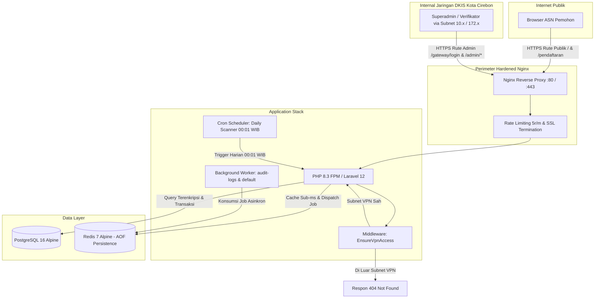

# Sistem Monitoring Penerbitan TTE & Pelayanan Email Dinas Resmi Pemerintah Kota Cirebon (V5)

[]()
[]()
[]()
[]()
[]()
[]()
[]()

Aplikasi web enterprise yang dikembangkan khusus untuk **Dinas Komunikasi, Informatika, dan Statistik Kota Cirebon (DKIS Kota Cirebon) / Bidang Persandian**. Sistem ini mengelola siklus operasional permohonan sertifikat Tanda Tangan Elektronik (TTE) Balai Sertifikasi Elektronik (BSrE), standarisasi dan rekapitulasi akun email dinas resmi (`@cirebonkota.go.id`), verifikasi berkas dua tahap, pemantauan masa berlaku 2 tahun dengan peringatan dini (H-7 Warning Zone), analitik capaian adopsi 20 SKPD Kota Cirebon, ekspor streaming unbuffered hemat memori, serta perlindungan perimeter **Zero-Trust VPN Gateway** dengan mode siluman (*Stealth Defense 404*).

---

## 📑 Daftar Isi
1. [Fitur Utama Sistem](#-fitur-utama-sistem)
2. [Hasil Nyata & Remediasi Audit Sistem (V5)](#-hasil-nyata--remediasi-audit-sistem-v5)
3. [Arsitektur & Topologi Jaringan](#-arsitektur--topologi-jaringan)
4. [Master Data & Kapasitas Nyata](#-master-data--kapasitas-nyata)
5. [Prasyarat Sistem (System Requirements)](#-prasyarat-sistem-system-requirements)
6. [Panduan Penerapan & Deployment](#-panduan-penerapan--deployment)
   - [Metode A: Deployment via Docker Compose (Standar Produksi)](#metode-a-deployment-via-docker-compose-standar-produksi)
   - [Metode B: Deployment Manual / Bare-Metal (Non-Docker)](#metode-b-deployment-manual--bare-metal-non-docker)
7. [Konfigurasi Background Worker & Otomatisasi](#-konfigurasi-background-worker--otomatisasi)
8. [Kredensial Default & Pemetaan Rute](#-kredensial-default--pemetaan-rute)
9. [Matriks Troubleshooting & Solusi Error](#-matriks-troubleshooting--solusi-error)
10. [Struktur Direktori Proyek](#-struktur-direktori-proyek)
11. [Dokumentasi Teknis Terkait](#-dokumentasi-teknis-terkait)

---

## 🏛️ Fitur Utama Sistem

### 1. Pendaftaran Mandiri ASN (Paperless, Resilient & Low-Bandwidth)
- **100% Form Data Tanpa Beban Upload Berkas Fisik:** Mengeliminasi kegagalan transmisi pada jaringan lambat (*low-bandwidth*). Formulir berbasis data teks murni yang ringan (< 5 KB per submit).
- **Searchable Live Combobox:** Dropdown pemilihan Unit Kerja (SKPD), Jabatan, dan Golongan dilengkapi fitur pencarian instan tanpa dependensi library eksternal (100% Vanilla JS & CSS Carbon Flat 0px).
- **Deskripsi Penempatan Kerja yang Fleksibel:** Menyediakan field `deskripsi` untuk mencatat penempatan kerja detail secara fleksibel (misal: *Puskesmas Kesambi*, *SDN 1 Kejaksan*, *Bidang Pengelolaan Sampah*, *Poli Gigi*) tanpa membatasi pengguna dengan hierarki kaku.
- **Auto Email Generator Cerdas:** Otomatis menghasilkan usulan akun email dinas resmi `nama.nip@cirebonkota.go.id` yang secara otomatis membersihkan gelar akademik (Prof., Dr., S.Kom., M.Si., Ph.D.), gelar keagamaan (H., Hj., K.H., Ustadz), dan tanda baca.
- **Proteksi NIK & NIP:** Enkripsi tingkat kolom AES-256-GCM disertai HMAC-SHA256 Blind Index (`nik_bidx` & `nip_bidx`) untuk mencegah enumerasi data kependudukan.
- **Anti-Bot Bertingkat:** Integrasi Google reCAPTCHA dengan fallback otomatis ke *Local Math CAPTCHA* bertanda tangan kriptografis HMAC-SHA256 jika jaringan internet terputus.
- **Draft SessionStorage Aman:** Fitur auto-save draft formulir di browser yang secara ketat mengecualikan data sensitif NIK/NIP (kepatuhan UU PDP No. 27/2022).

### 2. Panel Verifikasi Berkas Tahap 1
- **Antrian FIFO Transparan:** Permohonan ASN diproses berurutan berdasarkan stempel waktu pengajuan (*First-In, First-Out*).
- **Pemeriksaan Deskripsi Penempatan:** Verifikator dapat melihat deskripsi unit kerja detail langsung pada tabel antrian dan rincian verifikasi.
- **Kunci & Rekapitulasi Email Dinas:** Verifikator dapat menyetujui usulan email atau menetapkan username definitif berdomain wajib `@cirebonkota.go.id` sebelum berkas disetujui.
- **Pencegahan Tabrakan Akun (Collision Guard):** Pengecekan instan via AJAX dan *Partial Unique Index* di database menjamin tidak ada duplikasi email dinas ASN.
- **Catatan Penolakan:** Form penolakan berkas disertai alasan spesifik yang tersimpan rapi untuk transparansi tindak lanjut pemohon.

### 3. Penerbitan Sertifikat Tahap 2 & Lifecycle Management (H-7 Warning)
- **Kalkulasi Otomatis 2 Tahun:** Penetapan masa berlaku sertifikat resmi BSrE secara otomatis (`tanggal_terbit + 2 tahun`).
- **Daily Scanner Pukul 00:01 WIB:** Scanner terjadwal harian memindai seluruh sertifikat dan otomatis mengubah status menjadi `WARNING_H7` saat mendekati kedaluwarsa serta `EXPIRED` saat melewati batas waktu.
- **Siklus Status Lengkap:** Mendukung status `AKTIF`, `WARNING_H7` (dan legacy `WARNING_H3`), `EXPIRED`, `REVOKED`, dan `PERLU_PERPANJANG`.
- **Policy Enforcement:** Seluruh mutasi data tahap 2 dilindungi oleh `SertifikatTtePolicy`.

### 4. Analitik Capaian Adopsi SKPD Kota Cirebon (`/admin/capaian-skpd`)
- **Cakupan 20 SKPD Aktif:** Memantau persentase capaian adopsi TTE secara real-time terhadap total pegawai ASN pada 20 Satuan Kerja Perangkat Daerah di lingkungan Pemerintah Kota Cirebon.
- **4 KPI Agregat Kota:**
  1. *Rata-rata Capaian Kota (%)*
  2. *Total SKPD Aktif Terdaftar*
  3. *Total Populasi ASN Se-Kota*
  4. *Total Pemohon TTE Masuk*
- **Segmentasi Kepatuhan & Filter Cepat:**
  - **Optimal:** Capaian $\ge 80\%$
  - **Progres:** Capaian $50\% - 79\%$
  - **Perlu Percepatan:** Capaian $< 50\%$
  - **Belum Diset:** SKPD yang belum memiliki target total ASN
- **Pencarian, Pengurutan & Ekspor CSV:** Pencarian instan teks nama/kode SKPD, pengurutan kolom dinamis, dan unduh laporan capaian format CSV dengan UTF-8 BOM.

### 5. Ekspor Massal Streaming Memory-Safe (FastCGI Unbuffered)
- **Konsumsi RAM Konstan (< 20 MB):** Menggunakan kueri unbuffered single join `DB::table('pendaftaran_tte')->leftJoin(...)` yang mengalirkan ratusan ribu data transaksi langsung ke stream CSV tanpa query storm dan tanpa risiko *out-of-memory*.
- **Bypass Proxy Buffering:** Konfigurasi Nginx `fastcgi_buffering off` mencegah terjadinya *Gateway Timeout (504)* saat unduhan data besar.
- **Kompatibilitas Excel:** Dilengkapi penanda `\xEF\xBB\xBF` (UTF-8 BOM) sehingga nama dan karakter khusus ASN langsung rapi saat dibuka di Microsoft Excel.

### 6. Keamanan Enterprise & Perimeter Zero-Trust
- **Isolasi Rute Administratif:** Jalur autentikasi `/gateway/login` dan kendali `/admin/*` diisolasi khusus subnet IP terdaftar (`10.0.0.0/8`, `172.16.0.0/12`, `192.168.0.0/16`, `127.0.0.1/32`).
- **Stealth Defense (HTTP 404):** Permintaan dari IP publik luar VPN otomatis menerima status HTTP 404 Not Found murni untuk menyembunyikan eksistensi antarmuka admin.
- **Anti-Spoofing Trusted Proxy:** Pemeriksaan IP memvalidasi integritas header forwarding dan hanya mempercayai upstream proxy yang terdaftar sah.
- **Multi-Factor Authentication (RFC 6238 TOTP):** Dukungan Google Authenticator / Microsoft Authenticator dengan penyimpanan terenkripsi 8 kode pemulihan (*recovery codes*) dan re-autentikasi kata sandi saat penonaktifan.
- **Audit Log Terpartisi Bulanan:** Tabel `security_audit_logs` berpartisi bulanan dengan partisi default jangka panjang dan pencatatan asinkron via Redis queue.

---

## 📊 Hasil Nyata & Remediasi Audit Sistem (V5)

Sistem telah melalui audit kode program komprehensif 4 pilar (Keamanan, Basis Data, Kualitas Kode, dan Infrastruktur) dengan **12 temuan yang telah 100% terselesaikan dan tervalidasi**:

| Kode | Kategori | Temuan Masalah Nyata | Tindakan Remediasi yang Telah Diterapkan | Status |
| :---: | :---: | :--- | :--- | :---: |
| **SEC-01** | 🔴 Kritis | Potensi IP Spoofing via header `CF-Connecting-IP` / `X-Forwarded-For` membypass VPN | Implementasi validasi trusted reverse proxy dan penggunaan `REMOTE_ADDR` fisik pada `EnsureVpnAccess`. | ✅ Tuntas |
| **SEC-02** | 🔴 Kritis | Ketiadaan validasi tantangan TOTP/MFA pada alur login | Penegakan tantangan MFA aktif saat login akun terdaftar dan pencatatan audit log `MFA_CHALLENGE_FAILED`. | ✅ Tuntas |
| **SEC-03** | 🔴 Kritis | Kerentanan DOM XSS akibat injeksi pesan API ke `innerHTML` | Standardisasi manipulasi DOM menggunakan `textContent` / sanitasi ketat pada template JavaScript. | ✅ Tuntas |
| **INF-01** | 🔴 Kritis | Ketiadaan worker antrian Redis pada orkestrasi container | Penambahan container service `queue_worker` resmi pada `docker-compose.yml` untuk queue `audit-logs` & `default`. | ✅ Tuntas |
| **DB-01** | 🟡 Major | Race Condition pendaftaran email ganda (*TOCTOU*) | Pembuatan *Partial Unique Index* di PostgreSQL pada kolom `email_final_terverifikasi`. | ✅ Tuntas |
| **DB-02** | 🟡 Major | Potensi lonjakan RAM kueri `->get()` tanpa paginasi | Refaktor kueri antrian verifikasi dan penerbitan menjadi kueri terpaginasi (*cursor/chunked*). | ✅ Tuntas |
| **DB-03** | 🟡 Major | Kueri sintaks non-portabel PostgreSQL (`::numeric`) | Standardisasi pemanggilan fungsi agregat SQL yang kompatibel dan konsisten. | ✅ Tuntas |
| **INF-02** | 🟡 Major | Konfigurasi cookie sesi belum mewajibkan HTTPS | Penegakan `session.cookie_secure = 1` dan `SESSION_ENCRYPT=true` pada environment produksi. | ✅ Tuntas |
| **INF-03** | 🟡 Major | Kunci rahasia default `APP_KEY` terisi di `.env.example` | Pengosongan nilai kunci rahasia pada `.env.example` agar tidak terjadi kebocoran kunci default. | ✅ Tuntas |
| **QUA-01** | 🟡 Major | Pengecekan eksistensi sertifikat di luar blok transaksi | Pembungkusan operasi pengecekan dan pembuatan sertifikat ke dalam `DB::transaction` atomik. | ✅ Tuntas |
| **QUA-02** | 🔵 Minor | Inkonsistensi mutator model saat menerima nilai null | Penyelarasan mutator/accessor Eloquent pada model `PendaftaranTte`. | ✅ Tuntas |
| **QUA-03** | 🔵 Minor | Kerapian kode dan kepatuhan cache config | Pembersihan dead code dan penyesuaian pembacaan konfigurasi melalui `config('...')`. | ✅ Tuntas |

---

## 🌐 Arsitektur & Topologi Jaringan



---

## 🏛️ Master Data & Kapasitas Nyata

Sistem diinisialisasi dengan master data resmi yang merepresentasikan struktur organisasi Pemerintah Kota Cirebon:

- **20 Satuan Kerja Perangkat Daerah (SKPD):**
  Dinas Komunikasi, Informatika, dan Statistik (DKIS: 45 ASN), Bappeda (55 ASN), BPKAD (65 ASN), BKPSDM (50 ASN), Dinas Kesehatan (120 ASN), Dinas Pendidikan (200 ASN), DPUPR (85 ASN), Dishub (60 ASN), Dinsos P3A (40 ASN), Dinperkim (50 ASN), DLHK (75 ASN), Disdukcapil (55 ASN), DPMPTSP (40 ASN), Dinperin (35 ASN), Inspektorat (30 ASN), Setda (90 ASN), Setwan (35 ASN), Kecamatan Lemahwungkuk (25 ASN), Kecamatan Kejaksan (25 ASN), dan Kecamatan Pekalipan (20 ASN).
- **10 Master Jabatan ASN:** Kepala Dinas, Sekretaris Dinas, Kepala Bidang, Kepala Seksi, Kasubag, Analis Kebijakan, Pranata Komputer, Sandiman, Fungsional Umum, Staf.
- **17 Master Golongan/Pangkat:** Golongan I/a s/d IV/e lengkap dengan nama pangkat resmi.

---

## 💻 Prasyarat Sistem (System Requirements)

### 1. Spesifikasi Perangkat Keras (Hardware)
| Komponen | Spesifikasi Minimal | Rekomendasi Produksi |
| :--- | :--- | :--- |
| **CPU** | 2 Cores | 4 Cores atau lebih |
| **RAM** | 4 GB | 8 GB |
| **Penyimpanan** | 20 GB SSD | 50 GB NVMe SSD |
| **Sistem Operasi** | Ubuntu 22.04/24.04 LTS / Debian 12 | Linux Server 64-bit / Windows Server dengan Docker |

### 2. Spesifikasi Perangkat Lunak (Software Stack)
| Komponen | Versi | Keterangan |
| :--- | :--- | :--- |
| **PHP Runtime** | `8.2` atau `8.3` | Ekstensi: `pdo_pgsql`, `redis`, `gd`, `zip`, `bcmath`, `curl`, `mbstring`, `openssl`, `opcache` |
| **Framework** | `Laravel 12` (v12.68.x) | Dependensi terpasang via Composer |
| **Database** | `PostgreSQL 16` | Mendukung partisi tabel dan indeks GIN |
| **Cache & Queue**| `Redis 7` | Mode persistensi AOF dengan password |
| **Web Server** | `Nginx 1.24+` | Konfigurasi SSL, rate limiting, dan fastcgi unbuffered |
| **Container** | `Docker 24+` & Compose `v2.20+` | Multi-container stack |

---

## 🚀 Panduan Penerapan & Deployment

### METODE A: Deployment via Docker Compose (Standar Produksi)

Metode ini mengisolasi seluruh dependensi ke dalam 4 container: `tte_nginx`, `tte_app`, `tte_postgres`, dan `tte_redis`.

#### Tahap 1: Persiapan Repositori & Environment
```bash
# 1. Masuk ke direktori proyek
cd /path/to/sismon-tte-testing-V5

# 2. Salin template konfigurasi
cp .env.example .env

# 3. Sesuaikan konfigurasi produksi pada .env:
# - Atur DB_PASSWORD dan REDIS_PASSWORD dengan kata sandi kuat
# - Pastikan APP_ENV=production dan APP_DEBUG=false
# - Sesuaikan APP_URL=https://tte.cirebonkota.go.id
```

#### Tahap 2: Build & Jalankan Container
```bash
# Build image tanpa cache
docker compose build --no-cache

# Jalankan seluruh stack container di background
docker compose up -d

# Periksa status seluruh container (semua harus berstatus Up)
docker compose ps
```

#### Tahap 3: Inisialisasi Aplikasi
```bash
# Generate kunci aplikasi
docker compose exec app php artisan key:generate --force

# Symlink storage publik
docker compose exec app php artisan storage:link

# Jalankan migrasi tabel, partisi bulanan, dan indeks
docker compose exec app php artisan migrate --force

# Seeding master data resmi (20 SKPD, Jabatan, Golongan, Superadmin)
docker compose exec app php artisan db:seed --force

# Caching konfigurasi untuk performa optimal
docker compose exec app php artisan config:cache
docker compose exec app php artisan route:cache
docker compose exec app php artisan view:cache
```

---

### METODE B: Deployment Manual / Bare-Metal (Non-Docker)

Gunakan metode ini jika menjalankan sistem langsung pada OS host Linux/Windows.

```bash
# 1. Pasang dependensi PHP via Composer
composer install --no-dev --optimize-autoloader

# 2. Buat database di PostgreSQL
# CREATE DATABASE tte_monitoring;

# 3. Konfigurasi .env dan inisialisasi aplikasi
cp .env.example .env
php artisan key:generate
php artisan storage:link
php artisan migrate --force
php artisan db:seed --force

# 4. Optimasi cache aplikasi
php artisan config:cache
php artisan route:cache
php artisan view:cache
```

---

## ⚙️ Konfigurasi Background Worker & Otomatisasi

### 1. Crontab Scheduler (Host Linux)
Jadwalkan cron job server (`crontab -e`) agar scheduler otomatis berjalan setiap menit:

**Jika menggunakan Docker:**
```bash
* * * * * cd /path/to/sismon-tte-testing-V5 && docker compose exec -T app php artisan schedule:run >> /dev/null 2>&1
```

**Jika menggunakan Non-Docker:**
```bash
* * * * * cd /path/to/sismon-tte-testing-V5 && php artisan schedule:run >> /dev/null 2>&1
```

**Tugas Otomatis yang Berjalan:**
- **Pukul 00:01 WIB Setiap Hari:** `UpdateSertifikatStatusJob` memindai masa berlaku sertifikat. Sertifikat yang tersisa $\le 7$ hari otomatis masuk status `WARNING_H7`, dan sertifikat kedaluwarsa masuk status `EXPIRED`.
- **Setiap 30 Menit:** `RefreshDailyAggregatorJob` menghitung ulang metrik analitik dashboard ke Redis Cache `dashboard_stats_summary`.

### 2. Supervisor untuk Queue Worker
Gunakan konfigurasi Supervisor (`/etc/supervisor/conf.d/tte-worker.conf`) untuk memproses audit log dan job asinkron:

```ini
[program:tte-audit-worker]
process_name=%(program_name)s_%(process_num)02d
command=docker compose -f /path/to/sismon-tte-testing-V5/docker-compose.yml exec -T app php artisan queue:work redis --queue=audit-logs,default --sleep=3 --tries=3 --max-time=3600
autostart=true
autorestart=true
user=root
numprocs=2
redirect_stderr=true
stdout_logfile=/var/log/tte-worker.log
```

---

## 🔑 Kredensial Default & Pemetaan Rute

### 1. Pemetaan Rute Web
| Rute | Akses Jaringan | Deskripsi & Fungsi |
| :--- | :--- | :--- |
| `https://localhost/` | **Publik (Internet)** | Beranda Informasi & Portal Pendaftaran TTE |
| `https://localhost/pendaftaran` | **Publik (Internet)** | Formulir Pendaftaran Mandiri ASN (Rate Limit: 5r/m) |
| `https://localhost/gateway/login`| **Isolasi VPN Only** | Portal Login Masuk Superadmin & Verifikator |
| `https://localhost/admin/dashboard` | **Isolasi VPN + Auth** | Dashboard Analitik Transaksi & Statistik Transaksi |
| `https://localhost/admin/capaian-skpd` | **Isolasi VPN + Auth** | Analitik Capaian Adopsi TTE 20 SKPD Kota Cirebon |
| `https://localhost/admin/capaian-skpd/export` | **Isolasi VPN + Auth** | Ekspor CSV Data Persentase Capaian SKPD (Streaming) |
| `https://localhost/admin/verifikasi` | **Isolasi VPN + Auth** | Panel Verifikasi Berkas Tahap 1 & Penetapan Email Dinas |
| `https://localhost/admin/penerbitan` | **Isolasi VPN + Auth** | Panel Penerbitan Sertifikat Tahap 2 (Kalkulasi 2 Tahun) |
| `https://localhost/admin/export/csv` | **Isolasi VPN + Auth** | Unduh Transaksi Masif (Cursor Stream RAM < 20MB + UTF-8 BOM) |
| `https://localhost/admin/master/*` | **Isolasi VPN + Auth** | Pengelolaan Master SKPD, Jabatan, Golongan, dan Akun |

### 2. Kredensial Akun Default (Hasil Seeder)
| Nama Akun | Email Login | Password Default | Role | Keterangan |
| :--- | :--- | :--- | :---: | :--- |
| **Superadmin Utama** | `admin@cirebonkota.go.id` | `SuperAdmin2026!@#` | `superadmin` | Akun resmi operasional DKIS Kota Cirebon |
| **Akun Penguji** | `ajriajundan@gmail.com` | `Jundan12012005!@#` | `superadmin` | Akun pengujian & audit sistem |
| **Operator Persandian** | `operator@cirebonkota.go.id` | `Operator!2026#Sandi` | `superadmin` | Operator verifikasi berkas |

> [!IMPORTANT]
> Saat deployment pertama di server produksi, segera ganti password default dan aktifkan **Multi-Factor Authentication (TOTP Google Authenticator)** pada menu Manajemen Akun. Simpan ke-8 kode pemulihan (*recovery codes*) di tempat yang aman.

---

## 🛠️ Matriks Troubleshooting & Solusi Error

| Kode | Gejala / Pesan Error | Akar Masalah (*Root Cause*) | Solusi & Tindakan Perbaikan |
| :---: | :--- | :--- | :--- |
| **E-01** | `Error 404 Not Found` saat buka `/gateway/login` atau `/admin/*` | Akses berasal dari IP di luar subnet VPN (*Stealth Defense*) | 1. Pastikan perangkat terhubung ke VPN DKIS Kota Cirebon.<br>2. Atau tambahkan IP Anda ke `.env`: `VPN_ALLOWED_SUBNETS="127.0.0.1/32,IP_ANDA/32"` lalu `php artisan config:clear`. |
| **E-02** | `InvalidArgumentException: Please provide a valid cache path` | Direktori `storage/framework` belum ada | Buat direktori: `mkdir -p storage/framework/{views,sessions,cache} storage/logs` dan `chmod -R 775 storage bootstrap/cache`. |
| **E-03** | `bind: address already in use` saat start container | Port 80, 443, 5432, atau 6379 digunakan layanan lain | Matikan web server host lokal (IIS/Apache/XAMPP) atau ubah port mapping pada `.env` (`HTTP_PORT=8080`, `APP_PORT=8443`). |
| **E-04** | `SQLSTATE[08006] could not connect to server` | PostgreSQL belum siap atau nama host salah | Pastikan container postgres berstatus Up. Gunakan `DB_HOST=postgres` dalam Docker atau `DB_HOST=127.0.0.1` di luar Docker. |
| **E-05** | `NOAUTH Authentication required` pada Redis | Password Redis pada `.env` kosong | Pastikan nilai `REDIS_PASSWORD` di `.env` terisi sama dengan konfigurasi redis container. |
| **E-06** | `419 Page Expired` saat submit form | Token CSRF kedaluwarsa atau reverse proxy tidak meneruskan header proto | Pastikan `APP_URL` menggunakan HTTPS dan Nginx meneruskan header `X-Forwarded-Proto $scheme`. Refresh halaman formulir. |
| **E-07** | Administrator Terkunci MFA (TOTP hilang) | Perangkat authenticator tidak dapat diakses | Gunakan salah satu dari 8 Recovery Backup Codes saat login, atau nonaktifkan via artisan tinker di server: `$u = App\Models\User::where('email','admin@cirebonkota.go.id')->first(); $u->update(['is_mfa_enabled'=>false,'mfa_secret'=>null]);`. |
| **E-08** | Google reCAPTCHA gagal terhubung | Server tidak memiliki akses internet ke API Google | Sistem otomatis beralih ke *Local Math CAPTCHA* berpenanda tangan HMAC. Pengguna dapat langsung menyelesaikan tantangan matematika lokal. |

---

## 📁 Struktur Direktori Proyek

```
sismon-tte-testing-V5/
├── app/
│   ├── Domain/                      # Arsitektur Clean Domain
│   │   ├── Analytics/               # Model & Action Statistik Dashboard
│   │   ├── Master/                  # Model Master SKPD, Jabatan, Golongan
│   │   ├── Pendaftaran/             # Model, Action, & Observers Permohonan TTE
│   │   └── Sertifikat/              # Model & Action Penerbitan Sertifikat BSrE
│   ├── Http/
│   │   ├── Controllers/             # Controller Publik, Admin, Capaian SKPD, Export
│   │   ├── Middleware/              # EnsureVpnAccess (Stealth 404), SecurityHeaders, Sanitize
│   │   └── Requests/                # Form Request Validation Rules
│   ├── Jobs/                        # Background Queue Jobs (Aggregator, Audit Log, Scanner)
│   ├── Models/                      # Model User dengan TOTP MFA & Audit Logs
│   └── Services/                    # Domain Service (CryptoHelper, EmailGenerator, Captcha)
├── bootstrap/                       # Inisialisasi Framework & Middleware Priority
├── config/                          # Konfigurasi Aplikasi (vpn.php, crypto.php, database.php)
├── database/
│   ├── migrations/                  # Skema DDL PostgreSQL, Partisi Bulanan, Indeks GIN
│   └── seeders/                     # Seeder 20 SKPD, Jabatan, Golongan, Superadmin
├── docker/
│   ├── nginx/                       # Dockerfile Nginx, nginx.conf Hardened, & SSL Certs
│   └── php/                         # Dockerfile PHP 8.3-FPM, php.ini, & Extensions
├── docs/                            # Dokumentasi Teknis Resmi
├── public/                          # Web Root (Aset CSS/JS Lokal Tanpa External CDN)
├── resources/
│   └── views/                       # Blade Views Berstandar Desain Carbon Flat 0px
├── routes/                          # web.php & console.php
├── storage/                         # Volume Penyimpanan Berkas & Cache Framework
├── tests/                           # Feature & Unit Test Suites (100% Passed)
├── docker-compose.yml               # Multi-Container Stack (Nginx, App, Postgres, Redis)
├── package.json                     # Vite & Frontend Assets Config
└── composer.json                    # Dependensi Framework Laravel 12 & PHP 8.2/8.3
```

---

## 📖 Dokumentasi Teknis Terkait

Untuk spesifikasi mendalam dan catatan evaluasi teknis, silakan merujuk pada berkas dokumentasi di folder `docs/`:

| Dokumen | Berkas | Deskripsi |
| :--- | :--- | :--- |
| **Product Requirements Document** | [`docs/PRD.md`](file:///f:/sismon-tte-testing-V5/docs/PRD.md) | Spesifikasi kebutuhan fungsional & proses bisnis |
| **Arsitektur Sistem** | [`docs/ARCHITECTURE.md`](file:///f:/sismon-tte-testing-V5/docs/ARCHITECTURE.md) | Topologi jaringan, arsitektur Clean Domain, Redis cache |
| **Skema Basis Data** | [`docs/SCHEMA.md`](file:///f:/sismon-tte-testing-V5/docs/SCHEMA.md) | Skema DDL PostgreSQL 16, partisi bulanan, indeks GIN |
| **Standar Keamanan** | [`docs/SECURITY.md`](file:///f:/sismon-tte-testing-V5/docs/SECURITY.md) | Enkripsi AES-256-GCM, HMAC blind index, TOTP MFA, CSP |
| **Panduan Desain UI** | [`docs/DESIGN.md`](file:///f:/sismon-tte-testing-V5/docs/DESIGN.md) | Carbon Flat Design Tokens, 0px border-radius, hairline borders |
| **Panduan Operasional & SOP** | [`docs/OPERATIONAL_GUIDE.md`](file:///f:/sismon-tte-testing-V5/docs/OPERATIONAL_GUIDE.md) | SOP deployment produksi, backup PostgreSQL, Cron & Supervisor |
| **Hasil Audit & Solusi Teknis** | [`docs/audit/solusi_audit.md`](file:///f:/sismon-tte-testing-V5/docs/audit/solusi_audit.md) | Laporan detail remediasi 12 temuan audit 4 pilar |

---

## 🛡️ Lisensi & Hak Cipta

Hak Cipta © 2026 **Dinas Komunikasi, Informatika, dan Statistik (DKIS Kota Cirebon) / Bidang Persandian**.  
Seluruh hak cipta dilindungi undang-undang.
