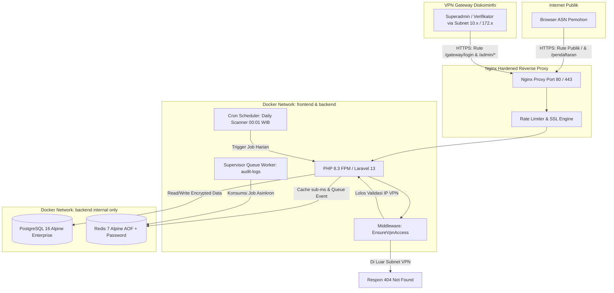

# Sistem Monitoring Penerbitan TTE & Pelayanan Email Dinas Resmi Pemerintah Kota Cirebon (v6)

[-brightgreen.svg)]()
[]()
[]()
[]()
[]()
[]()
[]()
[]()

Aplikasi web enterprise berskala nasional yang dikembangkan khusus untuk **Dinas Komunikasi dan Informatika (Diskominfo) / Bidang Persandian Pemerintah Kota Cirebon**. Sistem ini mengelola seluruh siklus permohonan sertifikat Tanda Tangan Elektronik (TTE) Balai Sertifikasi Elektronik (BSrE), rekapitulasi akun email dinas resmi (`@cirebonkota.go.id`), verifikasi berkas dua tahap, pemantauan masa berlaku 2 tahun dengan peringatan dini (H-7 Warning Zone), ekspor massal jutaan data berbasis streaming memory-safe (unbuffered single-query join), serta perlindungan perimeter **Zero-Trust VPN Gateway** dengan mode siluman (*Stealth Defense*).

---

> **Catatan Pembaruan Rilis Versi 6 (v6 - 29 September 2026):**
> 1. 📊 **Modul Analitik & Pelaporan (Breakdown Dinamis Sub-Kategori ASN Seluruh SKPD):** Analitik adopsi TTE kini menyediakan pemecahan (*drill-down*) sub-kategori dan sub-unit penempatan ASN di bawah SKPD secara dinamis (contoh: Dinas Kesehatan -> RSUD, Puskesmas/UPTD, Dinas Induk, Penugasan Eksternal BUMD/Lembaga). Menyajikan visualisasi Macro Category Cards, tabel capaian per sub-unit kerja terhadap target pegawai, filter instan ASN pemohon terkini, serta ekspor CSV khusus per sub-kategori/sub-unit.
> 2. 📝 **Formulir Pendaftaran (Searchable Autocomplete):** Penambahan pemilih interaktif (Search / Autocomplete Live Combobox) untuk Unit Kerja (SKPD), Jabatan, dan Golongan tanpa dependensi eksternal (100% Vanilla JS & CSS Carbon Flat 0px).
> 3. ⏱️ **Logika Bisnis & Notifikasi (Penyesuaian Ambang Batas H-7):** Ambang batas masa kedaluwarsa sertifikat ditingkatkan dari H-3 menjadi H-7 (`WARNING_H7`), mencakup scheduler otomatis, badge alert, dan agregasi statistik.
> 4. 🔒 **Backend & Architecture (UUID / UID untuk Routing & Database):** Migrasi parameter identifier URL pada database menggunakan UUID v4 pada tabel `skpd`, `master_jabatan_golongan`, `users`, `sertifikat_tte`, dan `pendaftaran_tte` guna mencegah eksploitasi ID Enumeration (OWASP IDOR).

---

## 📑 Daftar Isi
1. [Fitur Utama Sistem](#-fitur-utama-sistem)
2. [Arsitektur & Topologi Jaringan](#-arsitektur--topologi-jaringan)
3. [Prasyarat Sistem (System Requirements)](#-prasyarat-sistem-system-requirements)
4. [Panduan Lengkap Penerapan & Deployment](#-panduan-lengkap-penerapan--deployment)
   - [Metode A: Deployment via Docker Compose (Standar Produksi)](#metode-a-deployment-via-docker-compose-standar-produksi)
   - [Metode B: Deployment Manual / Bare-Metal (Non-Docker)](#metode-b-deployment-manual--bare-metal-non-docker)
5. [Konfigurasi Background Worker & Otomatisasi](#-konfigurasi-background-worker--otomatisasi)
6. [Kredensial Default & Rute Akses](#-kredensial-default--rute-akses)
7. [Panduan Troubleshooting & Solusi Error Lengkap](#-panduan-troubleshooting--solusi-error-lengkap)
8. [Struktur Direktori Proyek](#-struktur-direktori-proyek)
9. [Dokumentasi Lengkap & Standar Teknis](#-dokumentasi-lengkap--standar-teknis)

---

## 🏛️ Fitur Utama Sistem

### 1. Pendaftaran Mandiri ASN (Low-Bandwidth & Resilient)
- **Zero External CDN & Searchable Combobox:** 100% aset lokal. Formulir dilengkapi dropdown autocomplete/search live untuk SKPD, Jabatan, dan Golongan yang memudahkan pencarian pada daftar panjang secara instan.
- **SessionStorage Auto-Save (Aman Tanpa PII NIK/NIP):** Draft formulir tersimpan secara temporer di browser (`tte_registration_draft_temp`) tanpa pernah menyimpan data sensitif NIK/NIP mentah, serta otomatis dibersihkan saat formulir disubmit (kepatuhan UU PDP No. 27/2022).
- **Anti-Enumerasi & Blind Indexing:** Perlindungan NIK (16 digit) & NIP (18 digit) menggunakan enkripsi tingkat kolom AES-256-GCM dan HMAC-SHA256 Blind Index (`nik_bidx` & `nip_bidx`), serta perutean URL berbasis UUID v4.
- **Auto Email Generator:** Otomatis menghasilkan usulan format akun email resmi `nama.nip@cirebonkota.go.id` yang disanitasi dari seluruh gelar akademik, gelar keagamaan, dan karakter khusus.
- **Anti-Bot Bertingkat:** Router Google reCAPTCHA (v2/v3) dengan fallback otomatis ke *Local Math CAPTCHA* berpenanda tangan HMAC-SHA256 berbatas waktu 5 menit jika koneksi internet terputus.

### 2. Panel Verifikasi Berkas Tahap 1
- **Antrian FIFO Transparan:** Permohonan ASN diproses secara ketat berurutan berdasarkan waktu pengajuan (*First-In, First-Out*).
- **Policy Enforcement:** Akses verifikasi dan penetapan email dinas diproteksi oleh `PendaftaranTtePolicy`.
- **Kunci & Rekapitulasi Email Dinas:** Fitur AJAX untuk menetapkan email definitif pemohon berakhiran `@cirebonkota.go.id` sebelum berkas disetujui.
- **Persetujuan & Penolakan Berkas:** Form penolakan berkas disertai catatan alasan spesifik sehingga ASN dapat memperbaiki dan mengajukan ulang berkas.

### 3. Penerbitan Sertifikat Tahap 2 & Lifecycle Management (H-7 Warning)
- **Kalkulasi Otomatis 2 Tahun:** Penetapan masa berlaku sertifikat resmi BSrE secara otomatis (`tanggal_terbit + 2 tahun`).
- **Policy Enforcement:** Seluruh aksi penerbitan dan pembaruan status diawasi oleh `SertifikatTtePolicy`.
- **Daily Scanner Pukul 00:01 WIB:** Scanner latar belakang harian memindai masa berlaku dan otomatis menaikkan status menjadi `WARNING_H7` (Peringatan H-7) dan `EXPIRED`.
- **Status Lifecycle Lengkap:** Mendukung status `AKTIF`, `WARNING_H7` (dan `WARNING_H3`), `EXPIRED`, `REVOKED`, dan `PERLU_PERPANJANG`.

### 4. Dashboard Analitik Cepat & Breakdown Dinamis (< 50ms via Redis)
- **4 Stat Cards Utama:** Total ASN Terdata, Total Sertifikat Terbit Aktif, Antrian Verifikasi Berkas, dan Peringatan H-7 Kedaluwarsa.
- **Breakdown Capaian Adopsi Dinamis Seluruh SKPD:** Sub-analitik hierarki pimpinan/struktural, fungsional keahlian, dan pelaksana yang berlaku universal untuk semua unit kerja, dilengkapi ekspor CSV streaming.
- **Sinkronisasi Agregator:** Agregasi ringkasan data harian ke tabel `dashboard_daily_stats` dan disinkronkan ke Redis Cache.

### 4.1 Modul Analitik Capaian Adopsi SKPD & Breakdown Sub-Kategori ASN (Dinamis Seluruh SKPD)
- **Analisis Seluruh SKPD Tanpa Batasan:** Menu dedikasi (`/admin/capaian-skpd`) untuk memantau seluruh SKPD aktif di lingkungan Pemkot Cirebon dengan metrik persentase capaian adopsi terhadap populasi pegawai.
- **Breakdown Capaian Adopsi Berdasarkan Sub-Kategori ASN (Dinamis Seluruh SKPD):** Analitik tidak hanya menampilkan total adopsi di tingkat induk SKPD, melainkan menyediakan pemecahan (*drill-down*) sub-kategori ASN di bawah SKPD tersebut secara universal:
  - **Dinas Kesehatan:** Menampilkan adopsi TTE spesifik dari sub-kategori RSUD (misal: RSUD Gunung Jati), UPTD Puskesmas (Puskesmas Kesambi, Kejaksan, dll.), Labkesda, Dinas Induk, hingga ASN yang ditugaskan di unit/lembaga/perusahaan eksternal (BUMD).
  - **Dinas Pendidikan:** Menampilkan adopsi dari sub-kategori Satuan Pendidikan (SD, SMP), Dinas Induk, dan penugasan luar.
  - **Kecamatan & Kelurahan:** Menampilkan rincian ASN kantor kecamatan, kantor kelurahan di bawahnya, dan penugasan eksternal.
  - **SKPD Lainnya:** Otomatis mendukung breakdown Dinas Induk, UPTD, dan Penugasan Eksternal secara dinamis tanpa hardcode.
- **Visualisasi Antarmuka & Drill-Down Interaktif:**
  - *Macro-Category KPI Cards:* Kartu ringkasan interaktif per sub-kategori untuk melihat cepat volume pemohon, terbit, antrian, dan jumlah sub-unit.
  - *Tabel Rincian per Sub-Unit Kerja:* Kolom Target ASN, Total Pemohon, Terbit, Antri, Ditolak, mini-progress bar capaian (%), dan tombol aksi drill-down.
  - *Filter Instan Pemohon ASN:* Mengklik sub-kategori atau sub-unit langsung memfilter tabel 15 pemohon terkini secara dinamis melalui AJAX tanpa reload halaman.
  - *Ekspor CSV Spesifik per Sub-Unit:* Tombol unduh CSV berparameter `?sub_kategori=...&sub_unit=...` untuk pelaporan terfokus.
- **KPI Summary Cards Kota:** Menampilkan 4 ringkasan kota: Rata-rata Adopsi Kota (%), Total Pegawai Terdaftar, Total Pendaftar TTE, dan Total Sertifikat Terbit.
- **Filter & Sorting Interaktif:** Filter pencarian teks instan nama/singkatan SKPD, filter kategori capaian (Optimal, Progres, Perlu Percepatan, Belum Diset), dan pengurutan dinamis berdasarkan persentase atau kolom lainnya.
- **Ekspor CSV Terfilter (Streaming Memory-Safe):** Ekspor langsung data persentase capaian per SKPD berformat CSV dengan UTF-8 BOM (`/admin/capaian-skpd/export`) yang otomatis tersinkronisasi dengan filter pencarian dan kategori aktif.

### 5. Ekspor Massal Laporan (Unbuffered FastCGI Streaming)
- **Konsumsi RAM Konstan (< 20MB) & 0 N+1 Queries:** Menggunakan `DB::table('pendaftaran_tte')->leftJoin(...)` untuk mengalirkan 100.000 hingga 1.000.000+ data transaksi langsung ke format CSV dalam satu kueri terpadu tanpa *memory exhaustion* atau query storm.
- **Bypass Proxy Buffering:** Konfigurasi `fastcgi_buffering off` dan timeout 300 detik pada Nginx memastikan unduhan langsung mengalir tanpa kendala *Gateway Timeout*.
- **Kompatibilitas UTF-8 BOM:** Disertai penanda `\xEF\xBB\xBF` agar karakter khusus dan simbol nama ASN terbaca rapi di Microsoft Excel.

### 6. Keamanan Enterprise & Perimeter Zero-Trust
- **Zero-Trust VPN Gateway:** Seluruh jalur admin (`/gateway/login` dan `/admin/*`) diisolasi khusus subnet IP terdaftar (`EnsureVpnAccess`).
- **Stealth Defense (HTTP 404):** Akses ilegal dari luar VPN menghasilkan respon 404 Not Found murni untuk mengaburkan keberadaan antarmuka admin.
- **Multi-Factor Authentication (RFC 6238 TOTP):** Terintegrasi dengan Google Authenticator / Microsoft Authenticator disertai penyimpanan terenkripsi 8 kode pemulihan darurat (*backup recovery codes*) serta *step-up reauthentication* (`current_password`) saat menonaktifkan MFA.
- **Audit Log Terpartisi Bulanan & Default Partition:** Tabel `security_audit_logs` berpartisi bulanan (`PARTITION BY RANGE (created_at)`) dengan fallback `security_audit_logs_default` dan indeks GIN untuk pencatatan asinkron via antrian Redis `audit-logs`.
- **Strict Environment Secrets:** Docker Compose memberlakukan kewajiban deklarasi password produksi tanpa fallback plaintext default.
- **Proteksi Brute-Force:** Progressive lockout 5x percobaan gagal dengan jeda eksponensial (HTTP 429).
- **Strict Security Headers:** HSTS Preload, CSP, X-Frame-Options DENY, X-Content-Type-Options nosniff.

---

## 🌐 Arsitektur & Topologi Jaringan



---

## 💻 Prasyarat Sistem (System Requirements)

### 1. Spesifikasi Perangkat Keras (Minimum Hardware)
- **CPU:** 2 vCPU / Cores (Rekomendasi: 4 Cores untuk > 50.000 transaksi/hari)
- **RAM:** 4 GB (Rekomendasi: 8 GB)
- **Penyimpanan:** 20 GB SSD (NVMe direkomendasikan untuk PostgreSQL partition I/O)
- **Sistem Operasi:** Linux (Ubuntu 22.04/24.04 LTS, Debian 12, RHEL 9, Rocky Linux) atau Windows Server / Windows 11 dengan WSL2/Docker Desktop.

### 2. Spesifikasi Perangkat Lunak (Software Stack)
| Komponen | Versi Minimal | Keterangan |
| :--- | :--- | :--- |
| **Docker Engine** | `24.0+` | Diperlukan jika menggunakan metode deployment kontainer |
| **Docker Compose** | `v2.20+` | Mendukung sintaks Compose V2 |
| **PHP Runtime** | `8.2` atau `8.3` | Ekstensi: `pdo_pgsql`, `redis`, `gd`, `zip`, `bcmath`, `curl`, `mbstring`, `openssl`, `opcache` |
| **PostgreSQL** | `16.x` | Mendukung partisi tabel dan indeks GIN |
| **Redis** | `7.x` | Mode persistensi `appendonly yes` |
| **Nginx** | `1.24+` | Dilengkapi modul SSL, headers, dan rate limiting |
| **Composer** | `2.7+` | Manajer dependensi PHP |

---

## 🚀 Panduan Lengkap Penerapan & Deployment

Ikuti langkah-langkah di bawah ini secara berurutan agar sistem dapat langsung beroperasi stabil dan aman.

---

### METODE A: Deployment via Docker Compose (Standar Produksi)

Metode ini merupakan standar resmi yang mengisolasi seluruh dependensi (PHP 8.3 FPM, PostgreSQL 16, Redis 7, dan Nginx Edge Proxy) ke dalam jaringan kontainer terisolasi.

#### Tahap 1: Kloning Repositori & Persiapan Direktori
```bash
# 1. Kloning repositori kode program
git clone https://github.com/diskominfo-cirebon/sismon-tte-testing-V4.git
cd sismon-tte-testing-V4

# 2. Siapkan direktori storage & permissions (Khusus Linux Server)
mkdir -p storage/framework/views storage/framework/sessions storage/framework/cache/data storage/logs
chmod -R 775 storage bootstrap/cache
```

#### Tahap 2: Konfigurasi Berkas Environment (`.env`)
Salin berkas template konfigurasi dan sesuaikan variabel produksi:
```bash
cp .env.example .env
```

Pastikan variabel-variabel kunci pada `.env` dikonfigurasi sebagai berikut:
```env
APP_NAME="Sistem Monitoring TTE Kota Cirebon"
APP_ENV=production
APP_DEBUG=false
APP_URL=https://tte.cirebonkota.go.id

# DATABASE POSTGRESQL (Dalam Jaringan Docker)
DB_CONNECTION=pgsql
DB_HOST=postgres
DB_PORT=5432
DB_DATABASE=tte_monitoring
DB_USERNAME=postgres
DB_PASSWORD=<MASUKKAN_PASSWORD_DB_KUAT>

# CACHE & QUEUE REDIS (Dalam Jaringan Docker)
CACHE_STORE=redis
QUEUE_CONNECTION=redis
SESSION_DRIVER=database
SESSION_ENCRYPT=true
REDIS_CLIENT=phpredis
REDIS_HOST=redis
REDIS_PASSWORD=<MASUKKAN_PASSWORD_REDIS_KUAT>
REDIS_PORT=6379

# GOOGLE RECAPTCHA V2/V3 (Gunakan Kunci Resmi Anda atau Biarkan Fallback Math Aktif)
RECAPTCHA_SITE_KEY=6Ldxxxxxxxxxxxxxxxxxxxxxxxxxxxxxxxxx
RECAPTCHA_SECRET_KEY=6Ldxxxxxxxxxxxxxxxxxxxxxxxxxxxxxxxxx

# PERIMETER KEAMANAN ZERO-TRUST VPN GATEWAY
VPN_GATEWAY_ENABLED=true
VPN_ALLOWED_SUBNETS="127.0.0.1/32,::1/128,10.0.0.0/8,172.16.0.0/12,192.168.0.0/16"
VPN_BLOCK_RESPONSE=404
VPN_LOG_VIOLATIONS=true

# PORT MAPPING
HTTP_PORT=80
APP_PORT=443
```

#### Tahap 3: Build & Jalankan Kontainer Docker
```bash
# Build citra kontainer tanpa cache
docker compose build --no-cache

# Jalankan seluruh stack layanan di latar belakang
docker compose up -d

# Periksa status kesehatan seluruh kontainer (Harus berstatus 'Up')
docker compose ps
```

#### Tahap 4: Inisialisasi Kunci Aplikasi & Symlink Storage
```bash
# Generate application encryption key (AES-256-CBC)
docker compose exec app php artisan key:generate --force

# Buat symbolic link untuk media penyimpanan berkas
docker compose exec app php artisan storage:link
```

#### Tahap 5: Migrasi Database & Seeding Data Master
```bash
# 1. Jalankan migrasi tabel, partisi bulanan, dan indeks GIN
docker compose exec app php artisan migrate --force

# 2. Jalankan Seeder Master Data (SKPD, Jabatan, Golongan, Akun Superadmin)
docker compose exec app php artisan db:seed --force
```

> **Opsi Pengujian / Staging:**
> Jika Anda berada di lingkungan simulasi dan ingin memuat 50 data dummy ASN realistis:
> ```bash
> docker compose exec app php artisan migrate:fresh --seed --force
> ```

#### Tahap 6: Optimasi & Caching Produksi
```bash
docker compose exec app php artisan config:cache
docker compose exec app php artisan route:cache
docker compose exec app php artisan view:cache
```

#### Tahap 7: Jalankan Test Suite Otomatis
Pastikan seluruh 46 unit & feature test berhasil lolos 100%:
```bash
docker compose exec app php artisan test
```

---

### METODE B: Deployment Manual / Bare-Metal (Non-Docker)

Gunakan metode ini jika Anda menjalankan sistem langsung di atas OS Linux / Windows host tanpa Docker.

#### Tahap 1: Instalasi Dependensi PHP & Composer
```bash
# 1. Pastikan ekstensi PHP 8.2 / 8.3 terpasang
# Linux Ubuntu/Debian:
# sudo apt install php8.3-fpm php8.3-pgsql php8.3-redis php8.3-gd php8.3-zip php8.3-bcmath php8.3-curl php8.3-mbstring php8.3-xml

# 2. Pasang dependensi Composer
composer install --no-dev --optimize-autoloader
```

#### Tahap 2: Konfigurasi Database PostgreSQL & Redis Lokal
1. Buat basis data di PostgreSQL:
   ```sql
   CREATE DATABASE tte_monitoring;
   ```
2. Pastikan Redis server telah aktif dan dikonfigurasi kata sandi di `redis.conf`.
3. Sesuaikan `DB_HOST=127.0.0.1` dan `REDIS_HOST=127.0.0.1` pada file `.env`.

#### Tahap 3: Eksekusi Migrasi & Optimasi
```bash
php artisan key:generate
php artisan storage:link
php artisan migrate --force
php artisan db:seed --force
php artisan config:cache
php artisan route:cache
php artisan view:cache
```

---

## ⚙️ Konfigurasi Background Worker & Otomatisasi

Untuk memastikan fitur pemantauan kedaluwarsa H-3, penyegaran data agregator, dan pencatatan audit log berjalan lancar tanpa membebani request pengguna:

### 1. Konfigurasi Crontab Scheduler (Host Linux)
Buka editor crontab server (`crontab -e`) dan tambahkan baris berikut:

**Jika menggunakan Docker:**
```bash
* * * * * cd /path/to/sismon-tte-testing-V4 && docker compose exec -T app php artisan schedule:run >> /dev/null 2>&1
```

**Jika menggunakan Non-Docker:**
```bash
* * * * * cd /path/to/sismon-tte-testing-V4 && php artisan schedule:run >> /dev/null 2>&1
```

**Jadwal Otomatis yang Dijalankan:**
- **Pukul 00:01 WIB (Setiap Hari):** `UpdateSertifikatStatusJob` memindai seluruh sertifikat aktif. Sertifikat dalam rentang masa berlaku <= 3 hari otomatis diubah ke status `WARNING_H3`, dan sertifikat lewat masa berlaku diubah ke status `EXPIRED`.
- **Setiap 30 Menit:** `RefreshDailyAggregatorJob` menghitung ulang metrik ringkasan transaksi ke Redis Cache `dashboard_stats_summary`.

### 2. Konfigurasi Supervisor untuk Queue Worker (Audit Logs)
Buat berkas konfigurasi Supervisor di `/etc/supervisor/conf.d/tte-worker.conf`:

```ini
[program:tte-audit-worker]
process_name=%(program_name)s_%(process_num)02d
command=docker compose -f /path/to/sismon-tte-testing-V4/docker-compose.yml exec -T app php artisan queue:work redis --queue=audit-logs,default --sleep=3 --tries=3 --max-time=3600
autostart=true
autorestart=true
user=root
numprocs=2
redirect_stderr=true
stdout_logfile=/var/log/tte-worker.log
```

Muat ulang Supervisor:
```bash
sudo supervisorctl reread
sudo supervisorctl update
sudo supervisorctl start tte-audit-worker:*
```

---

## 🔑 Kredensial Default & Rute Akses

### 1. Pemetaan Rute Web
| Rute | Akses Jaringan | Deskripsi & Fungsi |
| :--- | :--- | :--- |
| `https://localhost/` atau `http://localhost/` | **Publik (Internet)** | Portal Formulir Pendaftaran Mandiri TTE & Email Dinas ASN |
| `https://localhost/pendaftaran` | **Publik (Internet)** | Endpoint POST submission pendaftaran ASN (Rate Limit: 5r/m) |
| `https://localhost/gateway/login` | **Isolasi VPN Only** | Portal Login Masuk Superadmin & Verifikator Persandian |
| `https://localhost/admin/dashboard` | **Isolasi VPN + Auth** | Dashboard Analitik Eksekutif Transaksi & Statistik SKPD |
| `https://localhost/admin/capaian-skpd` | **Isolasi VPN + Auth** | Analitik Capaian Adopsi TTE Seluruh SKPD (Filter, Sort, KPI) |
| `https://localhost/admin/capaian-skpd/export` | **Isolasi VPN + Auth** | Ekspor CSV Data Persentase Capaian Adopsi SKPD (Streaming) |
| `https://localhost/admin/verifikasi` | **Isolasi VPN + Auth** | Panel Verifikasi Berkas Tahap 1 & Penetapan Rekap Email Dinas |
| `https://localhost/admin/penerbitan` | **Isolasi VPN + Auth** | Panel Penerbitan Sertifikat Tahap 2 (Kalkulasi 2 Tahun) |
| `https://localhost/admin/export/csv` | **Isolasi VPN + Auth** | Unduh Data Transaksi (Cursor Stream RAM < 20MB + BOM UTF-8) |
| `https://localhost/admin/master/*` | **Isolasi VPN + Auth** | Pengelolaan SKPD, Jabatan, Golongan, dan Akun Administrator |

### 2. Kredensial Akun Default (Hasil Seeder)
| Nama Akun | Email Login | Password Default | Peran (Role) | Keterangan |
| :--- | :--- | :--- | :---: | :--- |
| **Superadmin Utama** | `admin@cirebonkota.go.id` | `SuperAdmin2026!@#` | `superadmin` | Akun resmi operasional Diskominfo |
| **Akun Penguji** | `ajriajundan@gmail.com` | `Jundan12012005!@#` | `superadmin` | Akun pengujian & verifikasi sistem |
| **Operator Persandian** | `operator@cirebonkota.go.id` | `Operator!2026#Sandi` | `superadmin` | Operator verifikasi berkas tahap 1 |

> [!IMPORTANT]
> - Segera ubah kata sandi default dan aktifkan **Multi-Factor Authentication (TOTP Google Authenticator)** pada menu `Master Data > Manajemen Akun` saat pertama kali deployment di server produksi.
> - Simpan ke-8 kode pemulihan (*recovery backup codes*) di brankas digital yang aman.

---

## 🛠️ Panduan Troubleshooting & Solusi Error Lengkap

Berikut adalah matriks lengkap kendala yang mungkin terjadi pada setiap tahapan, akar masalah (*root cause*), dan langkah solusinya:

```
+-------------------------------------------------------------------------------------------------------------------------------+
|                                  MATRIKS DIAGNOSIS DAN PENANGANAN KENDALA OPERASIONAL                                         |
+-----+-------------------------------+-----------------------------------+-----------------------------------------------------+
| No  | Gejala / Pesan Error          | Akar Masalah (Root Cause)         | Solusi & Tindakan Perbaikan                         |
+-----+-------------------------------+-----------------------------------+-----------------------------------------------------+
| E-01| InvalidArgumentException:     | Folder storage/framework belum    | Jalankan:                                           |
|     | Please provide a valid cache  | dibuat pada volume Docker baru.   | mkdir -p storage/framework/{views,sessions,cache}   |
|     | path (View path not found)    |                                   | chmod -R 775 storage bootstrap/cache                |
+-----+-------------------------------+-----------------------------------+-----------------------------------------------------+
| E-02| Error 404 Not Found saat buka | Akses berasal dari IP di luar     | 1. Pastikan perangkat terhubung ke VPN Diskominfo.  |
|     | /gateway/login atau /admin/*  | subnet whitelist VPN Gateway      | 2. Tambahkan subnet IP ke .env:                     |
|     | (Stealth Defense Active)      | (EnsureVpnAccess aktif).          |    VPN_ALLOWED_SUBNETS="127.0.0.1/32,IP_ANDA/CIDR"  |
|     |                               |                                   | 3. Jalankan: php artisan config:clear               |
+-----+-------------------------------+-----------------------------------+-----------------------------------------------------+
| E-03| bind: address already in use  | Port 80, 443, 5432, atau 6379     | 1. Matikan web server lokal (IIS/Apache/XAMPP).     |
|     | (Error start container Nginx) | telah digunakan layanan lain.     | 2. Atau sesuaikan port di .env:                     |
|     |                               |                                   |    HTTP_PORT=8080                                   |
|     |                               |                                   |    APP_PORT=8443                                    |
+-----+-------------------------------+-----------------------------------+-----------------------------------------------------+
| E-04| Nginx Crash Loop: unknown     | Berkas nginx.conf tersimpan       | Simpan ulang berkas docker/nginx/nginx.conf dengan   |
|     | directive "user" in line 1    | dengan encoding UTF-8 with BOM.   | format encoding "UTF-8 without BOM" (Plain UTF-8).  |
+-----+-------------------------------+-----------------------------------+-----------------------------------------------------+
| E-05| SQLSTATE[08006] Connection    | Kontainer PostgreSQL belum siap   | 1. Periksa container database:                      |
|     | refused / could not connect   | atau DB_HOST salah arah.          |    docker compose ps tte_postgres                   |
|     |                               |                                   | 2. Pastikan DB_HOST=postgres (dalam Docker)         |
|     |                               |                                   |    atau DB_HOST=127.0.0.1 (di luar Docker).         |
+-----+-------------------------------+-----------------------------------+-----------------------------------------------------+
| E-06| NOAUTH Authentication req.    | Redis mewajibkan autentikasi      | Pastikan nilai REDIS_PASSWORD di .env sama persis   |
|     | / Predis Auth Exception       | kata sandi tapi belum terisi.     | dengan flag --requirepass pada docker-compose.yml.  |
+-----+-------------------------------+-----------------------------------+-----------------------------------------------------+
| E-07| 419 Page Expired / CSRF Token | Sesi kedaluwarsa atau reverse     | 1. Pastikan APP_URL di .env menggunakan HTTPS.      |
|     | Mismatch saat submit form     | proxy tidak meneruskan header.    | 2. Nginx telah memuat proxy_set_header X-Forwarded- |
|     |                               |                                   |    Proto $scheme. Refresh halaman browser.          |
+-----+-------------------------------+-----------------------------------+-----------------------------------------------------+
| E-08| Peringatan SSL di Browser     | Menggunakan self-signed SSL       | Klik 'Advanced -> Proceed to localhost (unsafe)'    |
|     | (NET::ERR_CERT_INVALID)       | bawaan development di localhost.  | atau pasang SSL resmi (Let's Encrypt / Certbot)     |
|     |                               |                                   | di folder docker/nginx/certs/ untuk domain resmi.   |
+-----+-------------------------------+-----------------------------------+-----------------------------------------------------+
| E-09| Administrator Terkunci MFA    | HP hilang / Authenticator tidak   | Gunakan 8 Recovery Codes saat login, atau reset via |
|     | (TOTP Token Hilang)           | dapat diakses.                    | CLI server:                                         |
|     |                               |                                   | docker compose exec app php artisan tinker --exec=  |
|     |                               |                                   | "\$u=App\Models\User::where('email','admin@cirebon |
|     |                               |                                   | kota.go.id')->first(); \$u->update(['is_mfa_enabled |
|     |                               |                                   | '=>false,'mfa_secret'=>null]);"                     |
+-----+-------------------------------+-----------------------------------+-----------------------------------------------------+
| E-10| Google reCAPTCHA Timeout      | Koneksi keluar ke Google API      | Sistem secara otomatis mengaktifkan Local Math      |
|     | atau Domain Belum Didaftar    | terputus atau domain belum ada.   | CAPTCHA (HMAC-SHA256). Pendaftaran publik tetap     |
|     |                               |                                   | berjalan normal tanpa kendala.                      |
+-----+-------------------------------+-----------------------------------+-----------------------------------------------------+
| E-11| Ekspor CSV Karakter Rusak     | Excel tidak mengenali encoding    | Sistem telah menyematkan \xEF\xBB\xBF (UTF-8 BOM)   |
|     | di Microsoft Excel            | UTF-8 secara otomatis.            | pada cursor stream sehingga langsung terbaca rapi.  |
+-----+-------------------------------+-----------------------------------+-----------------------------------------------------+
```

---

## 📁 Struktur Direktori Proyek

```
sismon-tte-testing-V4/
├── app/
│   ├── Http/
│   │   ├── Controllers/             # Controller Domain (Publik, Admin, Master, Export)
│   │   ├── Middleware/
│   │   │   ├── EnsureVpnAccess.php  # Zero-Trust VPN Gateway Perimeter Guard
│   │   │   └── SecurityHeaders.php  # Strict Security Headers (CSP, HSTS, X-Frame)
│   │   └── Requests/                # Form Request Validation Rules
│   ├── Jobs/                        # Background Queue Jobs (Aggregator, Audit Log, Scanner)
│   ├── Models/                      # Eloquent Entities dengan AES-256 Kriptografi & Blind Index
│   └── Services/                    # Domain Service (Crypto, Email Generator, Captcha)
├── bootstrap/                       # Inisialisasi Framework & Middleware Priority
├── config/                          # Konfigurasi Aplikasi (vpn.php, database.php, session.php)
├── database/
│   ├── migrations/                  # Skema DDL PostgreSQL, Partisi Bulanan, Indeks GIN
│   └── seeders/                     # Master SKPD, Jabatan, Golongan, & Akun Superadmin
├── docker/
│   ├── nginx/                       # Dockerfile Nginx, nginx.conf Hardened, & SSL Certs
│   └── php/                         # Dockerfile PHP 8.3-FPM, local.ini, & Extensions
├── docs/                            # Dokumentasi Spesifikasi Resmi (PRD, Arsitektur, Skema)
├── public/                          # Web Root (Aset CSS/JS Lokal Tanpa External CDN)
├── resources/
│   └── views/                       # Blade Views Berstandar Desain Carbon Flat 0px
├── routes/                          # Definisi Rute (web.php & console.php)
├── storage/                         # Volume Penyimpanan Berkas & Cache Aplikasi
├── tests/                           # Unit & Feature Test Suite (70 Tests Passed)
├── docker-compose.yml               # Definisi Multi-Container Stack Produksi
├── package.json                     # Vite & Frontend Assets Config
└── composer.json                    # Konfigurasi Dependensi PHP & Laravel 13
```

---

## 📖 Dokumentasi Lengkap & Standar Teknis

Untuk membaca rincian arsitektur mendalam, standar kriptografi, dan spesifikasi basis data, silakan buka dokumen terkait di dalam folder `docs/`:

| Dokumen | Berkas | Deskripsi |
| :--- | :--- | :--- |
| **Product Requirements Document** | [`docs/PRD.md`](file:///f:/sismon-tte-testing-V4/docs/PRD.md) | Spesifikasi kebutuhan bisnis & alur 2 tahap (FR-01 s/d FR-22) |
| **Arsitektur Sistem** | [`docs/ARCHITECTURE.md`](file:///f:/sismon-tte-testing-V4/docs/ARCHITECTURE.md) | Struktur domain, Redis caching, cursor streaming, VPN perimeter |
| **Skema Basis Data** | [`docs/SCHEMA.md`](file:///f:/sismon-tte-testing-V4/docs/SCHEMA.md) | PostgreSQL 16 Alpine DDL, partisi bulanan, indeks GIN, field encryption |
| **Standar Keamanan** | [`docs/SECURITY.md`](file:///f:/sismon-tte-testing-V4/docs/SECURITY.md) | Kriptografi AES-256-GCM, HMAC blind index, TOTP MFA, CSP |
| **Panduan Desain UI** | [`docs/DESIGN.md`](file:///f:/sismon-tte-testing-V4/docs/DESIGN.md) | Carbon Flat Design Tokens, 0px border-radius, hairline borders |
| **Panduan Operasional & SOP** | [`docs/OPERATIONAL_GUIDE.md`](file:///f:/sismon-tte-testing-V4/docs/OPERATIONAL_GUIDE.md) | SOP Deployment, backup/restore PostgreSQL, Cron & Supervisor |
| **Catatan Temuan & Solusi** | [`CATATAN_TEMUAN_DAN_SOLUSI.md`](file:///f:/sismon-tte-testing-V4/CATATAN_TEMUAN_DAN_SOLUSI.md) | Laporan detail evaluasi teknis, root causes, dan solusi 46 test |
| **Petunjuk Pengujian Lokal** | [`PETUNJUK_TESTING.md`](file:///f:/sismon-tte-testing-V4/PETUNJUK_TESTING.md) | Panduan langkah simulasi pengujian end-to-end lingkungan lokal |

---

## 🛡️ Lisensi & Hak Cipta

Hak Cipta © 2026 **Dinas Komunikasi dan Informatika / Bidang Persandian Pemerintah Kota Cirebon**.  
Seluruh hak cipta dilindungi undang-undang.
