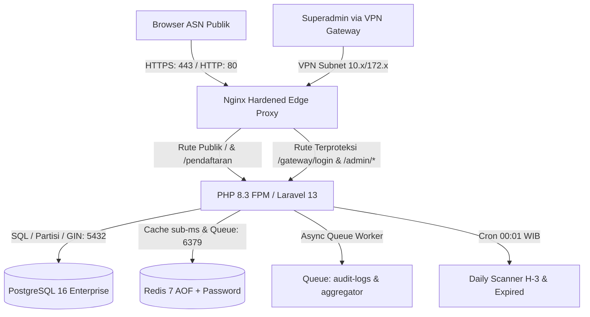

# PANDUAN OPERASIONAL & DEPLOYMENT SISTEM MONITORING TTE KOTA CIREBON

**Dokumen:** Panduan Operasional Sistem & Standard Operating Procedure (SOP)  
**Instansi:** Dinas Komunikasi, Informatika, dan Statistik Kota Cirebon (DKIS Kota Cirebon) / Bidang Persandian  
**Arsitektur:** Clean Domain Architecture (Laravel 13, PostgreSQL 16 Alpine, Redis 7, Nginx Hardened, VPN Gateway)  
**Versi Dokumen:** 3.2.0-PROD  
**Klasifikasi:** Internal Pemerintah Kota Cirebon  
**Dokumen Terkait:** [`PRD.md`](file:///f:/sismon-tte-testing-V4/docs/PRD.md) v3.2.0-PROD, [`ARCHITECTURE.md`](file:///f:/sismon-tte-testing-V4/docs/ARCHITECTURE.md) v3.2.0-PROD, [`DESIGN.md`](file:///f:/sismon-tte-testing-V4/docs/DESIGN.md) v3.2.0-PROD, [`SCHEMA.md`](file:///f:/sismon-tte-testing-V4/docs/SCHEMA.md) v3.2.0-PROD, [`SECURITY.md`](file:///f:/sismon-tte-testing-V4/docs/SECURITY.md) v3.2.0-PROD, [`solusi_audit.md`](file:///f:/sismon-tte-testing-V4/solusi_audit.md)  

---

> **Catatan Sebelumnya:**
> Versi 3.1.0-PROD (19-23 Agustus 2026) memuat SOP operasional kontainer Docker, isolasi VPN, dan queue worker. Versi 3.2.0-PROD (24 Agustus 2026) menambahkan instruksi operasional hasil audit kode program ([`AUDIT.md`](file:///f:/sismon-tte-testing-V4/AUDIT.md) & [`solusi_audit.md`](file:///f:/sismon-tte-testing-V4/solusi_audit.md)):
> 1. Penegakan variabel rahasia wajib (`DB_PASSWORD` dan `REDIS_PASSWORD`) pada berkas `docker-compose.yml` tanpa default plaintext.
> 2. Konfigurasi Nginx reverse proxy dengan blok `/admin/export/` unbuffered (`fastcgi_buffering off; fastcgi_read_timeout 300;`).
> 3. Tata cara pemulihan MFA menggunakan 8 recovery codes terenkripsi atau reset artisan tinker jika terjadi kehilangan perangkat TOTP.

---

## 1. Ikhtisar Arsitektur & Lingkungan Produksi

Sistem Monitoring TTE dan Pelayanan Email Dinas Resmi Pemerintah Kota Cirebon dirancang menggunakan arsitektur modular berstandar enterprise skala nasional, dengan spesifikasi infrastruktur kontainer berikut:



### Komponen Layanan Docker Compose:
- **`nginx` (Port 80/443):** Web server edge proxy dengan rate limiting zone (`pendaftaran_limit: 5r/m`, `general_limit: 30r/s`), kompresi Gzip/Brotli, pembatasan akses admin berbasis IP CIDR, dan strict Security Headers.
- **`app` (Port 9000):** PHP-FPM / Laravel 13 dengan ekstensi `pdo_pgsql`, `redis`, `gd`, `zip`, `opcache`. Berjalan di bawah user non-root `appuser (1000:1000)`.
- **`postgres` (Port 5432):** Basis data relasional PostgreSQL 16 Alpine dengan data directory terisolasi di internal network Docker.
- **`redis` (Port 6379):** Cache memory dan queue broker berkinerja tinggi dengan autentikasi kata sandi dan persistensi `appendonly yes`.

---

## 2. Prosedur Deployment Standar (Docker)

### Langkah 1: Kloning & Persiapan Environment
```bash
# Salin konfigurasi environment produksi
cp .env.example .env

# Sesuaikan kunci sensitif pada .env:
# APP_ENV=production
# APP_DEBUG=false
# APP_KEY=base64:... (generate via php artisan key:generate)
# DB_HOST=postgres
# DB_PORT=5432
# DB_DATABASE=tte_monitoring
# DB_USERNAME=postgres
# DB_PASSWORD=<RAHASIA_DB_PRODUKSI>
# REDIS_HOST=redis
# REDIS_PASSWORD=<RAHASIA_REDIS_PRODUKSI>
#
# Konfigurasi VPN Gateway:
# VPN_GATEWAY_ENABLED=true
# VPN_ALLOWED_SUBNETS="127.0.0.1/32,10.0.0.0/8,172.16.0.0/12,192.168.0.0/16"
# VPN_BLOCK_RESPONSE=404
```

### Langkah 2: Build & Jalankan Kontainer Docker
```bash
# Build seluruh citra kontainer tanpa cache
docker compose build --no-cache

# Jalankan seluruh stack kontainer di latar belakang (detached mode)
docker compose up -d

# Periksa status kesehatan seluruh kontainer
docker compose ps
```

### Langkah 3: Eksekusi Migrasi Basis Data & Inisialisasi Data Master
```bash
# Jalankan migrasi partisi bulanan dan indeks kustom
docker compose exec app php artisan migrate --force

# Jalankan seeder master SKPD, Jabatan, Golongan, dan Akun Superadmin Awal
docker compose exec app php artisan db:seed --force

# Optimasi cache konfigurasi dan rute di lingkungan produksi
docker compose exec app php artisan config:cache
docker compose exec app php artisan route:cache
docker compose exec app php artisan view:cache
```

---

## 3. SOP Akses Administrasi & Manajemen VPN Gateway

### A. Alur Akses Superadmin Melalui VPN Gateway
1. **Koneksi VPN:** Sebelum mengakses antarmuka administrasi, Superadmin wajib mengaktifkan koneksi VPN resmi Diskominfo Kota Cirebon (IP dalam subnet `10.x.x.x` atau `172.16.x.x`).
2. **Navigasi ke Endpoint Terisolasi:** Buka browser dan arahkan ke URL:
   ```
   https://tte.cirebonkota.go.id/gateway/login
   ```
   *(Catatan: Rute lama `/login` publik telah dinonaktifkan. Akses dari luar jaringan VPN akan menghasilkan respon **404 Not Found**).*
3. **Autentikasi Dua Faktor:** Masukkan email dan password, diikuti dengan input 6-digit kode TOTP (Google Authenticator).
4. **Verifikasi Status Jaringan:** Periksa indikator `[● VPN DISKOMINFO TERVERIFIKASI]` pada sudut kanan atas dashboard.

### B. Troubleshooting Akses VPN Gateway
Jika Superadmin mengalami pesan kesalahan **404 Not Found** atau **403 Forbidden**:
1. **Cek Alamat IP Klien:** Pastikan perangkat klien telah terhubung ke VPN dan mendapatkan IP dalam subnet yang diizinkan:
   ```bash
   docker compose exec app php artisan tinker --execute="echo request()->ip();"
   ```
2. **Periksa Konfigurasi Subnet di `.env`:**
   Pastikan parameter `VPN_ALLOWED_SUBNETS` mencakup subnet VPN gateway yang digunakan:
   ```env
   VPN_ALLOWED_SUBNETS="127.0.0.1/32,10.0.0.0/8,172.16.0.0/12,192.168.0.0/16,IP_SUBNET_BARU/CIDR"
   ```
3. **Periksa Log Percobaan Akses:**
   ```bash
   docker compose exec app tail -n 50 storage/logs/laravel.log
   ```

---

## 4. Konfigurasi Otomatisasi (Cron Scheduler & Queue Worker)

### A. Konfigurasi Crontab Host Linux
Tambahkan baris berikut ke crontab server host (`crontab -e`) agar scheduler harian Laravel 13 berjalan setiap menit:

```bash
* * * * * cd /path/to/sismon-tte-testing-V4 && docker compose exec -T app php artisan schedule:run >> /dev/null 2>&1
```

**Jadwal Rutin Sistem:**
1. **Pukul 00:01 WIB (Setiap Hari):** `UpdateSertifikatStatusJob` memindai sertifikat mendekati H-3 (status `WARNING_H3`) dan lewat jatuh tempo (status `EXPIRED`).
2. **Setiap 30 Menit:** `RefreshDailyAggregatorJob` memperbarui kalkulasi metrik ringkasan transaksi ke Redis Cache `dashboard_stats_summary`.

### B. Konfigurasi Supervisor untuk Queue Worker
Untuk memproses antrian audit log asinkron non-blocking (`audit-logs`), buat file `/etc/supervisor/conf.d/tte-worker.conf`:

```ini
[program:tte-audit-worker]
process_name=%(program_name)s_%(process_num)02d
command=docker compose -f /path/to/sismon-tte-testing-V4/docker-compose.yml exec -T app php artisan queue:work redis --queue=audit-logs,default --sleep=3 --tries=3 --max-time=3600
autostart=true
autorestart=true
user=root
numprocs=2
redirect_stderr=true
stdout_logfile=/var/log/tte-worker.log
```

---

## 5. Prosedur Pencadangan & Pemulihan Basis Data (Backup & Disaster Recovery)

### A. Prosedur Pencadangan Harian (Automated Daily Backup)
Gunakan utilitas `pg_dump` untuk mengekspor struktur tabel, partisi bulanan, dan data terenkripsi:

```bash
# Format Custom Compressed Backup (.dump)
docker compose exec -T postgres pg_dump -U postgres -Fc tte_monitoring > /backup/tte_backup_$(date +\%Y\%m\%d_\%H\%M\%S).dump

# Format Plain SQL Compressed (.sql.gz)
docker compose exec -T postgres pg_dump -U postgres tte_monitoring | gzip > /backup/tte_backup_$(date +\%Y\%m\%d_\%H\%M\%S).sql.gz
```

### B. Prosedur Pemulihan (Disaster Recovery / Restore)
```bash
# Buat basis data baru yang bersih
docker compose exec -T postgres dropdb -U postgres --if-exists tte_monitoring
docker compose exec -T postgres createdb -U postgres tte_monitoring

# Pulihkan data dari file backup dump
docker compose exec -T postgres pg_restore -U postgres -d tte_monitoring /path/to/tte_backup_file.dump
```

---

## 6. Administrasi Keamanan & Manajemen Akun Superadmin

### A. Kredensial Default Superadmin
Saat pertama kali inisialisasi database melalui seeder:
- **Email Utama:** `admin@cirebonkota.go.id` (Password Default: `SuperAdmin2026!@#`)
- **Email Penguji:** `ajriajundan@gmail.com` (Password Default: `Jundan12012005!@#`)
- **Peran:** `superadmin`

> [!IMPORTANT]
> Segera lakukan penggantian kata sandi pada saat pertama kali login dan aktifkan fitur **Multi-Factor Authentication (TOTP / Google Authenticator)** melalui menu **Master Data > Akun Superadmin & MFA**.

### B. Prosedur Reset MFA Jika Administrator Kehilangan Perangkat
Jika Superadmin kehilangan perangkat autentikator:
1. Gunakan salah satu dari **8 Kode Cadangan (Recovery Backup Codes)** saat setup awal.
2. Jika seluruh kode cadangan tidak tersedia, lakukan reset status MFA via CLI server:
```bash
docker compose exec app php artisan tinker --execute="
    \$u = App\Models\User::where('email', 'admin@cirebonkota.go.id')->first();
    \$u->update(['is_mfa_enabled' => false, 'mfa_secret' => null, 'mfa_recovery_codes' => null]);
    echo 'MFA untuk ' . \$u->email . ' berhasil direset.\n';
"
```

---

## 7. Pemantauan Kinerja & Database Cursor Streaming

### A. Verifikasi Penggunaan Memori Streaming Export
Sistem mengadopsi pola **Database Cursor Streaming** (`PendaftaranTte::cursor()`) yang mengalirkan data baris per baris tanpa memuat seluruh dataset ke memory PHP.
- **Konsumsi RAM:** Stabil di kisaran **< 20 MB RAM** saat mengekspor 100.000 hingga 1.000.000+ baris data transaksi.
- **Karakteristik Format:** Menyematkan UTF-8 Byte Order Mark (`\xEF\xBB\xBF`) agar data karakter khusus dan simbol ASN terbaca sempurna di Microsoft Excel.

### B. Pengujian Mutu & Otomatisasi (Test Suite)
Untuk memverifikasi seluruh komponen secara menyeluruh di server:
```bash
docker compose exec app php artisan test
```
*Seluruh 70 unit & feature test mencakup kriptografi, pendaftaran publik, proteksi perimeter VPN Gateway, verifikasi Tahap 1, penerbitan Tahap 2, modul capaian adopsi SKPD, ekspor CSV, dan render view Carbon Flat UI wajib berstatus **PASS (100% - 351 Assertions)**.*

### C. Operasional Analitik Capaian SKPD & Ekspor Laporan Pimpinan
1. **Akses Halaman Analitik:** Buka menu **Capaian Adopsi SKPD** (`/admin/capaian-skpd`).
2. **Evaluasi Tingkat Adopsi:**
   - Amati 4 kartu ringkasan KPI untuk mengetahui performa makro Kota Cirebon.
   - Gunakan filter kategori "Rendah (<25%)" untuk mengidentifikasi satuan kerja yang memerlukan sosialisasi dan pendampingan percepatan TTE dari Diskominfo.
3. **Pengunduhan Laporan Berkala (CSV):**
   - Klik tombol **"Ekspor CSV"** untuk mengunduh laporan spreadsheet resmi.
   - File CSV langsung siap dibuka di Microsoft Excel dan dapat dilampirkan dalam bahan rapat evaluasi pimpinan daerah (Walikota / Sekretaris Daerah).
