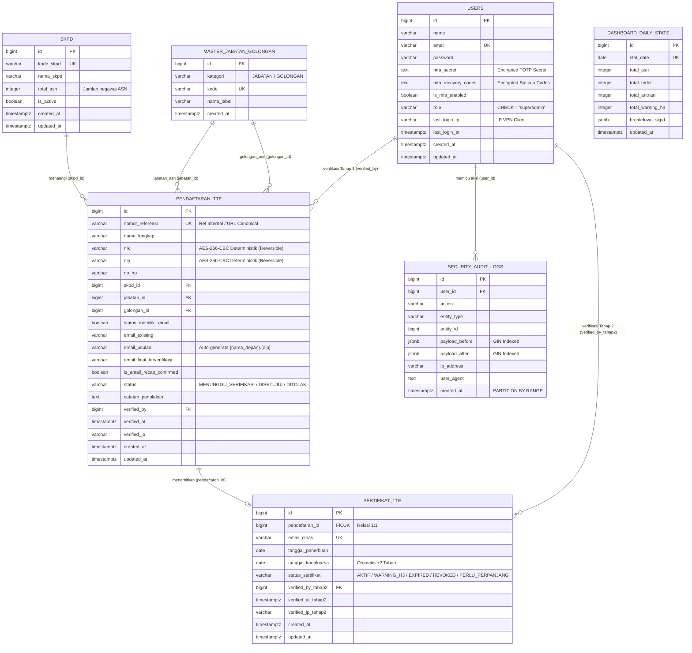

# SCHEMA.md — Skema Basis Data PostgreSQL 16 Enterprise

**Proyek:** Sistem Dashboard Monitoring TTE & Pelayanan Email Dinas  
**Instansi:** Dinas Komunikasi dan Informatika / Bidang Persandian  
**Domain Resmi Email Dinas:** `@cirebonkota.go.id`  
**Target Skalabilitas:** 100.000 – 1.000.000+ Records (Enterprise Skala Nasional)  
**Database Engine:** PostgreSQL 16 Alpine + PgBouncer  
**Dokumen Terkait:** [PRD.md](file:///f:/sismon-tte-testing-V4/docs/PRD.md) v3.2.0-PROD, [ARCHITECTURE.md](file:///f:/sismon-tte-testing-V4/docs/ARCHITECTURE.md) v3.2.0-PROD, [DESIGN.md](file:///f:/sismon-tte-testing-V4/docs/DESIGN.md) v3.2.0-PROD, [SECURITY.md](file:///f:/sismon-tte-testing-V4/docs/SECURITY.md) v3.2.0-PROD, [OPERATIONAL_GUIDE.md](file:///f:/sismon-tte-testing-V4/docs/OPERATIONAL_GUIDE.md) v3.2.0-PROD, [solusi_audit.md](file:///f:/sismon-tte-testing-V4/solusi_audit.md)  
**Versi Dokumen:** 3.2.0-PROD  
**Status:** Ditetapkan sebagai Spesifikasi Skema Basis Data Final Skala Nasional (Laravel 13 + Zero-Trust VPN Gateway + Post-Audit Hardened)  

---

> **Catatan Sebelumnya:**
> Versi 3.1.0-PROD (19-23 Agustus 2026) menetapkan 8 skema DDL PostgreSQL 16 tanpa beban file lampiran. Pembaruan Versi 3.2.0-PROD (24 Agustus 2026) menyelaraskan hasil audit kode program ([`AUDIT.md`](file:///f:/sismon-tte-testing-V4/AUDIT.md) & [`solusi_audit.md`](file:///f:/sismon-tte-testing-V4/solusi_audit.md)):
> 1. Penambahan kolom `mfa_recovery_codes` terenkripsi pada tabel `users` (Migrasi 10).
> 2. Penambahan partisi fallback `security_audit_logs_default` pada tabel terpartisi `security_audit_logs` (Migrasi 11).

---

## 1. Pendahuluan & Standar Skala Enterprise

Dokumen ini mendefinisikan rancangan basis data relasional enterprise menggunakan **PostgreSQL 16**. Skema ini dioptimasi secara mendalam untuk menangani transaksi bervolume jutaan data (*high-concurrency*), integritas data pribadi ASN (UU PDP), efisiensi ruang disk melalui normalisasi master data, performa query analitik instan, serta pencatatan audit log skala besar tanpa menimbulkan penguncian tabel (*table locking*)

### Standar Arsitektur Basis Data v5.0.0-PROD (Revisi Klien September 2026):
1. **Primary Key Modern:** Seluruh tabel menggunakan `BIGINT GENERATED ALWAYS AS IDENTITY` sesuai standar SQL enterprise PostgreSQL.
2. **Timestamp Berzona Waktu:** Penggunaan `TIMESTAMPTZ` (UTC / Asia/Jakarta) pada seluruh kolom waktu.
3. **Penyimpanan Sensitif Deterministik Dua Arah:** Kolom `nik` dan `nip` dienkripsi langsung menggunakan **AES-256-CBC Deterministik (Reversible)** yang tersimpan dalam string Base64. Kolom `nik_hash` dan `nip_hash` **dihapus sepenuhnya**, menyederhanakan struktur tanpa mengurangi fitur pencarian persis (*exact matching*). Kunci enkripsi disimpan aman di `.env` (`CIPHER_SECRET_KEY`).
4. **Partial Unique Indexing Langsung:** Memungkinkan ASN yang pendaftarannya `DITOLAK` untuk mendaftar ulang sebagai baris data baru. Indeks parsial unik PostgreSQL (`idx_pendaftaran_nik_active` dan `idx_pendaftaran_nip_active`) diterapkan langsung pada kolom `nik` dan `nip` terenkripsi dengan kondisi `WHERE status != 'DITOLAK'`.
5. **Alur Fleksibel Penetapan Email Dinas Superadmin:** Format otomatis `{nama_depan}.{nip}@cirebonkota.go.id` pada `email_usulan`, dilengkapi kolom `email_existing`, `email_final_terverifikasi`, dan flag `is_email_recap_confirmed` pada `pendaftaran_tte`.
6. **Formulir Ringan Tanpa Beban Berkas Fisik:** Alur transaksi difokuskan pada data identitas ASN dan standardisasi akun email tanpa memerlukan unggah berkas lampiran.
7. **Fast Aggregator:** Tabel `dashboard_daily_stats` menampung pra-kalkulasi agregat harian untuk menyuplai Redis Cache dashboard tanpa membebani tabel transaksi utama.
8. **Native Range Partitioning Bulanan:** Tabel `security_audit_logs` dipartisi per bulan (`PARTITION BY RANGE (created_at)`) dengan indeks GIN pada payload JSONB serta partisi fallback `security_audit_logs_default`.

---

## 2. Ruang Lingkup Entitas

Skema basis data mencakup 8 entitas utama yang terbagi ke dalam 5 domain fungsional:
1. **Domain Referensi Master:** `skpd`, `master_jabatan_golongan`.
2. **Domain Identitas & Akses:** `users` (Superadmin IAM + TOTP MFA + Audit IP VPN), `sessions`.
3. **Domain Transaksi Pendaftaran:** `pendaftaran_tte`.
4. **Domain Sertifikasi & Monitoring:** `sertifikat_tte`.
5. **Domain Observability & Analitik:** `dashboard_daily_stats`, `security_audit_logs`.

---

## 3. Konvensi Penamaan & Tipe Data

| Objek | Konvensi Standar | Contoh |
| :--- | :--- | :--- |
| **Nama Tabel** | `snake_case`, jamak/entitas domain | `pendaftaran_tte`, `security_audit_logs` |
| **Primary Key** | `id BIGINT GENERATED ALWAYS AS IDENTITY PRIMARY KEY` | `id` |
| **Foreign Key** | `{nama_tabel_tunggal}_id BIGINT REFERENCES ...` | `skpd_id`, `pendaftaran_id`, `verified_by` |
| **Kolom Waktu** | `TIMESTAMPTZ DEFAULT CURRENT_TIMESTAMP` | `created_at`, `updated_at`, `verified_at` |
| **Kolom Enkripsi** | `VARCHAR(255)` (Ciphertext AES-256-CBC Deterministik Dua Arah) | `nik`, `nip` |
| **Kolom Status** | `VARCHAR(30)` dengan `CHECK CONSTRAINT` eksplisit | `status`, `status_sertifikat`, `kategori` |
| **Kolom JSON Data** | `JSONB` dengan dukungan GIN Index | `payload_before`, `payload_after` |

---

## 4. Ringkasan Entitas Basis Data

| # | Nama Tabel | Peran & Deskripsi | Volume Estimasi |
| :-: | :--- | :--- | :--- |
| 1 | **`skpd`** | Master unit kerja / instansi kedinasan | Ratusan records |
| 2 | **`master_jabatan_golongan`** | Master referensi Jabatan dan Golongan untuk normalisasi disk | Ribuan records |
| 3 | **`users`** | Akun internal Superadmin dengan kredensial, TOTP MFA secret, dan jejak IP login VPN | Puluhan records |
| 4 | **`sessions`** | Penyimpanan sesi login terenkripsi di database | Ribuan records |
| 5 | **`pendaftaran_tte`** | Data pendaftaran utama, NIK/NIP terenkripsi 2 arah langsung, alur verifikasi & rekap email | 100.000 – 1.000.000+ records |
| 6 | **`sertifikat_tte`** | Data sertifikat TTE aktif, tanggal terbit, masa kadaluarsa, & status siklus | 100.000 – 1.000.000+ records |
| 7 | **`dashboard_daily_stats`** | Agregator statistik harian pra-kalkulasi untuk performa sub-milidetik | Ribuan records (per hari) |
| 8 | **`security_audit_logs`** | Log audit append-only terpartisi bulanan dengan indeks GIN | Jutaan records |

---

## 5. Entity Relationship Diagram (ERD)



---

## 6. Penjelasan Skema DDL Spesifik

### 7.1 `skpd` (Master Unit Kerja)
```sql
CREATE TABLE skpd (
    id BIGINT GENERATED ALWAYS AS IDENTITY PRIMARY KEY,
    kode_skpd VARCHAR(50) NOT NULL UNIQUE,
    nama_skpd VARCHAR(255) NOT NULL,
    total_asn INTEGER NOT NULL DEFAULT 0,  -- Jumlah total pegawai ASN (untuk metrik capaian adopsi TTE)
    is_active BOOLEAN DEFAULT TRUE,
    created_at TIMESTAMPTZ DEFAULT CURRENT_TIMESTAMP,
    updated_at TIMESTAMPTZ DEFAULT CURRENT_TIMESTAMP
);

CREATE INDEX idx_skpd_nama ON skpd (nama_skpd);
```

### 7.2 `master_jabatan_golongan` (Master Jabatan & Golongan)
```sql
CREATE TABLE master_jabatan_golongan (
    id BIGINT GENERATED ALWAYS AS IDENTITY PRIMARY KEY,
    kategori VARCHAR(20) NOT NULL CHECK (kategori IN ('JABATAN', 'GOLONGAN')),
    kode VARCHAR(50) NOT NULL UNIQUE,
    nama_label VARCHAR(100) NOT NULL,
    created_at TIMESTAMPTZ DEFAULT CURRENT_TIMESTAMP
);

CREATE INDEX idx_master_kategori ON master_jabatan_golongan (kategori);
```

### 7.3 `users` (IAM Superadmin)
```sql
CREATE TABLE users (
    id BIGINT GENERATED ALWAYS AS IDENTITY PRIMARY KEY,
    name VARCHAR(255) NOT NULL,
    email VARCHAR(255) NOT NULL UNIQUE,
    password VARCHAR(255) NOT NULL,
    mfa_secret TEXT NULL,
    is_mfa_enabled BOOLEAN DEFAULT FALSE,
    role VARCHAR(30) DEFAULT 'superadmin' CHECK (role = 'superadmin'),
    last_login_at TIMESTAMPTZ NULL,
    last_login_ip VARCHAR(45) NULL,
    created_at TIMESTAMPTZ DEFAULT CURRENT_TIMESTAMP,
    updated_at TIMESTAMPTZ DEFAULT CURRENT_TIMESTAMP
);
```

### 7.4 `pendaftaran_tte` (Transaksi Utama Pendaftaran)
```sql
CREATE TABLE pendaftaran_tte (
    id BIGINT GENERATED ALWAYS AS IDENTITY PRIMARY KEY,
    nomor_referensi VARCHAR(64) NOT NULL UNIQUE, -- Referensi Internal / URL Canonical
    nama_lengkap VARCHAR(255) NOT NULL,
    nik VARCHAR(255) NOT NULL,                    -- Enkripsi Deterministik Dua Arah AES-256-CBC
    nip VARCHAR(255) NOT NULL,                    -- Enkripsi Deterministik Dua Arah AES-256-CBC
    no_hp VARCHAR(30) NOT NULL,
    skpd_id BIGINT NOT NULL REFERENCES skpd(id),
    jabatan_id BIGINT REFERENCES master_jabatan_golongan(id),
    golongan_id BIGINT REFERENCES master_jabatan_golongan(id),
    status_memiliki_email BOOLEAN NOT NULL DEFAULT FALSE,
    email_existing VARCHAR(255) NULL,
    email_usulan VARCHAR(255) NULL,              -- Auto-generate format {nama_depan}.{nip}@cirebonkota.go.id
    email_final_terverifikasi VARCHAR(255) NULL, -- Definitif setelah review / edit Superadmin
    is_email_recap_confirmed BOOLEAN NOT NULL DEFAULT FALSE,
    status VARCHAR(30) NOT NULL DEFAULT 'MENUNGGU_VERIFIKASI' 
        CHECK (status IN ('MENUNGGU_VERIFIKASI', 'DISETUJUI', 'DITOLAK')),
    catatan_penolakan TEXT NULL,
    verified_by BIGINT NULL REFERENCES users(id),
    verified_at TIMESTAMPTZ NULL,
    verified_ip VARCHAR(45) NULL,
    created_at TIMESTAMPTZ DEFAULT CURRENT_TIMESTAMP,
    updated_at TIMESTAMPTZ DEFAULT CURRENT_TIMESTAMP
);

-- PARTIAL UNIQUE INDEX V5: Cegah duplikasi data aktif langsung pada kolom NIK/NIP terenkripsi deterministik
CREATE UNIQUE INDEX idx_pendaftaran_nik_active 
ON pendaftaran_tte (nik) WHERE status != 'DITOLAK';

CREATE UNIQUE INDEX idx_pendaftaran_nip_active 
ON pendaftaran_tte (nip) WHERE status != 'DITOLAK';

CREATE INDEX idx_pendaftaran_status_created ON pendaftaran_tte (status, created_at);
CREATE INDEX idx_pendaftaran_skpd ON pendaftaran_tte (skpd_id);
```

### 7.5 `sertifikat_tte` (Penerbitan & Monitoring Siklus Hidup)
```sql
CREATE TABLE sertifikat_tte (
    id BIGINT GENERATED ALWAYS AS IDENTITY PRIMARY KEY,
    pendaftaran_id BIGINT NOT NULL UNIQUE REFERENCES pendaftaran_tte(id),
    email_dinas VARCHAR(255) NOT NULL UNIQUE,    -- Format @cirebonkota.go.id
    tanggal_penerbitan DATE NOT NULL,
    tanggal_kadaluarsa DATE NOT NULL,            -- Kalkulasi: tanggal_penerbitan + 2 tahun
    status_sertifikat VARCHAR(20) NOT NULL DEFAULT 'AKTIF' 
        CHECK (status_sertifikat IN ('AKTIF', 'WARNING_H3', 'EXPIRED', 'REVOKED', 'PERLU_PERPANJANG')),
    verified_by_tahap2 BIGINT NOT NULL REFERENCES users(id),
    verified_at_tahap2 TIMESTAMPTZ NOT NULL DEFAULT CURRENT_TIMESTAMP,
    verified_ip_tahap2 VARCHAR(45) NULL,
    created_at TIMESTAMPTZ DEFAULT CURRENT_TIMESTAMP,
    updated_at TIMESTAMPTZ DEFAULT CURRENT_TIMESTAMP
);

CREATE INDEX idx_sertifikat_status_kadaluarsa ON sertifikat_tte (status_sertifikat, tanggal_kadaluarsa);
CREATE INDEX idx_sertifikat_email ON sertifikat_tte (email_dinas);
```

### 7.6 `dashboard_daily_stats` (Agregasi Statistik Harian)
```sql
CREATE TABLE dashboard_daily_stats (
    id BIGINT GENERATED ALWAYS AS IDENTITY PRIMARY KEY,
    stat_date DATE NOT NULL UNIQUE,
    total_asn INTEGER NOT NULL DEFAULT 0,
    total_terbit INTEGER NOT NULL DEFAULT 0,
    total_antrian INTEGER NOT NULL DEFAULT 0,
    total_warning_h3 INTEGER NOT NULL DEFAULT 0,
    breakdown_skpd JSONB NULL,                   -- JSONB struktur agregasi per SKPD
    created_at TIMESTAMPTZ DEFAULT CURRENT_TIMESTAMP,
    updated_at TIMESTAMPTZ DEFAULT CURRENT_TIMESTAMP
);

CREATE INDEX idx_dashboard_stats_date ON dashboard_daily_stats (stat_date DESC);
```

### 7.7 `security_audit_logs` (Partisi Bulanan & GIN Index)
```sql
CREATE TABLE security_audit_logs (
    id BIGINT GENERATED ALWAYS AS IDENTITY,
    user_id BIGINT NULL REFERENCES users(id),
    action VARCHAR(50) NOT NULL,
    entity_type VARCHAR(100) NOT NULL,
    entity_id BIGINT NULL,
    payload_before JSONB NULL,
    payload_after JSONB NULL,
    ip_address VARCHAR(45) NOT NULL,
    user_agent TEXT NULL,
    created_at TIMESTAMPTZ NOT NULL DEFAULT CURRENT_TIMESTAMP,
    PRIMARY KEY (id, created_at)
) PARTITION BY RANGE (created_at);

-- Indeks GIN pada payload JSONB untuk query forensik instan
CREATE INDEX idx_audit_payload_before_gin ON security_audit_logs USING GIN (payload_before);
CREATE INDEX idx_audit_payload_after_gin ON security_audit_logs USING GIN (payload_after);
CREATE INDEX idx_audit_action_created ON security_audit_logs (action, created_at DESC);
CREATE INDEX idx_audit_user_created ON security_audit_logs (user_id, created_at DESC);
```

---

## 7. Pemetaan Relasi & Kunci Asing (Foreign Keys)

| Tabel Sumber | Kolom FK | Tabel Target | Kolom PK | Aksi Hapus (ON DELETE) | Keterangan |
| :--- | :--- | :--- | :--- | :---: | :--- |
| `pendaftaran_tte` | `skpd_id` | `skpd` | `id` | RESTRICT | SKPD tidak dapat dihapus jika masih ada pendaftar |
| `pendaftaran_tte` | `jabatan_id` | `master_jabatan_golongan` | `id` | SET NULL | Jabatan dapat dinonaktifkan tanpa menghapus data pendaftar |
| `pendaftaran_tte` | `golongan_id` | `master_jabatan_golongan` | `id` | SET NULL | Golongan dapat dinonaktifkan tanpa menghapus data pendaftar |
| `pendaftaran_tte` | `verified_by` | `users` | `id` | SET NULL | Jejak verifikator tetap terjaga |
| `sertifikat_tte` | `pendaftaran_id` | `pendaftaran_tte` | `id` | RESTRICT | Data pendaftaran induk tidak boleh dihapus saat sertifikat aktif |
| `sertifikat_tte` | `verified_by_tahap2` | `users` | `id` | RESTRICT | Jejak verifikator penerbitan terjaga |
| `security_audit_logs` | `user_id` | `users` | `id` | SET NULL | Log audit tetap ada meskipun user dinonaktifkan |

---

## 8. Pemetaan Berkas Migrasi Laravel 13

| No | Berkas Migrasi | Tabel / Objek Basis Data |
| :-: | :--- | :--- |
| 1 | `2026_08_01_000001_create_skpd_table.php` | `skpd` |
| 2 | `2026_08_01_000002_create_master_jabatan_golongan_table.php` | `master_jabatan_golongan` |
| 3 | `2026_08_01_000003_create_users_table.php` | `users` & `sessions` |
| 4 | `2026_08_01_000004_create_pendaftaran_tte_table.php` | `pendaftaran_tte` |
| 5 | `2026_08_01_000005_add_partial_unique_indexes_pendaftaran_tte.php` | Partial Unique Indexes (`nik`, `nip` terenkripsi langsung) |
| 6 | `2026_08_01_000007_create_sertifikat_tte_table.php` | `sertifikat_tte` |
| 7 | `2026_08_01_000008_create_dashboard_daily_stats_table.php` | `dashboard_daily_stats` |
| 8 | `2026_08_01_000009_create_security_audit_logs_partitioned_table.php` | `security_audit_logs` (Partitioned + GIN Index) |
| 9 | `2026_08_01_000010_add_mfa_recovery_codes_to_users_table.php` | `users.mfa_recovery_codes` (Encrypted) |
| 10 | `2026_08_01_000011_add_default_partition_to_security_audit_logs.php` | `security_audit_logs_default` (Default Partition Fallback) |
| 11 | `2026_09_09_000001_add_total_asn_to_skpd_table.php` | `skpd.total_asn` (Kolom populasi ASN untuk metrik capaian adopsi) |

---

## 9. Riwayat Versi Skema Basis Data

| Versi | Rincian Perubahan |
| :--- | :--- |
| **v1.3.0** | Skema dasar dengan partial unique index & blind index. |
| **v2.1.0-PROD** | Migrasi penuh ke PostgreSQL 16 Enterprise DDL: `BIGINT GENERATED ALWAYS AS IDENTITY`, `TIMESTAMPTZ`, tabel `master_jabatan_golongan`, penambahan kolom alur rekap email definitif Superadmin (`email_final_terverifikasi`, `is_email_recap_confirmed`), fast counter `dashboard_daily_stats`, dan Native Monthly Partitioning pada `security_audit_logs` dengan indeks GIN. |
| **v3.1.0-PROD** | Penyelarasan skema untuk runtime **Laravel 13**, pencatatan jejak IP autentikasi VPN pada `users.last_login_ip`, dan penyederhanaan skema lean (menghapus tabel `pendaftaran_lampiran` untuk fokus pada data kepegawaian ASN). |
| **v3.2.0-PROD** | Remediasi Audit Kode Program: Penambahan kolom `mfa_recovery_codes` (tipe TEXT terenkripsi AES-256-GCM) pada tabel `users` serta penambahan partisi fallback `security_audit_logs_default` untuk ketahanan log audit tak terhingga. |
| **v5.0.0-PROD** | **Revisi Klien September 2026 (Sismon TTE V5):**<br>1. **Penyatuan Kolom & Enkripsi Dua Arah Deterministik:** Menghapus kolom `nik_hash` dan `nip_hash`. Nilai NIK dan NIP disimpan langsung ke kolom `nik` dan `nip` dengan enkripsi AES-256-CBC dua arah yang deterministik dan *reversible*.<br>2. **Pembaruan Partial Unique Index:** Indeks unik `idx_pendaftaran_nik_active` dan `idx_pendaftaran_nip_active` langsung diterapkan pada kolom `nik` dan `nip` (`WHERE status != 'DITOLAK'`).<br>3. **Pembaruan Format Otomatis Email Usulan:** Pola default `{nama_depan}.{nip}@cirebonkota.go.id`.<br>4. **Canonical Route Parameter:** Enforcing `nomor_referensi` sebagai identifier transaksi di routing publik dan admin. |
| **v5.1.0-PROD** | **Penambahan Metrik Populasi Pegawai (`total_asn`):** Penambahan kolom `total_asn INTEGER DEFAULT 0` pada tabel `skpd` via migrasi `2026_09_09_000001_add_total_asn_to_skpd_table.php` untuk mendukung kalkulasi persentase adopsi TTE terhadap populasi instansi. |
| **v5.2.0-PROD** | **Integrasi Kueri Analitik Capaian Seluruh SKPD & Ekspor CSV:** Optimalisasi kueri agregasi single-pass yang menghubungkan tabel `skpd`, `pendaftaran_tte`, dan `sertifikat_tte` dengan penanganan pembagian nol aman (`COALESCE`), paginasi terindeks, dan ekspor streaming terstruktur. |
