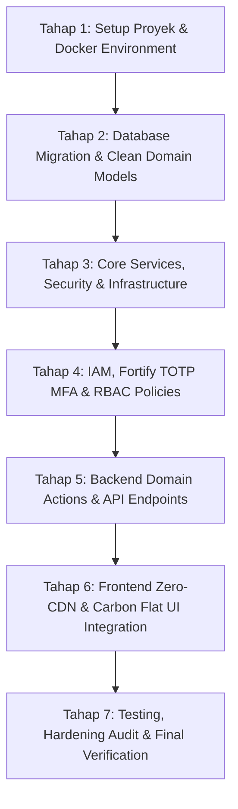

# IMPLEMENTATION PLAN: Sistem Dashboard Monitoring TTE & Pelayanan Email Dinas (@cirebonkota.go.id)

**Versi Dokumen:** 2.1.0-PROD  
**Target Lingkungan:** Enterprise Skala Nasional (100.000 – 1.000.000+ Records)  
**Core Stack:** PHP 8.3 / Laravel 13 + PostgreSQL 16 + Redis 7 + Nginx + Docker Compose + Vite (Vanilla JS/CSS Carbon 0px)  
**Dokumen Acuan:** [PRD.md](file:///f:/sismon-tte-testing-V4/docs/PRD.md), [ARCHITECTURE.md](file:///f:/sismon-tte-testing-V4/docs/ARCHITECTURE.md), [SCHEMA.md](file:///f:/sismon-tte-testing-V4/docs/SCHEMA.md), [SECURITY.md](file:///f:/sismon-tte-testing-V4/docs/SECURITY.md), [DESIGN.md](file:///f:/sismon-tte-testing-V4/docs/DESIGN.md)

---

## Ringkasan Proyek & Hasil Analisis Alignment

Berdasarkan analisis mendalam terhadap kelima dokumen spesifikasi fondasi (`PRD.md`, `ARCHITECTURE.md`, `SCHEMA.md`, `SECURITY.md`, dan `DESIGN.md`), seluruh spesifikasi telah terkonfirmasi **100% konsisten dan selaras (aligned)** tanpa ada kontradiksi:
1. **Model Peran (2 Peran):** Publik (ASN Pendaftar, form mandiri satu kolom tanpa registrasi akun) dan Superadmin (Internal IAM, wajib login dengan password hashing kuat + TOTP MFA).
2. **Standardisasi Email Dinas:** Domain tunggal `@cirebonkota.go.id`. Sistem menyediakan auto-generator usulan email, panel verifikasi interaktif Superadmin (tombol "Gunakan Usulan", field editable manual, dan tombol penegasan definitif "Rekap Email").
3. **Keamanan & Privasi (UU PDP):** Enkripsi *at-rest* AES-256-GCM untuk NIK & NIP dipadukan dengan HMAC-SHA256 Blind Indexing, serta *Partial Unique Index* (mengizinkan ASN mendaftar ulang jika berstatus `DITOLAK`).
4. **Resiliensi Pelosok (Low-Bandwidth):** 100% Zero External CDN (bundle lokal IBM Plex Sans/Mono via Vite), kompresi Nginx Brotli/Gzip level 6, Client-side Draft Auto-Save (`localStorage`), serta Fast-timeout reCAPTCHA (3s) dengan fallback ke Local Math CAPTCHA.
5. **Skalabilitas & Anti-DoS:** Asynchronous Audit Logging via Redis 7 Queue ke tabel bulanan `security_audit_logs` (PostgreSQL 16 Range Partitioning + GIN Index), Fast Counter `dashboard_daily_stats` (sub-milidetik dengan Redis Cache), dan Database Cursor Streaming Export (RAM < 20MB untuk 500k+ records).

---

## User Review Required

> [!IMPORTANT]
> **Keputusan Arsitektur & Lingkungan Eksekusi:**
> 1. **Struktur Clean Domain:** Kode backend akan diorganisasikan ke dalam direktori domain `app/Domain/{Pendaftaran, Sertifikat, Master, Analytics}` sesuai panduan `ARCHITECTURE.md §8`.
> 2. **Infrastruktur Docker Enterprise:** Menggunakan Named Isolated Volumes (`vendor_data`, `node_data`, `storage_data`) serta segmentasi jaringan `backend` yang terisolasi (`internal: true`).
> 3. **Konfirmasi Sebelum Eksekusi:** Tidak ada kode aplikasi atau instalasi package yang dijalankan sebelum user menyetujui struktur direktori dan tahapan pada dokumen ini.

---

## Tahapan Implementasi Berurutan (Execution Roadmap)



---

### Tahap 1: Inisialisasi Proyek, Docker Environment & Boilerplate Foundation
- [x] Menyiapkan struktur skeleton aplikasi Laravel 13 dan dependensi inti (`composer.json`, `package.json`).
- [x] Mengonfigurasi `docker-compose.yml` dengan 4 layanan terisolasi: `nginx` (edge proxy, read-only rootfs, tmpfs), `app` (PHP 8.3-FPM), `postgres` (PostgreSQL 16), dan `redis` (Redis 7 dengan `requirepass` & AOF persistence).
- [x] Menyiapkan konfigurasi Nginx hardened (`docker/nginx/nginx.conf`, `docker/nginx/Dockerfile`) dengan Brotli/Gzip, rate limiting zone (`pendaftaran_limit: 5r/m`, `general_limit: 30r/s`), and CSP headers.
- [x] Menyiapkan `docker/php/Dockerfile` dan `docker/php/php.ini` (memory limit, max upload 5M, non-root user `1000:1000`).
- [x] Mengonfigurasi environment `.env.example` dan `.env` yang lengkap dengan koneksi DB PostgreSQL, Redis, session driver, queue driver Redis, dan hashing key.

---

### Tahap 2: Database Migrations, PostgreSQL 16 DDL & Domain Models
- [x] Membuat migrasi tabel `skpd` dengan kode SKPD unik dan index nama SKPD.
- [x] Membuat migrasi tabel `master_jabatan_golongan` dengan check constraint `kategori IN ('JABATAN', 'GOLONGAN')`.
- [x] Membuat migrasi tabel `users` (Superadmin IAM, `mfa_secret`, `is_mfa_enabled`, `role = 'superadmin'`).
- [x] Membuat migrasi tabel `pendaftaran_tte` dengan foreign key ke `skpd` dan `master_jabatan_golongan`.
- [x] Menambahkan raw SQL migration untuk *Partial Unique Indexes* pada `pendaftaran_tte`:
  - `idx_pendaftaran_nik_hash_active` (`nik_hash` WHERE status != 'DITOLAK')
  - `idx_pendaftaran_nip_hash_active` (`nip_hash` WHERE status != 'DITOLAK')
- [x] Membuat migrasi tabel `sertifikat_tte` (1:1 ke `pendaftaran_tte`, `email_dinas` UNIQUE, FK `verified_by_tahap2`, composite index status & expiry).
- [x] Membuat migrasi tabel `dashboard_daily_stats` (fast counter harian, `stat_date` UNIQUE).
- [x] Membuat migrasi raw SQL partisi bulanan `security_audit_logs` (`PARTITION BY RANGE (created_at)`, Primary Key composite `(id, created_at)`, GIN Index pada `payload_after`).
- [x] Membangun Eloquent Models pada Clean Domain Architecture:
  - `App\Domain\Master\Models\Skpd`
  - `App\Domain\Master\Models\MasterJabatanGolongan`
  - `App\Models\User` (dengan trait Fortify MFA & Superadmin Scope)
  - `App\Domain\Pendaftaran\Models\PendaftaranTte` (dengan mutator enkripsi AES-256-GCM & HMAC blind index setter)
  - `App\Domain\Sertifikat\Models\SertifikatTte`
  - `App\Domain\Analytics\Models\DashboardDailyStats`
  - `App\Domain\Analytics\Models\SecurityAuditLog`
- [x] Menyiapkan Database Seeders (`SkpdSeeder`, `MasterJabatanGolonganSeeder`, `SuperadminUserSeeder`) untuk data awal instansi.

---

### Tahap 3: Core Services, Security Infrastructure & Queue
- [ ] Mengembangkan `App\Services\EmailGeneratorService`: generator otomatis format baku `nama.nip@cirebonkota.go.id` dengan sanitasi karakter khusus.
- [ ] Mengembangkan `App\Services\LocalCaptchaService`: engine tantangan matematika HMAC-SHA256 berbatas waktu 5 menit.
- [ ] Mengembangkan `App\Services\CaptchaService`: router reCAPTCHA v2/v3 dengan timeout 3 detik + fallback otomatis ke `LocalCaptchaService`.
- [ ] Mengembangkan `App\Http\Middleware\SecurityHeaders`: implementasi ketat HSTS Preload, X-Frame-Options DENY, X-Content-Type-Options nosniff, Referrer-Policy, dan Content-Security-Policy.
- [ ] Mengembangkan `App\Http\Middleware\ThrottlingMiddleware`: rate limiting berlapis pada endpoint pendaftaran dan login.
- [ ] Mengonfigurasi `App\Jobs\ProcessAuditLogJob` pada antrian Redis `audit-logs` untuk penyimpanan log audit non-blocking.
- [ ] Mengonfigurasi `App\Domain\Pendaftaran\Observers\AuditObserver` untuk mencatat mutasi data pendaftaran dan sertifikat secara otomatis.

---

### Tahap 4: IAM, Autentikasi Superadmin & TOTP MFA
- [ ] Mengonfigurasi alur autentikasi Superadmin dengan proteksi lockout progresif (5x percobaan gagal).
- [ ] Mengimplementasikan TOTP MFA (Google Authenticator) menggunakan library standar (QR Code generation, verifikasi token 6 digit, dan recovery codes terenkripsi).
- [ ] Mengembangkan `App\Policies\PendaftaranTtePolicy` dan `App\Policies\SertifikatTtePolicy` untuk otorisasi eksplisit operasi Superadmin (`approveTahap1`, `rekapEmailDinas`, `terbitkanSertifikat`, `exportLaporan`).

---

### Tahap 5: Backend Actions, FormRequests, Controllers & Schedulers
- [ ] **Modul Pendaftaran Publik:**
  - `App\Http\Requests\StorePendaftaranRequest`: validasi format 16 digit NIK, 18 digit NIP, file upload 2MB (PDF/JPG/PNG), reCAPTCHA/Local CAPTCHA, dan anti-enumeration error message `"NIK/NIP sudah terdata."`.
  - `App\Domain\Pendaftaran\Actions\StorePendaftaranAction`: upload lampiran dengan SHA-256 Checksum, blind index generation, auto-generate `email_usulan`, dan simpan pendaftaran.
  - `App\Http\Controllers\PendaftaranController`: endpoint `GET /` (render form publik + local captcha signature) dan `POST /pendaftaran`.
- [ ] **Modul Verifikasi Tahap 1 & Rekap Email Dinas:**
  - `App\Http\Requests\RekapEmailDinasRequest`: validasi format email `@cirebonkota.go.id`.
  - `App\Domain\Pendaftaran\Actions\RekapEmailDinasAction`: update `email_final_terverifikasi`, set `is_email_recap_confirmed = true`, dan catat audit log.
  - `App\Domain\Pendaftaran\Actions\ApproveTahap1Action`: verifikasi data dan ubah status ke `DISETUJUI`.
  - `App\Domain\Pendaftaran\Actions\RejectPendaftaranAction`: ubah status ke `DITOLAK` dengan `catatan_penolakan`.
  - `App\Http\Controllers\VerifikasiController`: antrian pendaftaran, panel detail, aksi rekap email, approve, dan reject.
- [ ] **Modul Penerbitan Sertifikat Tahap 2 & Lifecycle:**
  - `App\Domain\Sertifikat\Actions\TerbitkanSertifikatAction`: input `tanggal_penerbitan`, auto-calculate `tanggal_kadaluarsa` (+2 tahun), create record `sertifikat_tte` dengan status `AKTIF`.
  - `App\Http\Controllers\PenerbitanController`: antrian Tahap 2 dan modal input tanggal terbit.
  - `App\Jobs\UpdateSertifikatStatusJob`: daily scanner (00:01 WIB) untuk update status `WARNING_H3` dan `EXPIRED`.
- [ ] **Modul Dashboard Analytics & Fast Aggregator:**
  - `App\Domain\Analytics\Actions\RefreshDailyAggregatorAction` & `App\Jobs\RefreshDailyAggregatorJob`: kalkulasi harian ke `dashboard_daily_stats`.
  - `App\Http\Controllers\DashboardController`: sub-milisecond dashboard stats via Redis Cache `dashboard_stats_summary`.
- [ ] **Modul Streaming Export:**
  - `App\Http\Controllers\ExportLaporanController`: Database Cursor Streaming (`PendaftaranTte::cursor()`) export CSV dan Excel tanpa buffering memori (RAM < 20MB).
- [ ] **Modul Master Data:**
  - `App\Http\Controllers\MasterSkpdController`, `App\Http\Controllers\MasterJabatanGolonganController`, `App\Http\Controllers\UserManagementController`.

---

### Tahap 6: Frontend Zero-CDN Asset Pipeline & Carbon Flat UI Integration
- [ ] Menyiapkan aset font lokal **IBM Plex Sans** dan **IBM Plex Mono** di `resources/fonts/` (100% Zero External CDN).
- [ ] Mengembangkan `resources/css/app.css` berbasis token desain Carbon Flat 0px radius, palette semantik resmi, hairline borders, dan utilitas responsif.
- [ ] Mengembangkan layout utama Blade:
  - `resources/views/layouts/public.blade.php`: layout ramping mobile-first untuk publik.
  - `resources/views/layouts/admin.blade.php`: layout sidebar 240px + topbar untuk Superadmin.
- [ ] Mengembangkan komponen UI & Interaksi Frontend:
  - **Portal Pendaftaran Mandiri (`resources/views/public/pendaftaran.blade.php`):**
    - Client-side auto-save ke `localStorage` setiap ketikan pengguna + deteksi offline/online badge status.
    - Widget Local Math CAPTCHA fallback jika script Google reCAPTCHA gagal/timeout.
    - Drag-and-drop file upload zone dengan indikator file info & MIME preview.
  - **Dashboard Superadmin (`resources/views/admin/dashboard.blade.php`):**
    - 4 Stat Cards: Total ASN, Sertifikat Terbit, Antrian Verifikasi, H-3 Warning Card (top border accent kuning).
  - **Panel Verifikasi Tahap 1 (`resources/views/admin/verifikasi/show.blade.php`):**
    - Widget interaktif penetapan email: Tombol "Gunakan Usulan", field input editable username `@cirebonkota.go.id`, dan tombol aksi "Rekap Email" via AJAX.
    - Modal Setujui dan Modal Tolak (+ input alasan penolakan).
  - **Panel Penerbitan Tahap 2 (`resources/views/admin/penerbitan/index.blade.php`):**
    - Modal input tanggal terbit sertifikat dengan kalkulator otomatis masa berlaku +2 tahun.
  - **Panel Monitoring H-3 & Master Data:**
    - Filter status sertifikat, CRUD SKPD, CRUD Jabatan & Golongan, CRUD Admin.
  - **Modal Streaming Mass Export:**
    - Progress shimmer bar saat mendownload ribuan data.

---

### Tahap 7: Testing, Verifikasi & Audit Hardening
- [ ] **Unit Testing (`tests/Unit/`):**
  - `EmailGeneratorServiceTest`: verifikasi sanitasi nama dan NIP.
  - `LocalCaptchaServiceTest`: verifikasi integritas signature HMAC dan timeout 5 menit.
  - `PendaftaranTteEncryptionTest`: verifikasi enkripsi AES-256-GCM dan blind index match.
  - `SertifikatExpiryCalculationTest`: verifikasi kalkulasi presisi +2 tahun.
- [ ] **Feature Testing (`tests/Feature/`):**
  - `PendaftaranPublikTest`: submit form, duplicate detection error generik, auto-save payload.
  - `VerifikasiTahap1Test`: aksi rekap email, approval, rejection note.
  - `PenerbitanTahap2Test`: terbitkan sertifikat TTE, check status `AKTIF`.
  - `MfaAuthenticationTest`: login flow, TOTP verification, lockout after 5 attempts.
  - `StreamingExportTest`: cursor stream download CSV/Excel.
  - `SchedulerLifecycleTest`: transisi status ke `WARNING_H3` dan `EXPIRED`.
- [ ] **Security & Performance Hardening:**
  - Validasi Security Headers (HSTS, CSP, X-Frame-Options).
  - Verifikasi isolasi Docker backend network (`internal: true`).
  - Verifikasi memory footprint streaming export < 20MB RAM.
- [ ] Menyiapkan dokumentasi `walkthrough.md` beserta instruksi operasional kontainer Docker.

---


---

### Tahap Tambahan: Modul Analitik Capaian Adopsi TTE Seluruh SKPD & Ekspor CSV (V5.2)
- [x] **Pembuatan Controller:** `App\Http\Controllers\CapaianSkpdController` (kalkulasi KPI agregat kota, filter, sorting, paginasi, dan ekspor streaming CSV UTF-8 BOM).
- [x] **Pembuatan Blade View:** `resources/views/admin/capaian_skpd/index.blade.php` (4 kartu KPI, filter bar, tabel interaktif dengan progress bar 4 warna, dan pagination).
- [x] **Pendaftaran Rute:** `admin.capaian-skpd.index` dan `admin.capaian-skpd.export` di `routes/web.php` di bawah isolasi VPN Gateway dan autentikasi admin.
- [x] **Integrasi Navigasi:** Menu sidebar "Capaian Adopsi SKPD", shortcut ekspor CSV, dan tombol "Lihat Seluruh SKPD & Ekspor" pada dashboard widget.
- [x] **Feature Testing:** `tests/Feature/CapaianSkpdTest.php` (12 skenario pengujian, 100% Passed).
- [x] **Full Suite Verification:** 70 Automated Tests Passed (351 Assertions).


## Verification Plan

### Automated Tests
```bash
# Menjalankan suite pengujian lengkap Laravel PHPUnit/Pest (70 Tests Passed)
php artisan test
php artisan test --filter=CapaianSkpdTest

# Pengujian spesifik modul
php artisan test --filter=PendaftaranTteEncryptionTest
php artisan test --filter=VerifikasiTahap1Test
php artisan test --filter=StreamingExportTest
php artisan test --filter=LocalCaptchaServiceTest
```

### Manual & Integration Verification
1. **Pendaftaran Publik & Offline Draft:** Mengisi data form, mematikan jaringan (offline mode di browser devtools), mengecek `localStorage`, menyalakan jaringan kembali, dan submit.
2. **Local CAPTCHA Fallback:** Memblokir domain `google.com/recaptcha` di network devtools dan memverifikasi widget matematika lokal tampil dan tervalidasi.
3. **Alur Rekap Email Superadmin:** Membuka antrian verifikasi, mengklik "Gunakan Usulan", mengedit username, mengklik "Rekap Email", dan memverifikasi data tersimpan di DB.
4. **Verifikasi Tahap 2 & Scheduler:** Menginput tanggal terbit, memverifikasi tanggal kedaluwarsa = tanggal terbit + 2 tahun, menjalankan command scheduler untuk menguji transisi H-3.
5. **Streaming Mass Export:** Mengekspor 10.000+ data dan memantau penggunaan RAM PHP tidak melebihi 20MB.
