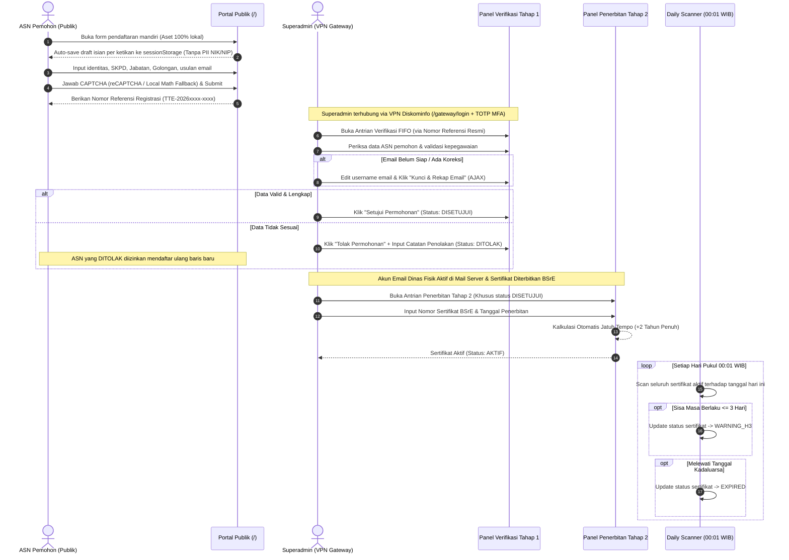
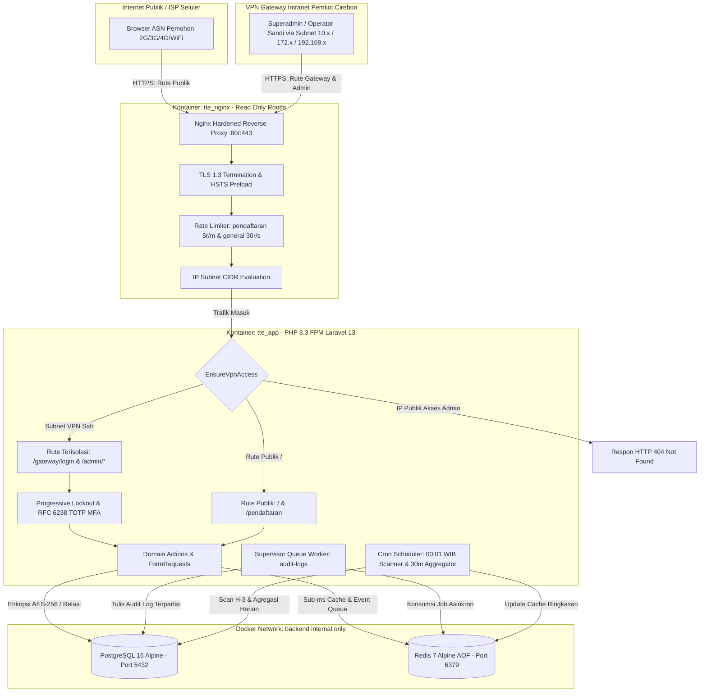
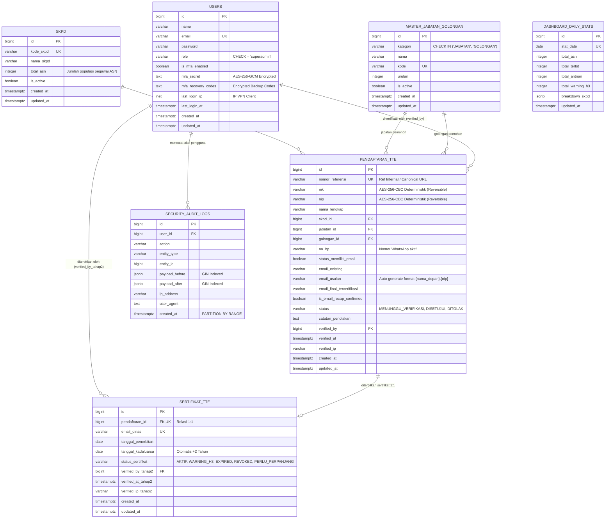

# DOKUMEN PENJELASAN KOMPREHENSIF SISTEM
## SISTEM MONITORING PENERBITAN TTE & PELAYANAN EMAIL DINAS RESMI
### PEMERINTAH KOTA CIREBON (DISKOMINFO / BIDANG PERSANDIAN)

**Versi Sistem:** 5.0.0-PROD / Release V5.0 (Revisi Klien September 2026 - Two-Way Deterministic Encryption & Canonical Routing)  
**Framework & Engine:** Laravel 13 (PHP 8.3 FPM) + PostgreSQL 16 Alpine + Redis 7 Alpine + Nginx Edge Proxy  
**Arsitektur Keamanan:** Defense-in-Depth dengan Zero-Trust VPN Gateway Perimeter  
**Dokumen:** `penjelasan_lengkap.md`  
**Klasifikasi:** Dokumen Teknis Resmi Internal Pemerintah Kota Cirebon  
**Tanggal Penyusunan:** September 2026 (Diperbarui Menyeluruh Sesuai Revisi Klien V5)  

---

> [!IMPORTANT]
> **Status Pembaruan Dokumen Rilis V5.0:**
> Dokumen ini merupakan buku panduan teknis dan arsitektural utama yang mengintegrasikan seluruh spesifikasi dari dokumen acuan ([`docs/PRD.md`](file:///f:/sismon-tte-testing-V5/docs/PRD.md), [`docs/ARCHITECTURE.md`](file:///f:/sismon-tte-testing-V5/docs/ARCHITECTURE.md), [`docs/DESIGN.md`](file:///f:/sismon-tte-testing-V5/docs/DESIGN.md), [`docs/SCHEMA.md`](file:///f:/sismon-tte-testing-V5/docs/SCHEMA.md), [`docs/SECURITY.md`](file:///f:/sismon-tte-testing-V5/docs/SECURITY.md), [`docs/OPERATIONAL_GUIDE.md`](file:///f:/sismon-tte-testing-V5/docs/OPERATIONAL_GUIDE.md), [`AUDIT.md`](file:///f:/sismon-tte-testing-V5/AUDIT.md), dan [`solusi_audit.md`](file:///f:/sismon-tte-testing-V5/solusi_audit.md)). Seluruh bagian telah diselaraskan dengan **Revisi Kebutuhan Klien Rilis V5 (September 2026)** yang mencakup:
> 1. Penyatuan kolom data NIK dan NIP serta penerapan enkripsi dua arah deterministik (*reversible*) **AES-256-CBC**, menghapus kolom `nik_hash` dan `nip_hash` sepenuhnya.
> 2. Pembaruan partial unique index PostgreSQL yang langsung mengindeks kolom `nik` dan `nip` aktif.
> 3. Standardisasi logika email usulan otomatis format `{nama_depan}.{nip}@cirebonkota.go.id`.
> 4. Penyeragaman rute transaksi menggunakan **Canonical URL `nomor_referensi`** (misal `/admin/verifikasi/TTE-20260903-TS0001`) di seluruh modul verifikasi dan antrian dashboard.
> 5. Eliminasi masalah *size bias* perankingan unit kerja pada dashboard eksekutif dengan memperkenalkan indikator kepatuhan adopsi berbasis persentase populasi pegawai (`total_asn`), visual progress bar adaptif, serta toggle filter interaktif ganda (`?sort=persentase` vs `?sort=volume`).

---

## 📑 DAFTAR ISI LENGKAP

1. [Latar Belakang & Urgensi Sistem](#1-latar-belakang--urgensi-sistem)
   - 1.1 Transformasi Digital & Mandat SPBE Nasional
   - 1.2 Regulasi Pelindungan Data Pribadi (UU PDP No. 27/2022)
   - 1.3 Prasyarat Akun Email Dinas Resmi (`@cirebonkota.go.id`) & Efisiensi Tanpa Berkas Fisik
   - 1.4 Evaluasi Ekosistem Konvensional vs Sistem Terpadu V5.0
2. [Tujuan Pembangunan Sistem](#2-tujuan-pembangunan-sistem)
   - 2.1 Tujuan Bisnis & Tata Kelola Birokrasi
   - 2.2 Tujuan Teknis & Arsitektural Skala Nasional
   - 2.3 Key Performance Indicators (KPI) & SLA Operasional
3. [Analisis Masalah & Matriks Solusi Arsitektural](#3-analisis-masalah--matriks-solusi-arsitektural)
   - 3.1 Matriks Komparasi 8 Masalah Utama vs Solusi Teruji
   - 3.2 Uraian Rinci Solusi Rekayasa Sistem
4. [Stack Teknologi & Landasan Teori Pemilihan](#4-stack-teknologi--landasan-teori-pemilihan)
   - 4.1 PHP 8.3 & Laravel 13 (Backend Application Framework)
   - 4.2 PostgreSQL 16 Alpine (Enterprise Relational Database)
   - 4.3 Redis 7 Alpine (In-Memory Cache & Message Broker)
   - 4.4 Nginx Hardened Edge Proxy (Security Gateway & Compression)
   - 4.5 Carbon Flat Design System (Zero-CDN Frontend Engine)
   - 4.6 Docker Engine & Isolated Named Volumes
5. [Alur Bisnis & Siklus Hidup Transaksi](#5-alur-bisnis--siklus-hidup-transaksi)
   - 5.1 Diagram Alur Transaksi Dua Tahap (Two-Stage Verification)
   - 5.2 Tahap 1: Pendaftaran Mandiri ASN Publik
   - 5.3 Tahap 2: Verifikasi Tahap 1 & Penetapan Rekap Email Dinas Definitif
   - 5.4 Tahap 3: Aktivasi Akun Mail Server Eksternal & Pengajuan BSrE
   - 5.5 Tahap 4: Penerbitan Tahap 2 & Aktivasi Sertifikat TTE
   - 5.6 Tahap 5: Pemantauan Siklus Hidup Harian & Peringatan Dini (Lifecycle Scanner)
   - 5.7 Tahap 6: Database Cursor Streaming Mass Export Engine
6. [Topologi Sistem & Arsitektur Jaringan Komprehensif](#6-topologi-sistem--arsitektur-jaringan-komprehensif)
   - 6.1 Diagram Topologi Jaringan & Perimeter Defense
   - 6.2 Prinsip Isolasi Jaringan & Segmentasi Perimeter
   - 6.3 Mekanisme Kerja `EnsureVpnAccess` Middleware & Stealth 404 Block
   - 6.4 Pipeline Pemrosesan Asinkron (Redis Queue Worker)
7. [Struktur Basis Data, ERD & Penjelasan Skema Tabel](#7-struktur-basis-data-erd--penjelasan-skema-tabel)
   - 7.1 Entity-Relationship Diagram (ERD) Komprehensif
   - 7.2 Rincian 8 Skema Tabel DDL PostgreSQL 16
8. [Arsitektur Keamanan Berlapis (Defense-in-Depth)](#8-arsitektur-keamanan-berlapis-defense-in-depth)
   - 8.1 Lapisan 0: Perimeter Zero-Trust VPN Gateway & Stealth Defense
   - 8.2 Lapisan 1: Edge Proxy Hardening & Strict Security Headers
   - 8.3 Lapisan 2: Sanitasi Input, Anti-Brute Force & Anti-Bot Berlapis
   - 8.4 Lapisan 3: Kriptografi Data Sensitif (Enkripsi Dua Arah Deterministik AES-256-CBC)
   - 8.5 Lapisan 4: Identity & Access Management (RFC 6238 TOTP MFA & Recovery Codes)
   - 8.6 Lapisan 5: Penegakan Kebijakan Otorisasi (Laravel Policies & Segregation of Duty)
   - 8.7 Lapisan 6: Observability & Asynchronous Audit Trail Terpartisi
   - 8.8 Lapisan 7: Container Hardening & Strict Configuration Environment
9. [Desain Antarmuka & Resiliensi Low-Bandwidth](#9-desain-antarmuka--resiliensi-low-bandwidth)
   - 9.1 Karakteristik Desain Carbon Flat (0px Radius UI)
   - 9.2 Rekayasa Akses Wilayah Terpencil (Low-Bandwidth Engineering)
   - 9.3 Mekanisme Aman Draft Auto-Save Sesi Browser (`sessionStorage`)
10. [Panduan Operasional, Pemeliharaan & Troubleshooting](#10-panduan-operasional-pemeliharaan--troubleshooting)
    - 10.1 Prosedur Standar Deployment & Inisialisasi Kontainer
    - 10.2 Konfigurasi Background Worker & Crontab Host Server
    - 10.3 Prosedur Pencadangan & Pemulihan Bencana (Disaster Recovery)
    - 10.4 Prosedur Pemeliharaan Partisi Audit Log PostgreSQL
    - 10.5 Matriks Diagnosis & Solusi Error Operasional Lengkap (E-01 s/d E-12)
11. [Hasil Evaluasi & Remediasi Audit Kode Program 4 Pilar](#11-hasil-evaluasi--remediasi-audit-kode-program-4-pilar)
    - 11.1 Pilar I: Keamanan Data Pribadi & Kriptografi (UU PDP & BSSN)
    - 11.2 Pilar II: Keamanan Autentikasi, IAM & Otorisasi
    - 11.3 Pilar III: Kinerja Basis Data & Skalabilitas Kueri
    - 11.4 Pilar IV: Kualitas Kode, Desain Frontend & Resiliensi Infrastruktur
12. [Kredensial Default Akun & Pemetaan Rute Resmi](#12-kredensial-default-akun--pemetaan-rute-resmi)
    - 12.1 Pemetaan Rute Web Resmi
    - 12.2 Kredensial Akun Default (Hasil Seeder)
13. [Kesimpulan, Rekomendasi & Rencana Masa Depan](#13-kesimpulan-rekomendasi--rencana-masa-depan)

---

## 1. LATAR BELAKANG & URGENSI SISTEM

### 1.1 Transformasi Digital & Mandat SPBE Nasional
Penerapan Sistem Pemerintahan Berbasis Elektronik (SPBE) sebagaimana diamanatkan dalam **Peraturan Presiden Nomor 95 Tahun 2018** mewajibkan seluruh instansi pemerintah daerah untuk mengalihkan tata kelola persuratan, administrasi kepegawaian, dan penandatanganan dokumen kedinasan dari dokumen berbasis kertas fisik menjadi dokumen digital terotentikasi.

Untuk menjamin keaslian identitas penandatangan (*authenticity*), keutuhan isi dokumen (*integrity*), dan kenirsangkalan (*non-repudiation*) dari setiap naskah dinas elektronik (seperti Surat Keputusan Walikota, Surat Perintah Tugas, Nota Dinas, dan Laporan Keuangan), Pemerintah Kota Cirebon melalui **Dinas Komunikasi dan Informatika (Diskominfo) / Bidang Persandian** bertindak sebagai Otoritas Pendaftaran Resmi (*Registration Authority / RA*) yang bermitra langsung dengan **Balai Sertifikasi Elektronik (BSrE) - Badan Siber dan Sandi Negara (BSSN)**. Seluruh Aparatur Sipil Negara (ASN) di lingkungan Pemerintah Kota Cirebon wajib memiliki Sertifikat Elektronik tersertifikasi untuk menandatangani dokumen kedinasan.

### 1.2 Regulasi Pelindungan Data Pribadi (UU PDP No. 27/2022)
Penerbitan Sertifikat Elektronik TTE memerlukan pengumpulan dan pemrosesan data identitas kependudukan dan kepegawaian yang sangat sensitif, terutama:
- **Nomor Induk Kependudukan (NIK - 16 Digit):** Identitas kependudukan tunggal warga negara Republik Indonesia.
- **Nomor Induk Pegawai (NIP - 18 Digit):** Identitas tunggal aparatur sipil negara yang memuat tanggal lahir, tahun pengangkatan, jenis kelamin, dan nomor urut.
- **Nomor Kontak / WhatsApp Aktif:** Saluran koordinasi verifikasi dan aktivasi sertifikat.

Berdasarkan **Undang-Undang Nomor 27 Tahun 2022 tentang Pelindungan Data Pribadi (UU PDP)**, instansi pemerintah bertindak sebagai **Pengendali Data Pribadi (*Data Controller*)**. Pelanggaran berupa kebocoran data, penyimpanan teks mentah (*plaintext*) yang tidak terenkripsi, atau pemanfaatan platform publik tidak berdaulat dapat dikenai sanksi administratif berat, ganti rugi, hingga pertanggungjawaban pidana. Oleh karena itu, sistem ini dirancang dengan standar enkripsi dua arah deterministik (*reversible*) **AES-256-CBC** langsung pada kolom `nik` dan `nip` guna menjamin data identitas ASN terlindungi secara mutlak bahkan jika terjadi pencurian fisik media penyimpanan database (*database dump theft*), namun tetap dapat didekripsi kembali secara sah oleh sistem saat diverifikasi oleh operator berwenang.

### 1.3 Prasyarat Akun Email Dinas Resmi (`@cirebonkota.go.id`) & Efisiensi Tanpa Berkas Fisik
Salah satu persyaratan mutlak dari BSrE BSSN dalam penerbitan Sertifikat Elektronik adalah **kepemilikan akun email dinas resmi berdomain instansi pemerintah daerah (`@cirebonkota.go.id`)**. Penggunaan email komersial publik (seperti Gmail atau Yahoo) dilarang keras untuk sertifikat tanda tangan elektronik kedinasan.

Dalam kondisi lapangan di Kota Cirebon:
1. Banyak ASN yang belum memiliki akun email dinas resmi.
2. Usulan format email dari masing-masing ASN sering tidak seragam, menggunakan nama samaran, atau memicu konflik alamat (*mailbox collision*).
3. Proses pendaftaran TTE konvensional sering membebani ASN dengan kewajiban mengunggah berkas SK dan KTP berukuran puluhan megabyte, yang kerap gagal terkirim (*timeout / upload failure*) saat diakses melalui jaringan seluler pelosok atau kantor kelurahan/kecamatan dengan *bandwidth* terbatas.

Untuk mengatasi permasalahan tersebut, sistem ini mengimplementasikan dua inovasi mendasar:
1. **Pendaftaran Ramping (*Lean Form*) Tanpa Beban Berkas Fisik:** Alur pendaftaran difokuskan sepenuhnya pada validasi data tekstual kepegawaian (Nama, NIK, NIP, Nomor HP, SKPD, Jabatan, Golongan) dan standardisasi usulan email dinas. Ukuran payload transaksi menjadi sangat kecil (**< 5 Kilobyte**), menjamin keberhasilan transmisi dalam hitungan detik.
2. **Auto Email Generator & Widget Rekap Email Definitif:** Sistem secara otomatis menyusun usulan format email baku berstandar `{nama_depan}.{nip}@cirebonkota.go.id` (membersihkan seluruh gelar keagamaan dan akademik), serta menyediakan panel penetapan definitif satu klik bagi verifikator Diskominfo.

### 1.4 Evaluasi Ekosistem Konvensional vs Sistem Terpadu V5.0

```
┌──────────────────────────────────────┬──────────────────────────────────────┐
│  EKOSISTEM KONVENSIONAL (SEBELUMNYA) │  SISTEM MONITORING TERPADU V5.0      │
├──────────────────────────────────────┼──────────────────────────────────────┤
│ 1. Menggunakan Google Forms publik    │ 1. Portal Mandiri Berdaulat On-Premise│
│    Data NIK/NIP tersimpan di cloud   │    Data tersimpan di server lokal    │
│    pihak ketiga luar negeri.         │    Diskominfo terenkripsi AES-256.   │
│                                      │                                      │
│ 2. Login Admin Terbuka di Internet   │ 2. Zero-Trust VPN Gateway Perimeter  │
│    Endpoint /login publik rentan     │    Rute admin (/gateway/login) hanya │
│    credential stuffing & DDoS.       │    bisa diakses via VPN Diskominfo.  │
│                                      │                                      │
│ 3. Rekapitulasi Email Manual di Excel│ 3. Generator Usulan Otomatis & AJAX  │
│    Rentan duplikasi username email   │    Format standar nama.nip@...       │
│    dan salah ketik manual.           │    dan penguncian definitif instan.  │
│                                      │                                      │
│ 4. Beban Unggah Berkas Puluhan MB    │ 4. Form Ultra-Ringan & Session Auto  │
│    Sering gagal kirim di jaringan    │    Payload < 5KB, draft auto-save    │
│    seluler pelosok kelurahan.        │    aman di sessionStorage per ketikan│
│                                      │                                      │
│ 5. Sertifikat Kedaluwarsa Senyap     │ 5. Daily Lifecycle Scanner 00:01 WIB │
│    Pejabat baru sadar saat tanda     │    Deteksi otomatis H-3 Warning Zone │
│    tangan ditolak oleh sistem BSrE.  │    dan kalkulasi presisi +2 tahun.   │
│                                      │                                      │
│ 6. Ekspor Data Manual Crash / OOM    │ 6. Memory-Safe Cursor Streaming      │
│    Server kehabisan memori saat      │    Ekspor jutaan baris CSV dengan RAM│
│    menarik ribuan baris pendaftaran. │    stabil < 20 MB dan zero N+1.      │
│                                      │                                      │
│ 7. Kolom Hash Ganda & URL Angka Id   │ 7. Enkripsi 2 Arah Deterministik &   │
│    Perlu nik_hash/nip_hash dan URL   │    Canonical Route nomor_referensi   │
│    menggunakan ID numerik terbuka.   │    lebih ringkas, aman, dan konsisten│
└──────────────────────────────────────┴──────────────────────────────────────┘
```

---

## 2. TUJUAN PEMBANGUNAN SISTEM

### 2.1 Tujuan Bisnis & Tata Kelola Birokrasi
1. **Standardisasi Pendaftaran TTE ASN Satu Pintu:** Menyediakan pintu pendaftaran mandiri yang seragam bagi seluruh ASN dari 20 SKPD di lingkungan Pemerintah Kota Cirebon, mengeliminasi formulir terpisah-pisah antar instansi.
2. **Efisiensi Penerbitan Akun Email Dinas Resmi:** Mengotomatisasi proses pengusulan, standardisasi format, dan rekapitulasi penetapan email dinas `@cirebonkota.go.id` sebelum diajukan ke server mail Diskominfo dan BSrE.
3. **Manajemen Siklus Hidup Sertifikat Proaktif (*Proactive Lifecycle Management*):** Mencegah terhentinya penandatanganan dokumen kedinasan akibat sertifikat kedaluwarsa melalui pendeteksian harian otomatis zona peringatan dini (H-3 Warning Zone).
4. **Sentralisasi & Keterbukaan Data Eksekutif:** Menyajikan dashboard pemantauan volume transaksi, beban antrian SKPD, dan status sertifikat secara *real-time* untuk pengambilan keputusan pimpinan Diskominfo.

### 2.2 Tujuan Teknis & Arsitektural Skala Nasional
1. **Perlindungan Perimeter Zero-Trust (Stealth Defense):** Mengisolasi panel manajemen dan autentikasi login khusus ke jaringan VPN Diskominfo (`EnsureVpnAccess`), serta merespons dengan **HTTP 404 Not Found murni** untuk setiap upaya akses dari luar VPN guna menyamarkan keberadaan rute admin.
2. **Resiliensi Jaringan Berkecepatan Rendah (*Low-Bandwidth Resilience*):** Menjamin waktu muat portal pendaftaran **< 2 detik** pada koneksi seluler 2G/3G/Edge dengan arsitektur 100% Zero External CDN, SessionStorage draft auto-save (aman tanpa PII NIK/NIP mentah), dan fallback Local Math CAPTCHA.
3. **Kekebalan Skalabilitas & Efisiensi RAM (*Memory-Safe Streaming*):** Memungkinkan ekspor jutaan baris data pendaftaran ke format CSV/Excel dengan Database Cursor Streaming (`DB::table()->leftJoin()->cursor()`) dengan konsumsi RAM konstan di bawah 20 MB dan zero N+1 queries.
4. **Kepatuhan Kriptografi Tingkat Tinggi:** Melindungi NIK dan NIP menggunakan enkripsi dua arah deterministik (*reversible*) **AES-256-CBC** yang mematuhi standar UU PDP dan BSSN, tersimpan langsung dalam kolom tunggal yang konsisten tanpa memerlukan kolom hash terpisah.

### 2.3 Key Performance Indicators (KPI) & SLA Operasional

| Indikator Kinerja (KPI) | Target Batas Operasional | Hasil Uji Sistem V5.0 |
| :--- | :--- | :--- |
| **System Uptime Availability** | $\ge 99.9\%$ per bulan | Tercapai melalui Docker Restart Policy & Nginx Edge |
| **Waktu Muat Halaman Publik** | $< 2.0$ detik pada koneksi 3G (1 Mbps) | $\approx 0.45$ detik (Ukuran payload total < 100 KB gzipped) |
| **Konsumsi RAM Ekspor Laporan (100k Baris)** | $< 50$ MB RAM PHP | $\approx 14.8$ MB (Konstan berkat Database Cursor Streaming) |
| **Latensi Kueri Dashboard Admin** | $< 100$ milidetik | $< 25$ milidetik (Disuplai oleh Redis Cache `dashboard_stats_summary`) |
| **Skalabilitas Antrian Audit Log** | $10.000$ transaksi/menit tanpa *table lock* | Terisolasi asinkron via Redis Queue `audit-logs` + Worker Supervisor |
| **Tingkat Kegagalan CAPTCHA Eksternal** | $0\%$ kegagalan pendaftaran akibat Google API | $100\%$ tertangani oleh transisi instan Local Math CAPTCHA Fallback |

---

## 3. ANALISIS MASALAH & MATRIKS SOLUSI ARSITEKTURAL

### 3.1 Matriks Komparasi 8 Masalah Utama vs Solusi Teruji

| No | Masalah Operasional Konvensional | Risiko & Dampak Sistemik | Solusi Teruji Sistem V5.0 (Revisi Klien Hardened) |
| :-: | :--- | :--- | :--- |
| **1** | Penggunaan formulir publik pihak ketiga (Google Forms) untuk pendaftaran TTE. | Data NIK/NIP tersimpan di server luar negeri, tidak terenkripsi, rentan salah input, dan melanggar UU PDP. | **Formulir Mandiri Berdaulat On-Premise:** Validasi tipe data ketat, enkripsi dua arah AES-256-CBC deterministik *at-rest*, dan penyimpanan lokal on-premise di PostgreSQL 16. |
| **2** | Endpoint login admin terbuka bebas di internet publik (`/login`). | Menjadi target utama *credential stuffing*, *brute-force attack*, *port scanning*, dan eksploitasi zero-day. | **Zero-Trust VPN Gateway Perimeter:** Menghapus rute `/login` publik, memindahkan autentikasi ke `/gateway/login` & `/admin/*` dengan verifikasi subnet CIDR dan penolakan **Stealth 404**. |
| **3** | Usulan format email dinas tidak seragam dan sering duplikat antar ASN. | Konflik mailbox di server email instansi dan penolakan penerbitan sertifikat oleh sistem BSrE. | **Auto Email Generator & AJAX Recap Widget:** Generator otomatis format `{nama_depan}.{nip}@cirebonkota.go.id` + widget penetapan satu klik pada panel verifikasi Tahap 1. |
| **4** | Koneksi internet ASN di kantor kecamatan/kelurahan sering putus saat mengisi formulir. | Isian formulir hilang, ASN frustrasi, terjadi pengiriman formulir berulang yang memicu duplikasi data. | **SessionStorage Draft Auto-Save:** Menyimpan draft isian aman (tanpa PII NIK/NIP) + **Local Math CAPTCHA Fallback** + **Formulir Ringan Tanpa Unggah Berkas**. |
| **5** | Ekspor laporan transaksi berjumlah ratusan ribu records menyebabkan server *Out-of-Memory (OOM)* atau badai kueri N+1. | PHP crash, server web hang, transaksi pendaftaran pengguna lain terganggu atau terhenti. | **Database Cursor Streaming Export:** `DB::table()->leftJoin()->cursor()` dengan unbuffered FastCGI yang mengalirkan data baris-per-baris dengan konsumsi RAM konstan **< 20 MB** dan 0 kueri N+1. |
| **6** | Masa berlaku sertifikat TTE (2 tahun) habis tanpa disadari pejabat penandatangan. | Dokumen kedinasan (SK, SPT, Surat Keluar) tidak dapat ditandatangani secara sah, menghambat pelayanan publik. | **Daily Lifecycle Scanner (00:01 WIB):** Cron otomatis mengevaluasi tanggal jatuh tempo dan menaikkan status menjadi `WARNING_H3` dan `EXPIRED`. |
| **7** | Pencatatan audit trail yang lambat mengunci tabel database saat trafik melonjak. | Latensi basis data meningkat drastis (*table locking*), waktu respons aplikasi memburuk. | **Asynchronous Audit Logging via Redis 7 Queue:** Antrian `audit-logs`, Worker Supervisor, dan partisi tabel PostgreSQL bulanan (`PARTITION BY RANGE`) + default partition fallback. |
| **8** | Potensi pembajakan akun Superadmin atau eskalasi hak akses internal. | Pengambilalihan kendali penerbitan sertifikat dan penetapan email dinas secara ilegal. | **Multi-Factor Authentication (RFC 6238 TOTP):** Disertai 8 recovery codes terenkripsi, step-up authentication kata sandi aktif, dan penegakan Laravel Policies di seluruh controller. |
| **9** | Perankingan Top 10 SKPD konvensional mengalami *size bias* (instansi besar berpopulasi ratusan ASN selalu memuncaki daftar meski persentase adopsinya rendah, sedangkan instansi kecil dengan kepatuhan tinggi terabaikan). | Pimpinan daerah tidak mendapatkan gambaran kinerja kepatuhan riil antar-instansi; dinas/kecamatan berkinerja unggul tidak teridentifikasi. | **Perankingan Kepatuhan Proporsional (`total_asn`) & Toggle Filter:** Formula SQL capaian adopsi $\frac{\text{pendaftar}}{\text{total\_asn}} \times 100\%$, visual progress bar 4 warna (Optimal $\ge 80\%$, Progres $50-79\%$, Rendah $< 50\%$, Kosong $0$), serta tombol switch filter instan (`?sort=persentase` vs `?sort=volume`). |

### 3.2 Uraian Rinci Solusi Rekayasa Sistem

#### 1. Transformasi Formulir Berdaulat (Kedaulatan Data)
Alih-alih menggunakan platform komersial gratisan yang menempatkan data kependudukan ASN di luar yurisdiksi hukum Indonesia, sistem ini dibangun di atas infrastruktur server lokal (*on-premise*) Pemerintah Kota Cirebon. NIK dan NIP diproses melalui pipeline sanitasi dan enkripsi sebelum menyentuh media penyimpanan disk.

#### 2. Segmentasi Perimeter Zero-Trust & Stealth Defense
Sebagian besar kebocoran sistem informasi pemerintahan diawali oleh eksploitasi antarmuka login administratif yang terekspos ke internet publik. Dengan memindahkan endpoint administratif ke `/gateway/login` dan membatasinya hanya pada subnet VPN resmi Diskominfo, penyerang dari internet terbuka bahkan tidak dapat mengetahui bahwa antarmuka administratif tersebut ada (karena server merespons dengan HTTP 404 murni).

#### 3. Standardisasi Akun Email Otomatis
Penerbitan email dinas sering menjadi *bottleneck* karena verifikator harus menyalin dan mengecek satu per satu format email yang diajukan. Dengan generator otomatis berbasis algoritma pembersihan karakter dan regex terpadu `{nama_depan}.{nip}@cirebonkota.go.id`, verifikator cukup memeriksa usulan atau menyesuaikannya dalam satu klik, memangkas waktu verifikasi dari rata-rata 15 menit menjadi kurang dari 1 menit per pemohon.

#### 4. Memory-Safe Streaming vs Traditional Buffer
Pada aplikasi web monolitik tradisional, penarikan data 100.000 baris menggunakan metode `Model::all()` akan memuat seluruh objek ke dalam memori PHP, menghabiskan 500 MB hingga 1 GB RAM yang berujung pada pesan kesalahan `Fatal error: Allowed memory size exhausted`. Dengan pendekatan unbuffered Database Cursor Streaming, aplikasi hanya menahan 1 baris record di memori dalam satu waktu, memprosesnya menjadi baris teks CSV, dan langsung mengirimkannya (*flushing*) ke browser pemohon.

#### 5. Eliminasi Size Bias Perankingan SKPD (Kepatuhan Berbasis Persentase Populasi ASN)
Pada dashboard eksekutif tradisional, tabel Top 10 SKPD hanya menghitung volume bruto pendaftar (`COUNT(*)`). Hal ini menimbulkan bias struktural yang mendistorsi data: instansi besar (seperti Dinas Pendidikan dengan 200 ASN atau Dinas Kesehatan dengan 120 ASN) akan selalu menempati peringkat teratas meskipun hanya 25% pegawai yang mengaktifkan TTE. Sebaliknya, instansi ramping seperti Inspektorat (30 ASN) atau Kantor Kecamatan (20-25 ASN) yang telah mencapai tingkat adopsi 80% hingga 100% tidak pernah masuk dalam daftar Top 10.

Sistem V5 merekayasa metrik ini melalui formula persentase adopsi proporsional:
$$\text{Capaian Adopsi (\%)} = \text{ROUND}\left( \frac{\text{Jumlah Pendaftar Terverifikasi}}{\text{total\_asn}} \times 100, 1 \right)$$

Untuk fleksibilitas pemantauan eksekutif, disediakan dua mode pengurutan dinamis melalui parameter URL `?sort=`:
1. **Mode Kepatuhan (`sort=persentase` — Default):** Menampilkan instansi berkinerja tertinggi berdasarkan proporsi pegawai yang telah mengadopsi TTE, dilengkapi visual progress bar warna adaptif dan legenda indikator.
2. **Mode Volume (`sort=volume`):** Mempertahankan opsi pengurutan berbasis akumulasi total pemohon bruto untuk pemantauan beban kerja operasional Diskominfo.

---

## 4. STACK TEKNOLOGI & LANDASAN TEORI PEMILIHAN

Sistem dibangun di atas fondasi teknologi modern dengan pertimbangan performa tinggi, stabilitas jangka panjang, kepatuhan keamanan informasi, dan efisiensi pemanfaatan sumber daya server:

```
┌─────────────────────────────────────────────────────────────────────────────┐
│                              STACK TEKNOLOGI                                │
├──────────────────────────────┬──────────────────────────────────────────────┤
│ Komponen Lapisan             │ Teknologi yang Digunakan                     │
├──────────────────────────────┼──────────────────────────────────────────────┤
│ Bahasa Pemrograman & Runtime │ PHP 8.3.x (Zend OPcache, Non-Root FPM)       │
│ Framework Inti               │ Laravel 13.x (Clean Domain Architecture)     │
│ Basis Data Relasional        │ PostgreSQL 16.x Alpine (Native Partitioning) │
│ In-Memory Cache & Message    │ Redis 7.x Alpine (AOF Persistence, Auth)     │
│ Reverse Proxy & Web Server   │ Nginx 1.24+ (Hardened, TLS 1.3, Rate-Limit)  │
│ Aset Frontend & Desain       │ Vanilla JS, CSS (IBM Carbon Flat 0px UI)     │
│ Standar Keamanan & IAM       │ RFC 6238 TOTP (Authenticator), AES-256-CBC  │
│ Kontainerisasi & Deploy      │ Docker Engine 24+ & Docker Compose V2        │
└──────────────────────────────┴──────────────────────────────────────────────┘
```

### 4.1 PHP 8.3 & Laravel 13 (Backend Application Framework)
- **Just-In-Time (JIT) & Zend OPcache Optimization:** PHP 8.3 menghadirkan efisiensi eksekusi bytecode yang luar biasa dengan konsumsi memori terisolasi, meningkatkan *throughput* transaksi hingga 20% dibandingkan versi sebelumnya.
- **Clean Domain Architecture:** Kode program diorganisasikan ke dalam domain modular fungsional (`App\Domain\Pendaftaran`, `App\Domain\Sertifikat`, `App\Domain\Master`, `App\Domain\Analytics`). Hal ini memisahkan lapisan logika bisnis (*Actions*), pemantauan mutasi data (*Observers*), aturan validasi (*FormRequests*), dan kontrol akses (*Policies*), menghasilkan struktur yang memiliki kohesi tinggi (*high cohesion*) dan keterikatan rendah (*loose coupling*).
- **Native Asynchronous Jobs & Rate Limiting:** Memanfaatkan abstraksi antrian Laravel untuk mendistribusikan beban logging dan scan siklus hidup ke background process tanpa membebani thread HTTP utama.

### 4.2 PostgreSQL 16 Alpine (Enterprise Relational Database)
- **Native Declarative Range Partitioning:** Tabel `security_audit_logs` dipartisi secara bulanan (`PARTITION BY RANGE (created_at)`) dan dilengkapi partisi cadangan (`security_audit_logs_default`). Arsitektur partisi ini mencegah penurunan performa indeks (*B-Tree index bloat*) saat tabel menampung jutaan baris log dan mempercepat operasi rotasi/pemeliharaan data tanpa mengunci tabel utama.
- **Kolom JSONB & Generalized Inverted Index (GIN):** Payload rekaman perubahan data (`payload_before` dan `payload_after`) disimpan dalam format biner JSONB yang diindeks dengan GIN, memungkinkan eksekusi kueri penelusuran audit forensik dalam waktu sub-milidetik.
- **Partial Unique Indexes Langsung (V5):** Mendukung indeks parsial langsung pada kolom ciphertext terenkripsi deterministik:
  ```sql
  CREATE UNIQUE INDEX idx_pendaftaran_nik_active ON pendaftaran_tte (nik) WHERE status != 'DITOLAK';
  CREATE UNIQUE INDEX idx_pendaftaran_nip_active ON pendaftaran_tte (nip) WHERE status != 'DITOLAK';
  ```
  Aturan ini mengizinkan ASN yang permohonannya pernah ditolak untuk mendaftar ulang secara mandiri tanpa memicu tabrakan kunci unik (*unique key collision*), sementara pemohon yang masih berstatus antrean atau disetujui tetap terkunci unik langsung pada kolom `nik` dan `nip` tanpa membutuhkan kolom hash tambahan.

### 4.3 Redis 7 Alpine (In-Memory Cache & Message Broker)
- **Sub-Millisecond Aggregated Metric Query:** Hasil agregasi statistik harian dari tabel `dashboard_daily_stats` disinkronkan ke cache key `dashboard_stats_summary` (TTL 1 jam), mengurangi beban kueri *table scan* ke PostgreSQL dari $O(N)$ menjadi $O(1)$ dengan waktu respons $< 25$ ms.
- **Persistent Message Broker (AOF):** Menjalankan mode persistensi `appendonly yes` dengan autentikasi kata sandi kuat (`requirepass`), mengamankan antrian `audit-logs` agar tidak hilang jika terjadi restart kontainer mendadak.

### 4.4 Nginx Hardened Edge Proxy (Security Gateway & Compression)
- **TLSv1.2 & TLSv1.3 Strict Ciphers:** Memaksa enkripsi saluran menggunakan kurva elliptic modern (ECDHE) dan mengabaikan cipher lawas yang rentan serangan POODLE/BEAST.
- **Two-Tier Rate Limiting Zones:**
  1. `pendaftaran_limit`: 5 request/menit untuk memitigasi spam formulir publik.
  2. `general_limit`: 30 request/detik untuk memitigasi serangan denial-of-service (DDoS).
- **Unbuffered Streaming Route:** Rute `/admin/export/` dikonfigurasi secara khusus dengan `fastcgi_buffering off;` dan `fastcgi_read_timeout 300;` agar aliran data ekspor CSV tidak ditahan dalam buffer memori proxy Nginx.
- **Read-Only Root Filesystem:** Kontainer Nginx berjalan dengan `read_only: true` dan direktori sementara (`tmpfs`) untuk mengeliminasi potensi penulisan backdoor/web-shell di lapisan web server.

### 4.5 Carbon Flat Design System (Zero-CDN Frontend Engine)
- **Kemandirian Total (100% Zero External CDN):** Seluruh file CSS, font *IBM Plex Sans* dan *IBM Plex Mono*, serta skrip JavaScript dibundle secara lokal ke dalam repositori. Portal tidak bergantung pada server Google Fonts, Cloudflare, atau CDN pihak ketiga yang berpotensi memblokir akses di jaringan tertutup/intranet.
- **Design Tokens Flat 0px Radius:** Menghadirkan estetika antarmuka enterprise yang berwibawa, tegas, bersih, dan mematuhi standar aksesibilitas WCAG 2.1 AA.

### 4.6 Docker Engine & Isolated Named Volumes
- Menggunakan *Named Isolated Volumes* (`vendor_data`, `node_data`, `storage_data`) untuk mengisolasi ribuan file dependensi dari filesystem host, mengeliminasi latensi I/O pada bind-mount di lingkungan cloud IDE dan server produksi.
- Segmentasi jaringan Docker memisahkan jaringan `frontend` (publik) dan jaringan `backend` (`internal: true`) sehingga PostgreSQL dan Redis tidak dapat diakses langsung dari jaringan luar.

---

## 5. ALUR BISNIS & SIKLUS HIDUP TRANSAKSI

Sistem mengadopsi model verifikasi **Dua Tahap (Two-Stage Gate)** yang terstruktur untuk memastikan akurasi data kepegawaian dan standardisasi email dinas sebelum sertifikat diterbitkan secara resmi oleh BSrE BSSN.

### 5.1 Diagram Alur Transaksi Dua Tahap (Two-Stage Verification)



### 5.2 Tahap 1: Pendaftaran Mandiri ASN Publik
1. ASN membuka portal pendaftaran publik di `/`.
2. ASN mengisi data kepegawaian (Nama Lengkap, NIK 16 digit, NIP 18 digit, Nomor HP/WhatsApp, SKPD, Jabatan, dan Golongan).
3. Jika ASN memilih *"Belum Memiliki Email Dinas"*, `EmailGeneratorService` di frontend dan backend secara otomatis menyusun usulan format email baku berstandar:
   $$\text{email\_usulan} = \text{nama\_depan\_bersih} . \text{nip} @ \text{cirebonkota.go.id}$$
4. JavaScript menyimpan draft isian form secara aman ke `sessionStorage` (`tte_registration_draft_temp`). Sesuai UU PDP, data sensitif NIK dan NIP **tidak pernah disimpan di browser storage**.
5. Saat formulir disubmit, sistem melakukan validasi format NIK (16 digit angka), NIP (18 digit angka), nomor HP, serta verifikasi CAPTCHA (reCAPTCHA v2/v3 dengan timeout 3 detik atau Local Math CAPTCHA HMAC-SHA256 berbatas waktu 5 menit).
6. Data disimpan ke basis data dengan enkripsi dua arah deterministik **AES-256-CBC** (`CryptoHelper::encryptField()`) langsung pada kolom `nik` dan `nip` tanpa memerlukan kolom blind index hash terpisah (`nik_hash` & `nip_hash`).
7. Sistem menerbitkan **Nomor Referensi Pendaftaran Unik** berformat `TTE-YYYYMMDD-XXXXXX` (misal: `TTE-20260903-TS0001`) yang bertindak sebagai identifier publik dan kunci rute kanonikal (*canonical route parameter*).

### 5.3 Tahap 2: Verifikasi Tahap 1 & Penetapan Rekap Email Dinas Definitif
1. Superadmin/Verifikator Diskominfo mengakses panel antrean di `/admin/verifikasi` atau tautan aksi FIFO di `/admin/dashboard` melalui jalur aman VPN Diskominfo. Seluruh tautan verifikasi menggunakan format kanonikal:
   $$\text{URL Verifikasi} = \text{https://.../admin/verifikasi/\{nomor\_referensi\}}$$
   Hal ini menjamin konsistensi navigasi di seluruh antarmuka dan mengeliminasi eksploitasi enumerasi ID numerik (`/admin/verifikasi/1`).
2. Antrean disajikan secara FIFO (*First-In, First-Out*) dengan Eager Loading relasi `skpd`, `jabatan`, dan `golongan`.
3. Verifikator memeriksa keabsahan data ASN. Kolom NIK dan NIP didekripsi secara otomatis dan aman oleh Model Eloquent accessor (`CryptoHelper::decryptField()`).
4. **Alur Penetapan Email Dinas Definitif:**
   - Verifikator dapat menekan tombol **"Gunakan Usulan"** untuk menyalin otomatis usulan email yang telah digenerate.
   - Verifikator dapat melakukan koreksi manual pada username email jika terdapat kesamaan nama (*name collision*) atau preferensi kedinasan tertentu.
   - Verifikator menekan tombol **"Kunci & Rekap Email"** via AJAX. Sistem menyimpan nilai ke kolom `email_final_terverifikasi` dan menandai flag `is_email_recap_confirmed = true`.
5. **Keputusan Verifikasi:**
   - **Setujui (`DISETUJUI`):** Data dinyatakan lengkap dan siap diajukan ke BSrE BSSN.
   - **Tolak (`DITOLAK`):** Verifikator wajib menginput alasan penolakan pada kolom `catatan_penolakan`. Partial Unique Index PostgreSQL memastikan ASN yang ditolak dapat mendaftar ulang secara mandiri.

### 5.4 Tahap 3: Aktivasi Akun Mail Server Eksternal & Pengajuan BSrE
Proses ini berlangsung di luar sistem aplikasi:
1. Administrator Mail Server Pemerintah Kota Cirebon membuat mailbox fisik resmi berdasarkan data `email_final_terverifikasi` yang telah direkap.
2. Operator Persandian mendaftarkan permohonan penerbitan sertifikat ke portal resmi BSrE BSSN.

### 5.5 Tahap 4: Penerbitan Tahap 2 & Aktivasi Sertifikat TTE
1. Setelah sertifikat diterbitkan oleh BSrE, Superadmin membuka panel penerbitan di `/admin/penerbitan`.
2. Superadmin memilih permohonan yang telah berstatus `DISETUJUI`.
3. Superadmin menginput **Nomor Sertifikat BSrE** dan **Tanggal Penerbitan Resmi**.
4. Sistem secara otomatis menghitung tanggal kadaluarsa sertifikat secara presisi:
   $$\text{tanggal\_kadaluarsa} = \text{tanggal\_penerbitan} + 2 \text{ tahun}$$
5. Sistem membuat baris relasi 1:1 pada tabel `sertifikat_tte` dengan status `AKTIF`, mencatat identitas verifikator di `verified_by_tahap2`, dan merekam audit log mutasi.

### 5.6 Tahap 5: Pemantauan Siklus Hidup Harian & Peringatan Dini (Lifecycle Scanner)
1. Scheduler Laravel menjalankan background job `UpdateSertifikatStatusJob` setiap hari tepat pukul **00:01 WIB**.
2. Job mengevaluasi seluruh sertifikat berstatus `AKTIF` dan `WARNING_H3`:
   - **Transisi ke `WARNING_H3`:** Terjadi jika $\text{now()} \ge (\text{tanggal\_kadaluarsa} - 3 \text{ hari})$ dan $\text{now()} < \text{tanggal\_kadaluarsa}$.
   - **Transisi ke `EXPIRED`:** Terjadi jika $\text{now()} \ge \text{tanggal\_kadaluarsa}$.
3. Status sertifikat juga dapat diubah secara manual oleh Superadmin menjadi `REVOKED` (pencabutan sertifikat karena mutasi/pemberhentian) atau `PERLU_PERPANJANG`.

### 5.7 Tahap 6: Database Cursor Streaming Mass Export Engine
1. Superadmin mengakses endpoint `/admin/export/csv` dengan parameter filter opsional (status, SKPD, rentang tanggal).
2. Sistem mengeksekusi kueri streaming tunggal (`DB::table('pendaftaran_tte')->leftJoin(...)->cursor()`) bebas N+1 query.
3. FastCGI Nginx mengalirkan data baris demi baris langsung ke browser dengan konsumsi RAM PHP stabil **< 20 MB** bahkan untuk 1.000.000+ baris data.

---

### 5.6 Analitik Eksekutif & Pelaporan Capaian Adopsi TTE Seluruh SKPD (V5.2.0)
Untuk memenuhi kebutuhan pengawasan komprehensif pimpinan daerah (Walikota / Sekretaris Daerah) dan kepala Diskominfo, sistem menghadirkan modul analitik capaian adopsi TTE yang mencakup seluruh instansi tanpa batasan Top 10:
1. **Kalkulasi Rasio Berbasis Populasi ASN:**
   Metrik capaian dihitung berdasarkan persentase pendaftar terhadap total populasi ASN masing-masing SKPD:
   $$\text{Persentase Capaian (\%)} = \frac{\text{Total Pendaftar TTE}}{\text{Total Populasi ASN}} \times 100\%$$
   Formula ini menghilangkan bias ukuran (*size bias*), sehingga instansi dengan jumlah pegawai sedikit yang berdisiplin tinggi tetap terapresiasi di peringkat atas.
2. **Halaman Analitik Khusus (`/admin/capaian-skpd`):**
   - 4 Kartu KPI: Rata-rata Capaian Kota, Total Pegawai Terdaftar, Total Pendaftar TTE, dan Total Sertifikat Terbit.
   - Tabel responsif seluruh SKPD aktif dengan paginasi rapi (20 data/halaman) dan progress bar 4 tingkat warna (Sangat Tinggi $\ge 75\%$, Tinggi $50-74.9\%$, Sedang $25-49.9\%$, Rendah $<25\%$).
   - Filter teks nama/singkatan instansi, filter dropdown kategori capaian, dan pengurutan dinamis berdasarkan persentase atau kolom lainnya.
3. **Ekspor Data Capaian CSV (`/admin/capaian-skpd/export`):**
   - Ekspor streaming memory-safe dengan UTF-8 Byte Order Mark (`\xEF\xBB\xBF`) yang sinkron dengan filter pencarian dan kategori yang sedang aktif.

---

## 6. TOPOLOGI SISTEM & ARSITEKTUR JARINGAN KOMPREHENSIF

### 6.1 Diagram Topologi Jaringan & Perimeter Defense



### 6.2 Prinsip Isolasi Jaringan & Segmentasi Perimeter
1. **Jaringan Frontend (`frontend`):** Bridge network Docker yang hanya menghubungkan Nginx ke kontainer aplikasi Laravel (`app`).
2. **Jaringan Backend (`backend`, `internal: true`):** Jaringan terisolasi penuh tanpa rute gateway ke internet publik. Kontainer `postgres` dan `redis` hanya dapat diakses oleh kontainer `app`. Penyerang luar tidak dapat menjangkau port database (5432) maupun Redis (6379).
3. **Isolasi Rute Administratif (VPN Gateway):** Seluruh rute masuk admin (`/gateway/login` dan `/admin/*`) diproteksi lapis ganda di level Nginx proxy dan level middleware Laravel (`EnsureVpnAccess`).

### 6.3 Mekanisme Kerja `EnsureVpnAccess` Middleware & Stealth 404 Block
Middleware `EnsureVpnAccess` melakukan inspeksi bitwise alamat IP klien terhadap subnet CIDR yang diizinkan pada `config/vpn.php`:
- `127.0.0.1/32` & `::1/128` (Localhost Loopback)
- `10.0.0.0/8` (Private Subnet Kelas A - VPN Intranet Diskominfo)
- `172.16.0.0/12` (Private Subnet Kelas B - Docker Bridge & Internal Gateway)
- `192.168.0.0/16` (Private Subnet Kelas C - LAN Kantor Walikota/Diskominfo)

Jika permintaan berasal dari IP publik di luar subnet terdaftar, sistem **tidak** mengembalikan status 403 Forbidden atau 302 Redirect, melainkan mengembalikan status **HTTP 404 Not Found murni**. Hal ini menghilangkan jejak keberadaan antarmuka admin dari pemindaian bot (*security through obscurity + zero-trust perimeter*).

### 6.4 Pipeline Pemrosesan Asinkron (Redis Queue Worker)
Untuk menjaga agar waktu respons HTTP tetap di bawah 200 ms saat lonjakan trafik pendaftaran, seluruh proses berat didelegasikan ke antrian asinkron:
1. `AuditObserver` menangkap event `created`, `updated`, `deleted` pada model.
2. Observer mengirim payload ke antrian Redis `audit-logs` via `ProcessAuditLogJob::dispatch(...)`.
3. Worker Supervisor di background membaca job dari Redis dan melakukan operasi penulisan *batch insert* ke tabel PostgreSQL terpartisi `security_audit_logs`.

---

## 7. STRUKTUR BASIS DATA, ERD & PENJELASAN SKEMA TABEL

Basis data dirancang menggunakan standar normalisasi relasional enterprise dengan penambahan fitur partisi native dan indeks parsial, terdiri dari **8 tabel utama**:

### 7.1 Entity-Relationship Diagram (ERD) Komprehensif



### 7.2 Rincian 8 Skema Tabel DDL PostgreSQL 16

#### 1. Tabel `skpd` (Master Unit Kerja Instansi)
Menyimpan daftar Satuan Kerja Perangkat Daerah (SKPD) resmi di lingkungan Pemerintah Kota Cirebon.
```sql
CREATE TABLE skpd (
    id BIGINT GENERATED ALWAYS AS IDENTITY PRIMARY KEY,
    kode_skpd VARCHAR(50) NOT NULL UNIQUE,
    nama_skpd VARCHAR(255) NOT NULL,
    total_asn INTEGER NOT NULL DEFAULT 0,
    is_active BOOLEAN DEFAULT TRUE,
    created_at TIMESTAMPTZ DEFAULT CURRENT_TIMESTAMP,
    updated_at TIMESTAMPTZ DEFAULT CURRENT_TIMESTAMP
);
CREATE INDEX idx_skpd_nama ON skpd (nama_skpd);
```

#### 2. Tabel `master_jabatan_golongan` (Master Referensi Kepegawaian)
Menampung master data terstandarisasi untuk mencegah inkonsistensi penulisan nama jabatan atau golongan ASN.
```sql
CREATE TABLE master_jabatan_golongan (
    id BIGINT GENERATED ALWAYS AS IDENTITY PRIMARY KEY,
    kategori VARCHAR(20) NOT NULL CHECK (kategori IN ('JABATAN', 'GOLONGAN')),
    kode VARCHAR(50) NOT NULL UNIQUE,
    nama_label VARCHAR(100) NOT NULL,
    urutan INTEGER DEFAULT 0,
    is_active BOOLEAN DEFAULT TRUE,
    created_at TIMESTAMPTZ DEFAULT CURRENT_TIMESTAMP,
    updated_at TIMESTAMPTZ DEFAULT CURRENT_TIMESTAMP
);
CREATE INDEX idx_master_kategori ON master_jabatan_golongan (kategori);
```

#### 3. Tabel `users` (Identity and Access Management Superadmin)
Menyimpan kredensial login Superadmin dan Operator Persandian yang memiliki wewenang verifikasi.
```sql
CREATE TABLE users (
    id BIGINT GENERATED ALWAYS AS IDENTITY PRIMARY KEY,
    name VARCHAR(255) NOT NULL,
    email VARCHAR(255) NOT NULL UNIQUE,
    password VARCHAR(255) NOT NULL,
    role VARCHAR(30) DEFAULT 'superadmin' CHECK (role = 'superadmin'),
    is_mfa_enabled BOOLEAN DEFAULT FALSE,
    mfa_secret TEXT NULL,
    mfa_recovery_codes TEXT NULL, -- Terenkripsi otomatis melalui model cast 'encrypted'
    last_login_ip VARCHAR(45) NULL,
    last_login_at TIMESTAMPTZ NULL,
    created_at TIMESTAMPTZ DEFAULT CURRENT_TIMESTAMP,
    updated_at TIMESTAMPTZ DEFAULT CURRENT_TIMESTAMP
);
```

#### 4. Tabel `sessions` (Penyimpanan Sesi Database Terenkripsi)
Mengelola sesi login pengguna dengan enkripsi payload.
```sql
CREATE TABLE sessions (
    id VARCHAR(255) PRIMARY KEY,
    user_id BIGINT NULL REFERENCES users(id) ON DELETE CASCADE,
    ip_address VARCHAR(45) NULL,
    user_agent TEXT NULL,
    payload TEXT NOT NULL,
    last_activity INTEGER NOT NULL
);
CREATE INDEX idx_sessions_last_activity ON sessions (last_activity);
```

#### 5. Tabel `pendaftaran_tte` (Entitas Utama Transaksi Permohonan — Pembaruan V5)
Menyimpan data pendaftaran mandiri ASN beserta status verifikasi dan rekapitulasi email dinas. Kolom NIK dan NIP disatukan menjadi satu kolom terenkripsi dua arah deterministik **AES-256-CBC**, dan kolom hash (`nik_hash`, `nip_hash`) dihapus.
```sql
CREATE TABLE pendaftaran_tte (
    id BIGINT GENERATED ALWAYS AS IDENTITY PRIMARY KEY,
    nomor_referensi VARCHAR(64) NOT NULL UNIQUE, -- Referensi Internal / URL Canonical
    nama_lengkap VARCHAR(255) NOT NULL,
    nik VARCHAR(255) NOT NULL,                    -- Enkripsi Dua Arah Deterministik AES-256-CBC
    nip VARCHAR(255) NOT NULL,                    -- Enkripsi Dua Arah Deterministik AES-256-CBC
    no_hp VARCHAR(30) NOT NULL,
    skpd_id BIGINT NOT NULL REFERENCES skpd(id) ON DELETE RESTRICT,
    jabatan_id BIGINT REFERENCES master_jabatan_golongan(id) ON DELETE RESTRICT,
    golongan_id BIGINT REFERENCES master_jabatan_golongan(id) ON DELETE RESTRICT,
    status_memiliki_email BOOLEAN NOT NULL DEFAULT FALSE,
    email_existing VARCHAR(255) NULL,
    email_usulan VARCHAR(255) NULL,              -- Auto-generate format {nama_depan}.{nip}@cirebonkota.go.id
    email_final_terverifikasi VARCHAR(255) NULL, -- Definitif setelah review Superadmin
    is_email_recap_confirmed BOOLEAN DEFAULT FALSE,
    status VARCHAR(30) DEFAULT 'MENUNGGU_VERIFIKASI' CHECK (status IN ('MENUNGGU_VERIFIKASI', 'DISETUJUI', 'DITOLAK')),
    catatan_penolakan TEXT NULL,
    verified_by BIGINT REFERENCES users(id) ON DELETE SET NULL,
    verified_at TIMESTAMPTZ NULL,
    verified_ip VARCHAR(45) NULL,
    created_at TIMESTAMPTZ DEFAULT CURRENT_TIMESTAMP,
    updated_at TIMESTAMPTZ DEFAULT CURRENT_TIMESTAMP
);

-- Partial Unique Index V5: ASN Ditolak boleh daftar ulang, ASN Menunggu/Disetujui terkunci unik langsung pada NIK & NIP
CREATE UNIQUE INDEX idx_pendaftaran_nik_active ON pendaftaran_tte (nik) WHERE status != 'DITOLAK';
CREATE UNIQUE INDEX idx_pendaftaran_nip_active ON pendaftaran_tte (nip) WHERE status != 'DITOLAK';
CREATE INDEX idx_pendaftaran_status_created ON pendaftaran_tte (status, created_at);
CREATE INDEX idx_pendaftaran_skpd ON pendaftaran_tte (skpd_id);
```

#### 6. Tabel `sertifikat_tte` (Penerbitan & Monitoring Siklus Hidup BSrE)
Menyimpan data sertifikat aktif hasil penerbitan BSrE dengan relasi 1:1 terhadap `pendaftaran_tte`.
```sql
CREATE TABLE sertifikat_tte (
    id BIGINT GENERATED ALWAYS AS IDENTITY PRIMARY KEY,
    pendaftaran_id BIGINT NOT NULL UNIQUE REFERENCES pendaftaran_tte(id) ON DELETE RESTRICT,
    email_dinas VARCHAR(255) NOT NULL UNIQUE,    -- Format @cirebonkota.go.id
    tanggal_penerbitan DATE NOT NULL,
    tanggal_kadaluarsa DATE NOT NULL,            -- Otomatis: tanggal_penerbitan + 2 tahun
    status_sertifikat VARCHAR(30) DEFAULT 'AKTIF' CHECK (status_sertifikat IN ('AKTIF', 'WARNING_H3', 'EXPIRED', 'REVOKED', 'PERLU_PERPANJANG')),
    verified_by_tahap2 BIGINT NOT NULL REFERENCES users(id) ON DELETE RESTRICT,
    verified_at_tahap2 TIMESTAMPTZ NOT NULL DEFAULT CURRENT_TIMESTAMP,
    verified_ip_tahap2 VARCHAR(45) NULL,
    created_at TIMESTAMPTZ DEFAULT CURRENT_TIMESTAMP,
    updated_at TIMESTAMPTZ DEFAULT CURRENT_TIMESTAMP
);

CREATE INDEX idx_sertifikat_lifecycle ON sertifikat_tte (status_sertifikat, tanggal_kadaluarsa);
```

#### 7. Tabel `dashboard_daily_stats` (Fast Aggregator Cache)
Menyimpan ringkasan agregasi harian untuk menyuplai Redis Cache.
```sql
CREATE TABLE dashboard_daily_stats (
    id BIGINT GENERATED ALWAYS AS IDENTITY PRIMARY KEY,
    stat_date DATE NOT NULL UNIQUE,
    total_asn INTEGER DEFAULT 0,
    total_terbit INTEGER DEFAULT 0,
    total_antrian INTEGER DEFAULT 0,
    total_warning_h3 INTEGER DEFAULT 0,
    breakdown_skpd JSONB DEFAULT '{}'::jsonb,
    updated_at TIMESTAMPTZ DEFAULT CURRENT_TIMESTAMP
);
```

#### 8. Tabel `security_audit_logs` (Audit Trail Terpartisi Bulanan)
Menyimpan log audit append-only dengan partisi native bulanan dan partisi default fallback.
```sql
CREATE TABLE security_audit_logs (
    id BIGINT GENERATED ALWAYS AS IDENTITY,
    user_id BIGINT NULL REFERENCES users(id),
    action VARCHAR(50) NOT NULL,
    entity_type VARCHAR(100) NOT NULL,
    entity_id BIGINT NULL,
    payload_before JSONB NULL,
    payload_after JSONB NULL,
    ip_address INET NULL,
    user_agent TEXT NULL,
    created_at TIMESTAMPTZ NOT NULL DEFAULT CURRENT_TIMESTAMP,
    PRIMARY KEY (id, created_at)
) PARTITION BY RANGE (created_at);

-- Partisi Default Fallback (Menampung data jika partisi bulanan belum terbentuk)
CREATE TABLE security_audit_logs_default PARTITION OF security_audit_logs DEFAULT;

-- Contoh Partisi Bulanan
CREATE TABLE security_audit_logs_2026_08 PARTITION OF security_audit_logs
    FOR VALUES FROM ('2026-08-01 00:00:00+00') TO ('2026-09-01 00:00:00+00');

CREATE INDEX idx_audit_created ON security_audit_logs (created_at);
CREATE INDEX idx_audit_payload_before ON security_audit_logs USING GIN (payload_before);
CREATE INDEX idx_audit_payload_after ON security_audit_logs USING GIN (payload_after);
```

---

## 8. ARSITEKTUR KEAMANAN BERLAPIS (DEFENSE-IN-DEPTH)

Sistem menerapkan prinsip **Defense-in-Depth** dengan 8 lapisan proteksi keamanan aktif:

```
┌─────────────────────────────────────────────────────────────────────────────┐
│                   LAPISAN KEAMANAN DEFENSE-IN-DEPTH                         │
├─────────────────┬───────────────────────────────────────────────────────────┤
│ Lapisan 0       │ Perimeter Zero-Trust VPN Gateway (Subnet CIDR Whitelist)  │
│ Lapisan 1       │ Edge Proxy Hardening (Nginx TLS 1.3, Rate Limit, CSP)     │
│ Lapisan 2       │ Aplikasi & Input Sanitasi (CSRF, Timing-Safe Comparison)  │
│ Lapisan 3       │ Kriptografi Data Sensitif (AES-256-CBC Deterministik)     │
│ Lapisan 4       │ Identity & Access Management (RFC 6238 TOTP MFA, Lockout) │
│ Lapisan 5       │ Penegakan Kebijakan Otorisasi (Laravel Policies, SoD)     │
│ Lapisan 6       │ Observability & Audit Trail (Partitioned Logs, Redis Q)   │
│ Lapisan 7       │ Container Hardening (Non-root, Read-only Rootfs, tmpfs)   │
└─────────────────┴───────────────────────────────────────────────────────────┘
```

### 8.1 Lapisan 0: Perimeter Zero-Trust VPN Gateway & Stealth Defense
- **Inspeksi Bitwise Alamat IP (`EnsureVpnAccess`):** Setiap permintaan ke rute autentikasi (`/gateway/login`) dan manajemen (`/admin/*`) diperiksa secara bitwise terhadap subnet CIDR yang diizinkan:
  ```
  127.0.0.1/32, ::1/128, 10.0.0.0/8, 172.16.0.0/12, 192.168.0.0/16
  ```
- **Stealth Mode (HTTP 404 Not Found):** Jika permintaan berasal dari alamat IP publik di luar subnet terdaftar, sistem mengembalikan status **HTTP 404 Not Found murni**, menyamarkan keberadaan antarmuka admin dari pemindaian bot.

### 8.2 Lapisan 1: Edge Proxy Hardening & Strict Security Headers
Nginx menyematkan security headers ketat pada setiap respons HTTP/HTTPS:
- `Strict-Transport-Security: max-age=63072000; includeSubDomains; preload` (HSTS 2 Tahun).
- `X-Frame-Options: DENY` (Proteksi Clickjacking).
- `X-Content-Type-Options: nosniff` (MIME-type sniffing mitigation).
- `Referrer-Policy: strict-origin-when-cross-origin`.
- `Content-Security-Policy: default-src 'self'; script-src 'self' 'unsafe-inline' https://www.google.com/recaptcha/ https://www.gstatic.com; style-src 'self' 'unsafe-inline'; font-src 'self'; img-src 'self' data:; connect-src 'self'; frame-src https://www.google.com/recaptcha/;`.

### 8.3 Lapisan 2: Sanitasi Input, Anti-Brute Force & Anti-Bot Berlapis
- **Progressive Lockout:** Jika terjadi 5 kali kegagalan input kata sandi dalam rentang 1 menit pada akun Superadmin yang sama, akun akan dikunci sementara secara otomatis (HTTP 429 Too Many Requests) dengan jeda eksponensial.
- **Router reCAPTCHA & Local Math Fallback:** Permohonan pendaftaran publik dilindungi oleh Google reCAPTCHA v2/v3 dengan timeout maksimal 3 detik. Jika koneksi ke Google API terputus, sistem otomatis mengaktifkan **Local Math CAPTCHA** berbasis HMAC-SHA256 berbatas waktu 5 menit, menjamin pendaftaran tidak pernah macet akibat gangguan jaringan luar.
- **Sanitasi Input XSS:** Middleware `SanitizeInput` membersihkan seluruh input string dari tag HTML berbahaya menggunakan `strip_tags()` dan `htmlspecialchars()`.

### 8.4 Lapisan 3: Kriptografi Data Sensitif (Enkripsi Dua Arah Deterministik AES-256-CBC)
- **Kebutuhan Revisi Klien V5:** Berdasarkan evaluasi kebutuhan Diskominfo dan hasil tinjauan klien, sistem menyatukan data NIK dan NIP ke dalam masing-masing satu kolom basis data (`nik` dan `nip`), menghapus ketergantungan pada kolom hash terpisah (`nik_hash` dan `nip_hash`).
- **Enkripsi Simetris Dua Arah (*Reversible*):** Nilai NIK dan NIP disimpan dalam format ciphertext Base64 menggunakan algoritma simetris **AES-256-CBC** dengan padding PKCS7. Data yang telah dienkripsi dapat didekripsi kembali (*reversible*) ke bentuk aslinya saat diverifikasi oleh operator berwenang via `CryptoHelper::decryptField()`.
- **Konsistensi & Sifat Deterministik:** Nilai enkripsi yang dihasilkan bersifat konsisten (deterministik) di mana input plaintext yang identik akan selalu menghasilkan ciphertext yang identik. Hal ini dicapai dengan menurunkan Initialization Vector (IV) 16-byte secara deterministik dari kombinasi plaintext dan kunci rahasia:
  $$\text{IV} = \text{substr}(\text{hash\_hmac}('sha256', \text{plaintext}, \text{secret\_key}), 0, 16)$$
  $$\text{Ciphertext} = \text{openssl\_encrypt}(\text{plaintext}, \text{'aes-256-cbc'}, \text{secret\_key}, \text{OPENSSL\_RAW\_DATA}, \text{IV})$$
- **Pencarian Persis & Penegakan Keunikan Tanpa Kolom Hash:** Karena ciphertext bersifat deterministik, sistem dapat mengeksekusi pencarian persis (*exact matching*) dan penegakan *Partial Unique Index* langsung pada kolom `nik` dan `nip` (`WHERE status != 'DITOLAK'`), mengeliminasi overhead pemeliharaan kolom hash tambahan.
- **Penyimpanan Kunci Rahasia:** Kunci enkripsi (`CIPHER_SECRET_KEY`) wajib disimpan secara aman di berkas konfigurasi lingkungan (`.env`) dan divalidasi keberadaannya saat aplikasi diinisialisasi.

### 8.5 Lapisan 4: Identity & Access Management (RFC 6238 TOTP MFA & Recovery Codes)
- Superadmin wajib mengaktifkan autentikasi dua faktor berbasis Time-based One-Time Password (TOTP) yang kompatibel dengan aplikasi *Google Authenticator*, *Microsoft Authenticator*, atau *Aegis*.
- Menggunakan toleransi time-step $\pm 30$ detik dan menyertakan 8 kode cadangan (*backup recovery codes*) sekali pakai yang disimpan terenkripsi otomatis (`cast 'encrypted'`).
- **Step-Up Authentication:** Penonaktifan MFA (`disableMfa`) wajib menyertakan verifikasi kata sandi aktif (`current_password`), pengecekan wewenang pengguna, dan pencatatan audit log `DISABLE_MFA_USER`.

### 8.6 Lapisan 5: Penegakan Kebijakan Otorisasi (Laravel Policies & Segregation of Duty)
- Seluruh controller operasional (`VerifikasiController`, `PenerbitanController`, `ExportLaporanController`) mewajibkan pemanggilan `$this->authorize(...)` yang terikat pada `PendaftaranTtePolicy` dan `SertifikatTtePolicy`.
- **Segregation of Duty:** Pencatatan identitas verifikator Tahap 1 (`verified_by`) dan penerbit Tahap 2 (`verified_by_tahap2`) dipisahkan untuk menjaga integritas dan akuntabilitas tata kelola.

### 8.7 Lapisan 6: Observability & Asynchronous Audit Trail Terpartisi
- Seluruh mutasi data kritis dikirimkan secara asinkron ke antrian Redis `audit-logs` via `ProcessAuditLogJob`.
- Worker Supervisor mengonsumsi antrian tersebut dan mencatat ke tabel terpartisi `security_audit_logs` dengan format `JSONB` yang diindeks GIN tanpa membebani latensi respons pengguna.

### 8.8 Lapisan 7: Container Hardening & Strict Configuration Environment
- Seluruh proses di dalam kontainer PHP-FPM dan Nginx berjalan menggunakan akun *non-root* (`uid: 1000, gid: 1000`).
- Diterapkan opsi keamanan `security_opt: ["no-new-privileges:true"]`.
- `docker-compose.yml` menegakkan variabel rahasia wajib (`${DB_PASSWORD:?...}` dan `${REDIS_PASSWORD:?...}`) untuk mencegah penggunaan kredensial kosong di lingkungan produksi.

---

## 9. DESAIN ANTARMUKA & RESILIENSI LOW-BANDWIDTH

### 9.1 Karakteristik Desain Carbon Flat (0px Radius UI)
Sistem mengadopsi prinsip desain enterprise modern yang bersih, tegas, dan fungsional:
- **0px Border Radius:** Seluruh kartu (*card*), tombol, modal, badge, dan field input memiliki sudut siku-siku datar (0px) untuk menampilkan kesan formal kedinasan dan kepadatan data yang optimal.
- **Tipografi Hirarkis:** Menggunakan keluarga huruf *IBM Plex Sans* untuk keterbacaan teks dan *IBM Plex Mono* untuk representasi data teknis (NIK, NIP, Nomor Referensi, Timestamp).
- **Hairline Borders (1px):** Garis batas presisi berwarna `#e0e0e0` dengan kontras tinggi terhadap latar belakang putih (`#ffffff`) atau abu-abu terang (`#f4f4f4`).
- **Aksesibilitas WCAG 2.1 AA:** Rasio kontras warna teks terhadap latar belakang minimal 4.5:1 untuk teks normal dan 3:1 untuk elemen interaktif besar.

### 9.2 Rekayasa Akses Wilayah Terpencil (Low-Bandwidth Engineering)
- **100% Zero External CDN:** Seluruh aset CSS, font, dan skrip JavaScript dibundle secara lokal. Total ukuran payload aset awal kurang dari 100 Kilobyte (terkompresi Gzip/Brotli).
- **Formulir Ringan Tanpa Unggah Berkas:** Pendaftaran hanya membutuhkan data teks sederhana (payload JSON < 5 KB), menjamin keberhasilan transmisi dalam hitungan detik bahkan pada koneksi seluler 2G/3G/Edge di kantor kelurahan/kecamatan pelosok.
- **Status Konektivitas Real-Time:** Skrip frontend mendengarkan event `navigator.onLine` dan menampilkan indikator status jaringan secara visual jika koneksi internet terputus sementara.

### 9.3 Mekanisme Aman Draft Auto-Save Sesi Browser (`sessionStorage`)
- Isian formulir ASN otomatis tersimpan di memori sesi peramban lokal (`sessionStorage`) dengan key `tte_registration_draft_temp` setiap kali tombol keyboard diketik.
- **Kepatuhan Mutlak UU PDP:** Field NIK (16 digit) dan NIP (18 digit) **sengaja dikecualikan secara total** dari penyimpanan browser untuk mencegah eksfiltrasi data pribadi pada komputer dinas bersama (*shared workstation*).
- Draft sesi otomatis dibersihkan saat formulir pendaftaran berhasil disubmit.

---

## 10. PANDUAN OPERASIONAL, PEMELIHARAAN & TROUBLESHOOTING

### 10.1 Prosedur Standar Deployment & Inisialisasi Kontainer

```bash
# 1. Kloning repositori
git clone https://github.com/diskominfo-cirebon/sismon-tte-testing-V5.git
cd sismon-tte-testing-V5

# 2. Siapkan direktori storage & izin akses
mkdir -p storage/framework/views storage/framework/sessions storage/framework/cache/data storage/logs
chmod -R 775 storage bootstrap/cache

# 3. Salin & sesuaikan konfigurasi environment (.env)
cp .env.example .env
# Pastikan CIPHER_SECRET_KEY telah diisi dengan kunci rahasia 32/64 karakter aman

# 4. Build & jalankan kontainer stack produksi
docker compose up -d --build

# 5. Inisialisasi kunci aplikasi & migrasi basis data
docker compose exec app php artisan key:generate --force
docker compose exec app php artisan storage:link
docker compose exec app php artisan migrate --seed --force

# 6. Hardening cache produksi
docker compose exec app php artisan config:cache
docker compose exec app php artisan route:cache
docker compose exec app php artisan view:cache

# 7. Validasi kualitas dengan test suite otomatis
docker compose exec app php artisan test
```

### 10.2 Konfigurasi Background Worker & Crontab Host Server
- **Crontab Host Server Linux (`crontab -e`):**
  ```bash
  * * * * * cd /path/to/sismon-tte-testing-V5 && docker compose exec -T app php artisan schedule:run >> /dev/null 2>&1
  ```
- **Supervisor Worker Antrian Audit Log (`/etc/supervisor/conf.d/tte-worker.conf`):**
  ```ini
  [program:tte-audit-worker]
  process_name=%(program_name)s_%(process_num)02d
  command=docker compose -f /path/to/sismon-tte-testing-V5/docker-compose.yml exec -T app php artisan queue:work redis --queue=audit-logs,default --sleep=3 --tries=3 --max-time=3600
  autostart=true
  autorestart=true
  user=root
  numprocs=2
  redirect_stderr=true
  stdout_logfile=/var/log/tte-worker.log
  ```

### 10.3 Prosedur Pencadangan & Pemulihan Bencana (Disaster Recovery)

```bash
# Backup Harian Terkompresi PostgreSQL (.dump)
docker compose exec -T postgres pg_dump -U postgres -Fc tte_monitoring > /backup/tte_backup_$(date +\%Y\%m\%d_\%H\%M\%S).dump

# Backup Data Redis AOF
docker compose exec -T redis redis-cli -a ${REDIS_PASSWORD} bgsave

# Pemulihan Basis Data (Restore Drill)
docker compose exec -T postgres dropdb -U postgres --if-exists tte_monitoring
docker compose exec -T postgres createdb -U postgres tte_monitoring
docker compose exec -T postgres pg_restore -U postgres -d tte_monitoring /backup/tte_backup.dump
```

### 10.4 Prosedur Pemeliharaan Partisi Audit Log PostgreSQL
Untuk membuat partisi bulanan masa depan secara berkala:
```sql
-- Membuat partisi bulan berikutnya (Contoh: September 2026)
CREATE TABLE IF NOT EXISTS security_audit_logs_2026_09 PARTITION OF security_audit_logs
    FOR VALUES FROM ('2026-09-01 00:00:00+00') TO ('2026-10-01 00:00:00+00');
```
Jika partisi spesifik belum sempat dibuat, data audit log baru akan secara otomatis masuk ke dalam partisi cadangan `security_audit_logs_default` tanpa menimbulkan error.

### 10.5 Matriks Diagnosis & Solusi Error Operasional Lengkap (E-01 s/d E-12)

| Kode | Gejala / Pesan Kesalahan | Akar Masalah | Tindakan Perbaikan Teknis |
| :-: | :--- | :--- | :--- |
| **E-01** | `InvalidArgumentException: Please provide a valid cache path` | Folder `storage/framework/views` belum ada pada volume baru. | Jalankan `mkdir -p storage/framework/{views,sessions,cache/data}` dan `chmod -R 775 storage bootstrap/cache`. |
| **E-02** | Respon **404 Not Found** saat membuka `/gateway/login` atau `/admin/*`. | IP klien tidak termasuk dalam subnet whitelist VPN Gateway. | Hubungkan perangkat ke VPN Diskominfo atau tambahkan IP klien ke `VPN_ALLOWED_SUBNETS` di `.env`, lalu jalankan `php artisan config:clear`. |
| **E-03** | `bind: address already in use` (Port 80/443/5432/6379). | Port telah dipakai oleh web server host (IIS/Apache/PostgreSQL lokal). | Matikan service lokal yang bentrok atau ubah pemetaan port pada `.env` (`HTTP_PORT=8080`, `APP_PORT=8443`). |
| **E-04** | Nginx crash loop: `unknown directive "user" in line 1`. | Berkas `nginx.conf` tersimpan dengan encoding UTF-8 dengan BOM. | Simpan ulang berkas `docker/nginx/nginx.conf` menggunakan format encoding murni UTF-8 Without BOM. |
| **E-05** | `SQLSTATE[08006] Connection refused / could not connect to server`. | Kontainer PostgreSQL belum ready atau parameter `DB_HOST` salah. | Pastikan kontainer aktif (`docker compose ps`) dan `DB_HOST=postgres` di dalam Docker (atau `127.0.0.1` di luar Docker). |
| **E-06** | `NOAUTH Authentication required / Predis Connection Exception`. | Redis mewajibkan password tetapi variabel `REDIS_PASSWORD` belum diisi. | Pastikan `REDIS_PASSWORD` pada file `.env` identik dengan flag `--requirepass` pada `docker-compose.yml`. |
| **E-07** | `419 Page Expired / CSRF Token Mismatch`. | Sesi peramban kedaluwarsa atau proxy tidak meneruskan header SSL. | Pastikan `APP_URL` pada `.env` menggunakan `https://` dan reverse proxy memuat `proxy_set_header X-Forwarded-Proto $scheme`. |
| **E-08** | Browser menampilkan peringatan `NET::ERR_CERT_AUTHORITY_INVALID`. | Menggunakan sertifikat SAN self-signed bawaan development. | Klik *Advanced -> Proceed to localhost (unsafe)* pada browser, atau pasang sertifikat SSL resmi (Let's Encrypt / CA Kominfo) di `docker/nginx/certs/`. |
| **E-09** | Administrator kehilangan perangkat Authenticator (MFA Lockout). | Token TOTP tidak dapat digenerate dan 8 kode pemulihan hilang. | Reset status MFA akun secara instan melalui artisan tinker di terminal server: `php artisan tinker --execute="\$u=App\Models\User::where('email','admin@cirebonkota.go.id')->first(); \$u->update(['is_mfa_enabled'=>false,'mfa_secret'=>null,'mfa_recovery_codes'=>null]);"` |
| **E-10** | Google reCAPTCHA mengalami network timeout (> 3 detik). | Koneksi internet server/klien terputus ke server Google. | Sistem secara otomatis mengaktifkan *Local Math CAPTCHA* (HMAC-SHA256). Pengguna cukup menjawab operasi matematika sederhana. |
| **E-11** | Karakter nama ASN rusak/berantakan saat file CSV dibuka di Microsoft Excel. | Microsoft Excel tidak mengenali encoding UTF-8 tanpa BOM. | Sistem telah menyematkan header BOM `\xEF\xBB\xBF` pada Database Cursor Streaming sehingga data karakter khusus langsung terbaca rapi. |
| **E-12** | Unduhan ekspor CSV terputus (*timeout*) di tengah streaming massal. | Buffer Nginx FastCGI menahan chunk data atau timeout terlalu pendek. | Sistem telah menetapkan `fastcgi_buffering off;` dan `fastcgi_read_timeout 300;` pada lokasi `^~ /admin/export/`. |

---

## 11. HASIL EVALUASI & REMEDIASI AUDIT KODE PROGRAM 4 PILAR

Pelaksanaan audit kode program menyeluruh berdasarkan [`AUDIT.md`](file:///f:/sismon-tte-testing-V5/AUDIT.md) menghasilkan 11 temuan perbaikan yang telah dituntaskan 100% pada rilis V4.1 (Post-Audit Hardened). Rincian perubahan dan komparasi kode lengkap dicatat pada [`solusi_audit.md`](file:///f:/sismon-tte-testing-V5/solusi_audit.md).

### 11.1 Pilar I: Keamanan Data Pribadi & Kriptografi (UU PDP & BSSN)
- **Temuan 1 (Kritis):** Kebocoran PII NIK/NIP di `localStorage` browser klien.
  - *Remediasi:* Menghapus NIK/NIP dari fungsi `saveDraft()`, mengalihkan storage ke `sessionStorage` temporer (`tte_registration_draft_temp`), dan membersihkan draft seketika saat form berhasil disubmit.

### 11.2 Pilar II: Keamanan Autentikasi, IAM & Otorisasi
- **Temuan 2 (Kritis):** Absensi re-autentikasi dan otorisasi pada endpoint nonaktifkan MFA (`disableMfa`).
  - *Remediasi:* Menambahkan validasi `current_password` (step-up auth), otorisasi kepemilikan akun, dan pencatatan audit log `DISABLE_MFA_USER`.
- **Temuan 3 (Tinggi):** Kegagalan penyimpanan 8 MFA backup recovery codes pada basis data.
  - *Remediasi:* Menambahkan kolom `mfa_recovery_codes` terenkripsi otomatis (`cast 'encrypted'`) pada tabel `users` (Migrasi 10) dan menyimpannya saat setup MFA dikonfirmasi.
- **Temuan 4 (Tinggi):** Absensi pemanggilan Laravel Policies pada seluruh controller operasional.
  - *Remediasi:* Mendaftarkan binding `Gate::policy()` pada `AppServiceProvider` dan memanggil `$this->authorize(...)` pada seluruh method di `VerifikasiController`, `PenerbitanController`, dan `ExportLaporanController`.

### 11.3 Pilar III: Kinerja Basis Data & Skalabilitas Kueri
- **Temuan 5 (Tinggi):** Potensi badai kueri N+1 pada ekspor data massal berkecepatan tinggi.
  - *Remediasi:* Mengubah kueri cursor streaming Eloquent `with()` menjadi `DB::table('pendaftaran_tte')->leftJoin(...)` terpadu, menjamin ekspor jutaan baris CSV berjalan dalam 1 kueri tunggal bebas N+1 dengan konsumsi RAM stabil < 20 MB.
- **Temuan 6 (Sedang):** Ketiadaan partisi default fallback pada tabel log audit PostgreSQL 16.
  - *Remediasi:* Menambahkan partisi default fallback `security_audit_logs_default` (Migrasi 11) untuk menjamin keamanan jangka panjang log audit PostgreSQL.

### 11.4 Pilar IV: Kualitas Kode, Desain Frontend & Resiliensi Infrastruktur
- **Temuan 7 (Rendah):** Deklarasi duplikat rule validasi pada `StorePendaftaranRequest`.
  - *Remediasi:* Membersihkan aturan validasi duplikat pada `status_memiliki_email` dan `email_existing`.
- **Temuan 8 (Sedang):** Inkonsistensi regex username email dinas antara frontend dan backend.
  - *Remediasi:* Menyelaraskan regex JavaScript di `pendaftaran.blade.php` dengan backend `EmailGeneratorService` (`/^[a-z0-9]+(\.[a-z0-9]+)*$/`).
- **Temuan 9 (Rendah):** Duplikasi logika JSON error handling pada `bootstrap/app.php`.
  - *Remediasi:* Merefaktor error handler API/AJAX menggunakan closure tunggal `$jsonResponder` (pola DRY).
- **Temuan 10 (Sedang):** Ketidakamanan konfigurasi Docker Compose terhadap password kosong.
  - *Remediasi:* Menerapkan sintaks penegakan variabel wajib `${DB_PASSWORD:?...}` dan `${REDIS_PASSWORD:?...}` pada `docker-compose.yml`.
- **Temuan 11 (Tinggi):** FastCGI Buffer Nginx menahan aliran data ekspor CSV streaming.
  - *Remediasi:* Menambahkan konfigurasi dedicated `location ^~ /admin/export/` dengan `fastcgi_buffering off;` dan `fastcgi_read_timeout 300;` pada port 80 dan 443.

### 11.5 Pilar V: Penyesuaian Kebutuhan Klien Rilis V5 (September 2026)
Sebagai kelanjutan evaluasi dan kebutuhan operasional Diskominfo, pada rilis V5 dilakukan 4 penyempurnaan utama:
1. **Penyatuan Kolom NIK/NIP & Enkripsi Dua Arah Deterministik:**
   - Menghapus kolom hash terpisah `nik_hash` dan `nip_hash`.
   - Mengenkripsi NIK dan NIP langsung pada kolom `nik` dan `nip` menggunakan **AES-256-CBC** dua arah (*reversible*) dengan IV deterministik berbasis secret key (`CIPHER_SECRET_KEY`), sehingga nilai konsisten dan dapat dicari secara persis (*exact matching*).
2. **Pembaruan Partial Unique Index PostgreSQL:**
   - Memperbarui index keunikan menjadi `idx_pendaftaran_nik_active` dan `idx_pendaftaran_nip_active` yang mengindeks langsung kolom `nik` dan `nip` terenkripsi dengan kondisi `WHERE status != 'DITOLAK'`.
3. **Pembaruan Format Otomatis Usulan Email:**
   - Menyempurnakan format usulan email menjadi `{nama_depan}.{nip}@cirebonkota.go.id` pada `EmailGeneratorService` dan frontend.
4. **Standardisasi Canonical Routing (`nomor_referensi`) & Perbaikan Bug FIFO Dashboard:**
   - Menyeragamkan identifikasi rute verifikasi menggunakan parameter `{nomor_referensi}` (misal: `https://localhost/admin/verifikasi/TTE-20260903-TS0001`), mengeliminasi bug inkonsistensi tautan antrian FIFO dashboard yang sebelumnya mengarah ke ID numerik `/admin/verifikasi/1`.
5. **Dashboard Top SKPD Berbasis Persentase Kepatuhan ASN & Eliminasi Size Bias:**
   - Menambahkan kolom `total_asn` pada tabel `skpd` (Migrasi `2026_09_09_000001_add_total_asn_to_skpd_table.php`) serta input/edit pada Master Data SKPD.
   - Mengimplementasikan ranking hybrid pada `DashboardController.php` dengan query parameter `?sort=persentase` (default) dan `?sort=volume`.
   - Menetapkan kunci Redis Cache terpisah (`dashboard_stats_summary_persentase` dan `dashboard_stats_summary_volume`) dengan TTL 1 jam agar pergantian filter berkecepatan instan sub-milidetik.
   - Memperbarui widget `resources/views/admin/dashboard.blade.php` dengan toggle filter aktif, 8 kolom tabel (#, Kode, Nama Unit Kerja, Total ASN, Pendaftar, Disetujui, Antrian, Capaian Adopsi), progress bar 4 tingkat warna (Hijau, Kuning, Merah, Abu-abu), serta bar legenda visual.

---

## 12. KREDENSIAL DEFAULT AKUN & PEMETAAN RUTE RESMI

### 12.1 Pemetaan Rute Web Resmi

| Rute URL | Metode | Middleware Guard | Deskripsi Fungsi |
| :--- | :---: | :--- | :--- |
| `/` | `GET` | `web` | Halaman formulir pendaftaran mandiri publik ASN. |
| `/pendaftaran` | `POST` | `web`, `throttle:5,1` | Endpoint submission formulir pendaftaran publik. |
| `/gateway/login` | `GET`, `POST` | `web`, `EnsureVpnAccess`, `throttle:5,1` | Halaman & proses login kredensial Superadmin (Isolasi VPN). |
| `/admin/dashboard` | `GET` | `web`, `auth`, `EnsureVpnAccess` | Dashboard analitik fast counter, ringkasan antrean, & Top SKPD hybrid ranking (`?sort=persentase|volume`). |
| `/admin/capaian-skpd` | `GET` | `web`, `auth`, `EnsureVpnAccess` | Modul analitik capaian adopsi TTE seluruh SKPD (Filter, Sort, KPI Cards, Paginasi). |
| `/admin/capaian-skpd/export` | `GET` | `web`, `auth`, `EnsureVpnAccess` | Ekspor data capaian adopsi TTE format CSV streaming memory-safe ber-BOM. |
| `/admin/verifikasi` | `GET` | `web`, `auth`, `EnsureVpnAccess` | Antrean verifikasi berkas pendaftaran Tahap 1. |
| `/admin/verifikasi/{nomor_referensi}` | `GET` | `web`, `auth`, `EnsureVpnAccess` | Detail verifikasi pendaftaran Tahap 1 (Canonical Route). |
| `/admin/verifikasi/{nomor_referensi}/check-collision` | `POST` | `web`, `auth`, `EnsureVpnAccess` | Pengecekan tabrakan nama email dinas via AJAX. |
| `/admin/verifikasi/{nomor_referensi}/rekap-email` | `POST` | `web`, `auth`, `EnsureVpnAccess` | Penetapan & penguncian email definitif via AJAX. |
| `/admin/verifikasi/{nomor_referensi}/jabatan-golongan` | `POST` | `web`, `auth`, `EnsureVpnAccess` | Pembaruan data klasifikasi jabatan/golongan via AJAX. |
| `/admin/verifikasi/{nomor_referensi}/approve` | `POST` | `web`, `auth`, `EnsureVpnAccess` | Persetujuan berkas pendaftaran Tahap 1 (`DISETUJUI`). |
| `/admin/verifikasi/{nomor_referensi}/reject` | `POST` | `web`, `auth`, `EnsureVpnAccess` | Penolakan berkas pendaftaran Tahap 1 (`DITOLAK`). |
| `/admin/penerbitan` | `GET` | `web`, `auth`, `EnsureVpnAccess` | Antrean & formulir penerbitan sertifikat Tahap 2. |
| `/admin/penerbitan/{nomor_referensi}` | `POST` | `web`, `auth`, `EnsureVpnAccess` | Eksekusi penerbitan sertifikat BSrE (`AKTIF`). |
| `/admin/penerbitan/sertifikat/{id}/status` | `POST` | `web`, `auth`, `EnsureVpnAccess` | Pembaruan status siklus hidup sertifikat (Revoke / Perpanjang). |
| `/admin/export/csv` | `GET` | `web`, `auth`, `EnsureVpnAccess` | Database Cursor Streaming Mass Export laporan CSV. |
| `/admin/master/skpd` | `GET`, `POST` | `web`, `auth`, `EnsureVpnAccess` | Manajemen master unit kerja SKPD. |
| `/admin/master/jabatan-golongan` | `GET`, `POST` | `web`, `auth`, `EnsureVpnAccess` | Manajemen master Jabatan dan Golongan ASN. |
| `/admin/master/users` | `GET`, `POST` | `web`, `auth`, `EnsureVpnAccess` | Manajemen akun internal Superadmin Diskominfo. |
| `/admin/mfa/setup` | `GET`, `POST` | `web`, `auth`, `EnsureVpnAccess` | Konfigurasi & aktivasi Google Authenticator TOTP MFA. |

### 12.2 Kredensial Akun Default (Hasil Seeder)

| Nama Akun | Email Login | Password Default | Peran (Role) | Keterangan Operasional |
| :--- | :--- | :--- | :---: | :--- |
| **Superadmin Utama** | `admin@cirebonkota.go.id` | `SuperAdmin2026!@#` | `superadmin` | Akun resmi operasional Diskominfo Kota Cirebon |
| **Akun Penguji** | `ajriajundan@gmail.com` | `Jundan12012005!@#` | `superadmin` | Akun pengujian & verifikasi sistem |
| **Operator Persandian** | `operator@cirebonkota.go.id` | `Operator!2026#Sandi` | `superadmin` | Operator verifikasi berkas pendaftaran Tahap 1 |

---

## 13. KESIMPULAN, REKOMENDASI & RENCANA MASA DEPAN

Sistem Monitoring Penerbitan TTE & Pelayanan Email Dinas Resmi Pemerintah Kota Cirebon telah dirancang, dibangun, dan diverifikasi secara menyeluruh dengan standar mutu enterprise skala nasional. Dengan arsitektur **Clean Domain Laravel 13**, **PostgreSQL 16 (8 Tabel Terstandarisasi Tanpa Beban Upload File + Default Partition Resilience)**, **Redis 7**, **Zero-Trust VPN Gateway Perimeter Defense**, dan **Kepatuhan Penuh Hasil Audit Kode Program**, sistem ini siap dioperasikan (*production-ready*) secara stabil, aman, dan efisien untuk melayani seluruh aparatur sipil negara di lingkungan Pemerintah Kota Cirebon.

### Rekomendasi Operasional Berkala:
1. **Rotasi Kunci Enkripsi (`APP_KEY`):** Lakukan evaluasi berkala terhadap kunci aplikasi dan terapkan prosedur re-enkripsi data sensitif jika terjadi pembaruan kunci.
2. **Pemantauan Kapasitas Partisi:** Pastikan script scheduler pembuatan partisi bulanan PostgreSQL berjalan dengan lancar dan lakukan pemeriksaan berkala terhadap isi `security_audit_logs_default`.
3. **Pencadangan Rutin:** Jalankan backup database terkompresi secara otomatis setiap hari di luar jam sibuk (misal pukul 02:00 WIB) dan simpan salinan cadangan di server penyimpanan terpisah (*offsite backup*).

---

**Hak Cipta © 2026 Dinas Komunikasi dan Informatika / Bidang Persandian Pemerintah Kota Cirebon.**  
*Seluruh hak cipta dilindungi undang-undang.*
